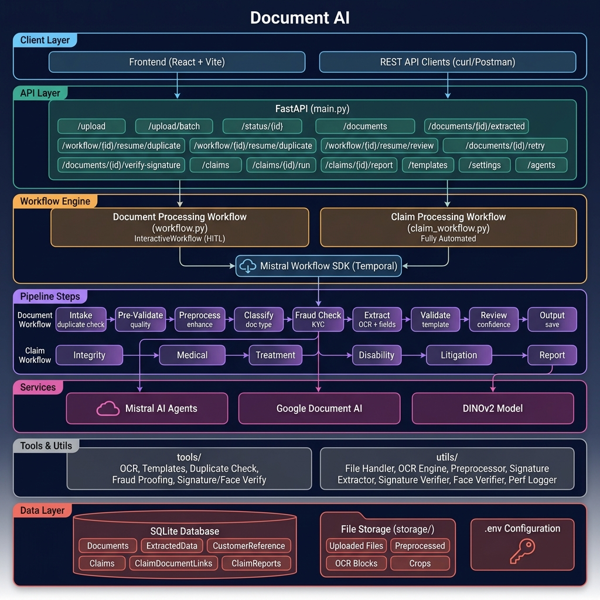
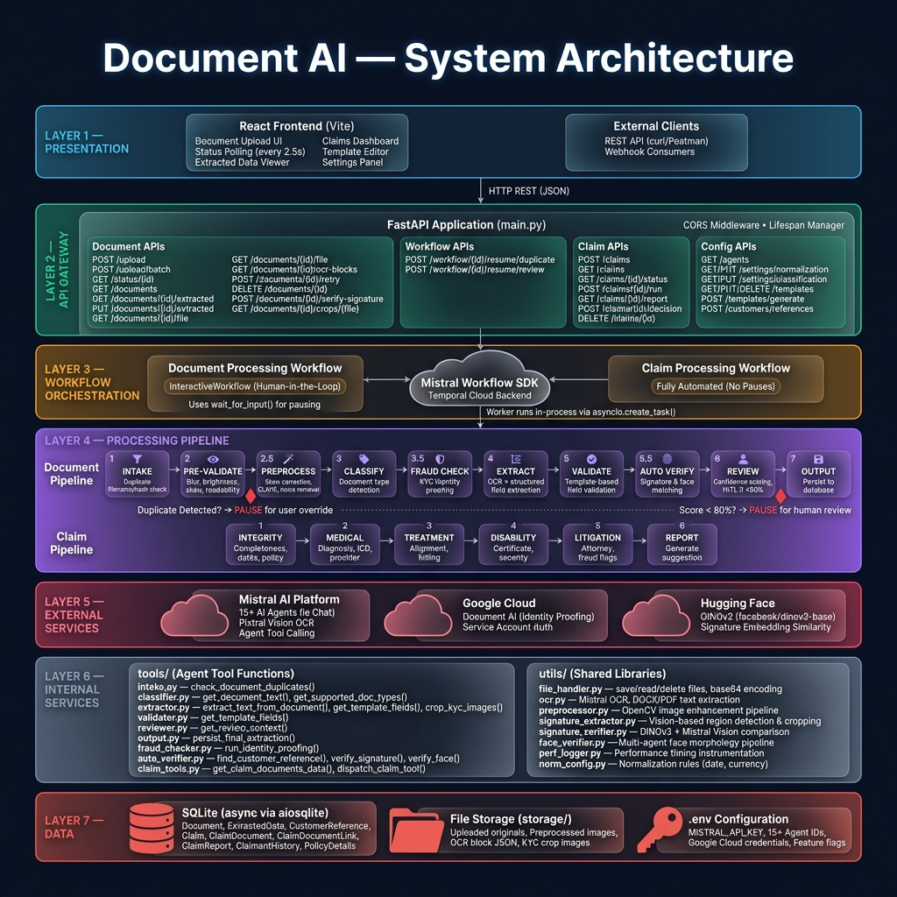
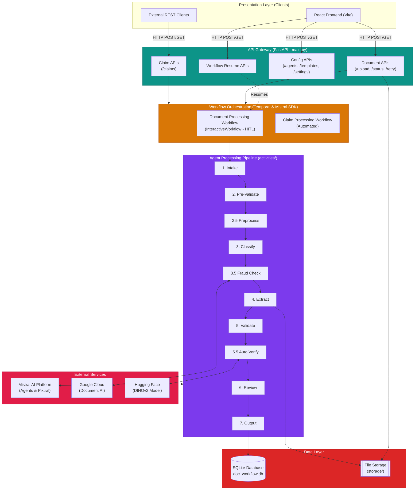
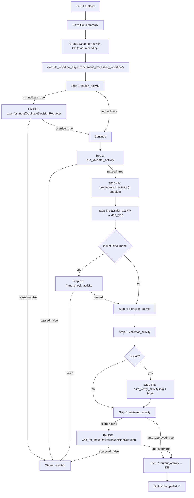
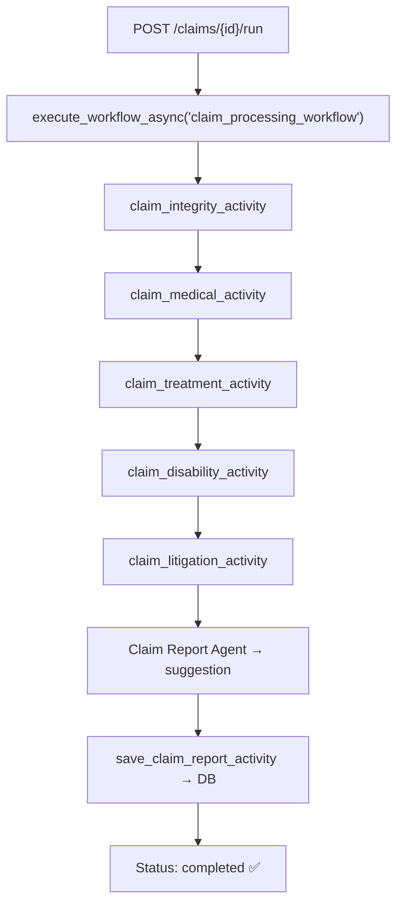
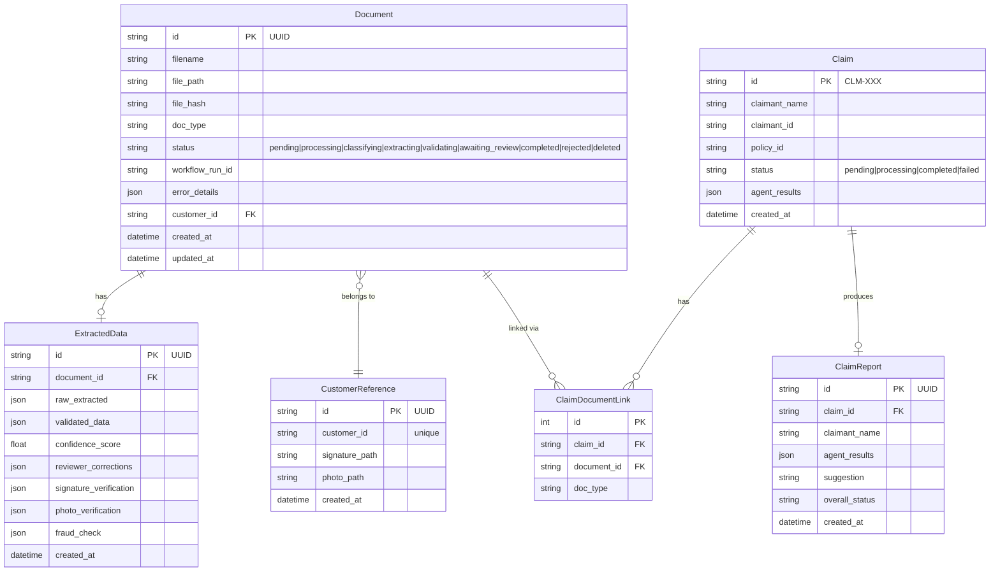

# Backend-v2 Code Graph & Architecture Reference

> **Purpose**: A comprehensive map of the `backend-v2` codebase for agents and developers to quickly navigate, understand dependencies, and debug errors.

## Architecture Diagram



### Detailed Flow & Architecture


#### System Architecture (Mermaid)
For a text-based, editable version of the system architecture, use the following Mermaid diagram:



### Detailed Request Flow (Sequence Diagram)
This sequence diagram shows the complete lifecycle of a single document processing request, from frontend upload to final extraction and database storage.

```mermaid
sequenceDiagram
    autonumber
    actor User
    participant Frontend as React Frontend
    participant API as FastAPI (main.py)
    participant DB as SQLite DB
    participant Storage as File Storage
    participant Workflow as Mistral Workflow<br>(Temporal)
    participant Agent as Mistral AI Agents
    participant External as External Services<br>(Google DocAI, DINOv2)

    User->>Frontend: Uploads Document
    Frontend->>API: POST /upload (multipart/form-data)
    
    rect rgb(20, 40, 60)
        Note right of API: 1. API Initialization
        API->>Storage: Save file to disk
        Storage-->>API: Returns file_path
        API->>DB: Create Document (status=pending)
        DB-->>API: Returns document_id
        API->>Workflow: execute_workflow_async()
        Workflow-->>API: Returns workflow_run_id
        API->>DB: Update Document (workflow_run_id)
    end
    
    API-->>Frontend: 200 OK {document_id, status=pending}
    
    par Async Workflow Execution
        Frontend->>API: GET /status/{document_id} (Polls every 2.5s)
        API->>DB: Fetch Document & ExtractedData
        DB-->>API: Return current status
        API-->>Frontend: 200 OK {status, extracted_data...}
    and
        rect rgb(40, 20, 60)
            Note right of Workflow: 2. Pipeline Execution (Agent Activities)
            
            Workflow->>Agent: Intake Activity (Check duplicates)
            Agent->>DB: query_hash / query_filename
            DB-->>Agent: Result
            Agent-->>Workflow: Result (duplicate/no duplicate)
            
            opt If Duplicate detected
                Workflow->>Frontend: Pause & Wait for user override
                Frontend->>API: POST /workflow/{id}/resume/duplicate
                API->>Workflow: Resume execution
            end
            
            Workflow->>Agent: Pre-validate Activity (Quality check)
            Agent-->>Workflow: Quality OK
            
            Workflow->>Agent: Classify Activity
            Agent->>Storage: Extract text via OCR
            Storage-->>Agent: Extracted text
            Agent-->>Workflow: doc_type (e.g., "invoice")
            
            opt If doc_type == KYC
                Workflow->>External: Fraud Check Activity (Google DocAI)
                External-->>Workflow: Fraud risk score
            end
            
            Workflow->>Agent: Extract Activity
            Agent->>Storage: Get OCR blocks & images
            Agent-->>Workflow: Extracted structured JSON
            
            Workflow->>Agent: Validate Activity (Against Template)
            Agent-->>Workflow: Validated fields
            
            opt If doc_type == KYC
                Workflow->>External: Auto-Verify Activity (DINOv2 Signature & Face)
                External-->>Workflow: Biometric match scores
            end
            
            Workflow->>Agent: Review Activity (Calculate Confidence)
            Agent-->>Workflow: confidence_score
            
            opt If confidence_score < 80%
                Workflow->>Frontend: Pause & Wait for Human Review
                Frontend->>API: POST /workflow/{id}/resume/review
                API->>Workflow: Resume with corrections
            end
            
            Workflow->>DB: Output Activity (Persist ExtractedData)
            DB-->>Workflow: Saved
        end
    end
    
    Workflow->>DB: Update Document (status=completed)
    Note over Frontend, DB: Frontend next poll receives status=completed with final data
```



---

## Directory Structure

```
backend-v2/
├── main.py                    # FastAPI app, all API endpoints, lifespan/startup
├── config.py                  # Pydantic Settings (env vars, agent IDs)
├── workflow.py                # Document Processing Workflow (Mistral InteractiveWorkflow)
├── claim_workflow.py          # Claim Processing Workflow (fully automated)
├── agents_config.py           # Agent system prompts & creation config
├── create_or_update_agents.py # Script to create/update Mistral agents
│
├── activities/                # Mistral Workflow activities (each step in the pipeline)
│   ├── intake.py              # Step 1: Duplicate detection
│   ├── pre_validator.py       # Step 2: Image quality checks (blur, brightness, skew)
│   ├── preprocessor.py        # Step 2.5: Image enhancement (skew correction, CLAHE)
│   ├── classifier.py          # Step 3: Document type classification
│   ├── fraud_checker.py       # Step 3.5: KYC fraud detection (Google DocAI)
│   ├── extractor.py           # Step 4: Field extraction via OCR + Mistral agent
│   ├── validator.py           # Step 5: Field validation against templates
│   ├── auto_verifier.py       # Step 5.5: Signature & face verification (KYC only)
│   ├── reviewer.py            # Step 6: Confidence-based review (auto-approve or HITL)
│   ├── output.py              # Step 7: Save final results to DB
│   ├── claim_integrity.py     # Claim: completeness, dates, policy, duplicates
│   ├── claim_medical.py       # Claim: diagnosis, ICD codes, provider
│   ├── claim_treatment.py     # Claim: treatment-diagnosis alignment, billing
│   ├── claim_disability.py    # Claim: disability certificate, severity
│   └── claim_litigation.py    # Claim: attorney involvement, fraud red flags
│
├── tools/                     # Tool functions called BY activities (via Mistral tool_choice)
│   ├── intake.py              # check_document_duplicates()
│   ├── pre_validator.py       # get_file_metadata()
│   ├── preprocessor.py        # enhance_document_image()
│   ├── classifier.py          # get_supported_doc_types(), get_document_text()
│   ├── extractor.py           # extract_text_from_document(), get_template_fields(), crop_kyc_images()
│   ├── validator.py           # get_template_fields()
│   ├── reviewer.py            # get_review_context()
│   ├── output.py              # persist_final_extraction()
│   ├── fraud_checker.py       # run_identity_proofing()
│   ├── auto_verifier.py       # find_customer_reference(), verify_signature(), verify_face()
│   └── claim_tools.py         # get_claim_documents_data(), get_claimant_history(), get_policy_details()
│
├── utils/                     # Shared utility modules
│   ├── file_handler.py        # save_file(), get_file_as_base64(), delete_file()
│   ├── ocr.py                 # extract_with_ocr() — Mistral OCR + DOCX/PDF text extraction
│   ├── preprocessor.py        # Image preprocessing (skew, brightness, noise, resolution)
│   ├── signature_extractor.py # Vision-based signature/photo region detection & cropping
│   ├── signature_verifier.py  # DINOv2 + Mistral Vision signature comparison pipeline
│   ├── face_verifier.py       # Multi-agent face morphology comparison pipeline
│   ├── perf_logger.py         # Performance timing hooks (wraps agents, activities, tools)
│   ├── norm_config.py         # Normalization rules config (date formats, currency, etc.)
│   └── classification_config.py # Custom document type classification config
│
├── db/                        # Database layer (async SQLAlchemy + SQLite)
│   ├── database.py            # Engine, session factory, init_db(), init_claim_tables()
│   ├── models.py              # ORM models: Document, ExtractedData, Claim, etc.
│   ├── operations.py          # Document CRUD: update_status(), check_duplicate_*, etc.
│   └── claim_operations.py    # Claim CRUD: create_claim(), save_claim_report(), etc.
│
├── schemas/                   # Pydantic request/response models
│   ├── documents.py           # DocumentUploadResponse, WorkflowStatusResponse, etc.
│   └── claims.py              # CreateClaimRequest, ClaimResponse, ClaimDecisionRequest, etc.
│
├── storage/                   # Runtime file storage (uploaded docs, crops, OCR blocks)
├── .env                       # Environment variables (API keys, agent IDs)
└── requirements.txt           # Python dependencies
```

---

## Workflow Pipeline (Document Processing)



---

## Workflow Pipeline (Claim Processing)



---

## API Endpoints (main.py)

### Document Processing
| Method | Path | Handler | Description |
|--------|------|---------|-------------|
| `POST` | `/upload` | `upload_document()` | Upload single document, trigger workflow |
| `POST` | `/upload/batch` | `upload_documents_batch()` | Upload multiple documents concurrently |
| `GET` | `/status/{document_id}` | `get_status()` | Poll document processing status |
| `POST` | `/workflow/{run_id}/resume/duplicate` | `resume_duplicate()` | Resume paused workflow (duplicate override) |
| `POST` | `/workflow/{run_id}/resume/review` | `resume_review()` | Resume paused workflow (human review) |
| `GET` | `/documents` | `list_documents()` | List all documents (paginated) |
| `GET` | `/documents/{id}/extracted` | `get_extracted_data()` | Get extracted data for a document |
| `PUT` | `/documents/{id}/extracted` | `update_extracted_data()` | Manually edit extracted data |
| `GET` | `/documents/{id}/file` | `get_document_file()` | Download the original file |
| `GET` | `/documents/{id}/ocr-blocks` | `get_ocr_blocks()` | Get raw OCR block data |
| `GET` | `/documents/{id}/crops/{filename}` | `get_document_crop()` | Get cropped KYC images |
| `POST` | `/documents/{id}/retry` | `retry_document()` | Re-trigger workflow for stuck documents |
| `DELETE` | `/documents/{id}` | `delete_document()` | Soft-delete document + cancel workflow |
| `POST` | `/documents/{id}/verify-signature` | `verify_signature()` | Run signature verification pipeline |

### Claims
| Method | Path | Handler | Description |
|--------|------|---------|-------------|
| `POST` | `/claims` | `create_claim()` | Create a new insurance claim |
| `GET` | `/claims` | `list_claims()` | List all claims |
| `GET` | `/claims/{id}/status` | `get_claim_status()` | Get claim processing status + agent results |
| `POST` | `/claims/{id}/run` | `run_claim_workflow()` | Trigger claim processing workflow |
| `GET` | `/claims/{id}/report` | `get_claim_report()` | Get final claim report |
| `POST` | `/claims/{id}/decision` | `submit_claim_decision()` | Submit approve/deny decision |
| `DELETE` | `/claims/{id}` | `delete_claim()` | Delete a claim |

### Settings & Templates
| Method | Path | Handler | Description |
|--------|------|---------|-------------|
| `GET` | `/agents` | `list_agents()` | List all configured Mistral agents |
| `GET/PUT` | `/settings/normalization` | | Get/update field normalization rules |
| `GET/PUT` | `/settings/classification` | | Get/update classification doc types |
| `GET/PUT` | `/templates` | | Get/update extraction templates |
| `DELETE` | `/templates/{name}` | | Delete a template |
| `POST` | `/templates/generate` | | Auto-generate template from sample doc |
| `POST` | `/customers/references` | | Register customer signature/photo references |

---

## Dependency Graph (imports)

```mermaid
graph TD
    MAIN["main.py"] --> CONFIG["config.py"]
    MAIN --> WORKFLOW["workflow.py"]
    MAIN --> CLAIM_WF["claim_workflow.py"]
    MAIN --> DB_OPS["db/operations.py"]
    MAIN --> DB_CLAIM["db/claim_operations.py"]
    MAIN --> DB_INIT["db/database.py"]
    MAIN --> DB_MODELS["db/models.py"]
    MAIN --> SCHEMAS_DOC["schemas/documents.py"]
    MAIN --> SCHEMAS_CLM["schemas/claims.py"]
    MAIN --> UTIL_FILE["utils/file_handler.py"]
    MAIN --> UTIL_NORM["utils/norm_config.py"]
    MAIN --> UTIL_CLASS["utils/classification_config.py"]

    WORKFLOW --> ACT_INTAKE["activities/intake.py"]
    WORKFLOW --> ACT_PREVAL["activities/pre_validator.py"]
    WORKFLOW --> ACT_PREPROC["activities/preprocessor.py"]
    WORKFLOW --> ACT_CLASS["activities/classifier.py"]
    WORKFLOW --> ACT_EXTRACT["activities/extractor.py"]
    WORKFLOW --> ACT_VALID["activities/validator.py"]
    WORKFLOW --> ACT_REVIEW["activities/reviewer.py"]
    WORKFLOW --> ACT_OUTPUT["activities/output.py"]
    WORKFLOW --> ACT_FRAUD["activities/fraud_checker.py"]
    WORKFLOW --> ACT_AUTOV["activities/auto_verifier.py"]
    WORKFLOW --> DB_OPS
    WORKFLOW --> CONFIG

    CLAIM_WF --> ACT_INTEG["activities/claim_integrity.py"]
    CLAIM_WF --> ACT_MED["activities/claim_medical.py"]
    CLAIM_WF --> ACT_TREAT["activities/claim_treatment.py"]
    CLAIM_WF --> ACT_DISAB["activities/claim_disability.py"]
    CLAIM_WF --> ACT_LITIG["activities/claim_litigation.py"]
    CLAIM_WF --> DB_CLAIM

    ACT_INTAKE --> TOOL_INTAKE["tools/intake.py"]
    ACT_PREVAL --> TOOL_PREVAL["tools/pre_validator.py"]
    ACT_PREPROC --> TOOL_PREPROC["tools/preprocessor.py"]
    ACT_CLASS --> TOOL_CLASS["tools/classifier.py"]
    ACT_EXTRACT --> TOOL_EXTRACT["tools/extractor.py"]
    ACT_VALID --> TOOL_VALID["tools/validator.py"]
    ACT_REVIEW --> TOOL_REVIEW["tools/reviewer.py"]
    ACT_OUTPUT --> TOOL_OUTPUT["tools/output.py"]
    ACT_FRAUD --> TOOL_FRAUD["tools/fraud_checker.py"]
    ACT_AUTOV --> TOOL_AUTOV["tools/auto_verifier.py"]

    TOOL_CLASS --> UTIL_OCR["utils/ocr.py"]
    TOOL_EXTRACT --> UTIL_OCR
    TOOL_PREPROC --> UTIL_PREPROC["utils/preprocessor.py"]
    TOOL_AUTOV --> UTIL_SIGVER["utils/signature_verifier.py"]
    TOOL_AUTOV --> UTIL_FACEVER["utils/face_verifier.py"]
    TOOL_EXTRACT --> UTIL_SIGEXT["utils/signature_extractor.py"]

    UTIL_OCR --> UTIL_FILE
    ACT_PREVAL --> UTIL_FILE

    TOOL_INTAKE --> DB_OPS
    TOOL_OUTPUT --> DB_MODELS
    TOOL_OUTPUT --> DB_INIT
    TOOL_AUTOV --> DB_MODELS
    TOOL_AUTOV --> DB_INIT

    ACT_INTEG --> TOOL_CLAIM["tools/claim_tools.py"]
    ACT_MED --> TOOL_CLAIM
    ACT_TREAT --> TOOL_CLAIM
    ACT_DISAB --> TOOL_CLAIM
    ACT_LITIG --> TOOL_CLAIM
    TOOL_CLAIM --> DB_CLAIM

    DB_OPS --> DB_INIT
    DB_OPS --> DB_MODELS
    DB_CLAIM --> DB_INIT
    DB_CLAIM --> DB_MODELS
    DB_MODELS --> DB_INIT
    CONFIG --> |".env"| ENV[".env file"]
```



---

## Database Models (db/models.py)



---

## Configuration (config.py)

### Required Environment Variables
| Variable | Description |
|----------|-------------|
| `MISTRAL_API_KEY` | Mistral API key |
| `CLASSIFIER_AGENT_ID` | Classifier agent ID |
| `VALIDATOR_AGENT_ID` | Validator agent ID |
| `REVIEWER_AGENT_ID` | Reviewer agent ID |
| `SIGNATURE_VISION_AGENT_ID` | Signature vision agent ID |
| `SIGNATURE_JUDGE_AGENT_ID` | Signature judge agent ID |

### Optional Environment Variables
| Variable | Default | Description |
|----------|---------|-------------|
| `STORAGE_DIR` | `./storage` | File storage directory |
| `DATABASE_URL` | `sqlite+aiosqlite:///./doc_workflow.db` | Database URL |
| `ENABLE_PREPROCESSING` | `false` | Enable image preprocessing |
| `PRE_VALIDATOR_AGENT_ID` | `""` | Pre-validation agent (skip if empty) |
| `INTAKE_AGENT_ID` | `""` | Intake agent |
| `FRAUD_AGENT_ID` | `""` | Fraud checker agent |
| `GENERAL_EXTRACTOR_AGENT_ID` | `""` | General extractor agent |
| `OUTPUT_AGENT_ID` | `""` | Output agent |
| `PREPROCESSING_AGENT_ID` | `""` | Preprocessing agent |
| `AUTO_VERIFIER_AGENT_ID` | `""` | Auto-verifier agent |
| `FACE_*_AGENT_ID` | `""` | Face verification agents (4 total) |
| `CLAIM_*_AGENT_ID` | `""` | Claim processing agents (6 total) |
| `GOOGLE_APPLICATION_CREDENTIALS` | `""` | Google Cloud SA key for Document AI |
| `DOCUMENTAI_PROJECT_ID` | `"458272416814"` | Google Cloud project |
| `DOCUMENTAI_PROCESSOR_ID` | `"ae6356d350bf69a6"` | Document AI processor |

---

## Key Patterns

### Activity ↔ Tool Pattern
Each workflow step follows a consistent pattern:
1. **Activity** (`activities/X.py`): Orchestrates the Mistral agent conversation loop, sends messages, handles tool calls
2. **Tools** (`tools/X.py`): Pure functions that the Mistral agent can call via `tool_choice`. Each file exports:
   - `*_TOOLS` list (OpenAI-format function schemas)
   - Actual Python functions that implement the tools

### Agent Conversation Loop (inside activities)
```python
@workflows.activity()
async def some_activity(document_id, ...):
    client = Mistral(api_key=settings.MISTRAL_API_KEY)
    messages = [{"role": "user", "content": "..."}]
    
    while True:
        response = await client.agents.complete_async(
            agent_id=settings.SOME_AGENT_ID,
            messages=messages,
            tools=SOME_TOOLS
        )
        choice = response.choices[0]
        
        if choice.finish_reason == "tool_calls":
            # Execute tool, append result, continue loop
            ...
        else:
            # Agent is done, parse final response
            return parsed_result
```

### Human-in-the-Loop (workflow.py)
Uses `InteractiveWorkflow.wait_for_input()` for two pause points:
1. **Duplicate check** → `DuplicateDecisionRequest` (override: bool)
2. **Low confidence review** → `ReviewerDecisionRequest` (approved: bool, corrections: dict)

Resume via Mistral SDK's `query_workflow_execution` + `update_workflow_execution` (Temporal Updates protocol).

---

## Common Error Scenarios

| Error | Root Cause | Fix |
|-------|-----------|-----|
| `FileNotFoundError` in classifier/extractor | `file_path` in DB points to wrong machine | Re-upload the document or update DB path |
| Document stuck at `pending` forever | Server restart killed in-flight workflow | Use `POST /documents/{id}/retry` |
| `ValidationError` on startup | Missing required env vars in `.env` | Fill in all required agent IDs |
| `ROLLBACK` in logs | Normal — read-only queries auto-rollback | Not an error |
| Ghost workflow errors | Stale workflow from previous deployment | Will auto-timeout; ignore or delete DB |

---

## Startup Flow (lifespan)

```
1. init_db()                → Create document tables
2. init_claim_tables()      → Create claim tables  
3. os.makedirs(STORAGE_DIR) → Ensure storage/ exists
4. DinoVerifier.preload()   → Background: download DINOv2 weights
5. workflows.run_worker()   → Start Mistral Workflow worker (Temporal)
```

The worker connects to Mistral's cloud Temporal server and listens for workflow executions. When `execute_workflow_async()` is called, the workflow runs inside this worker process.
