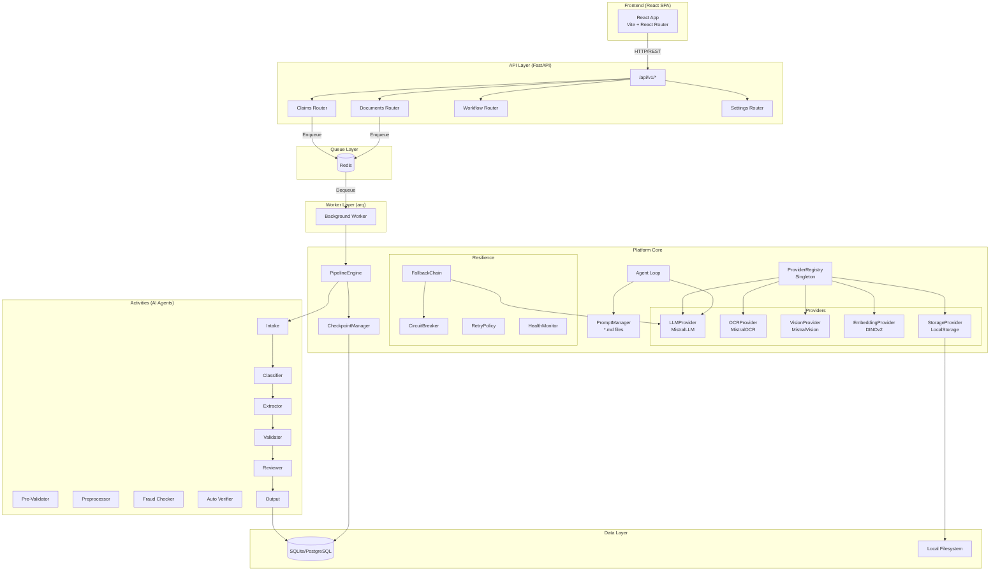
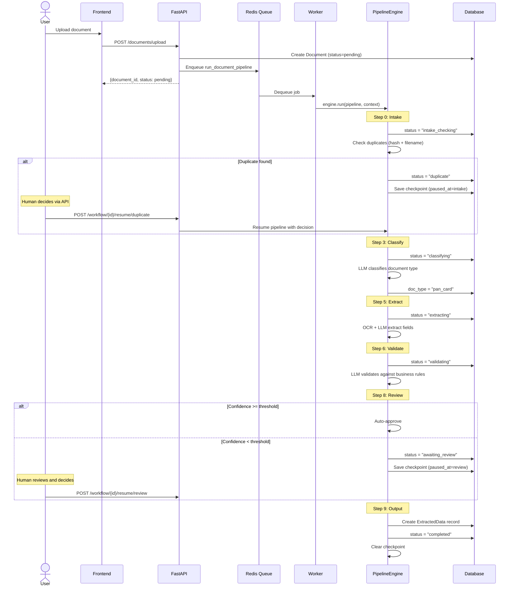
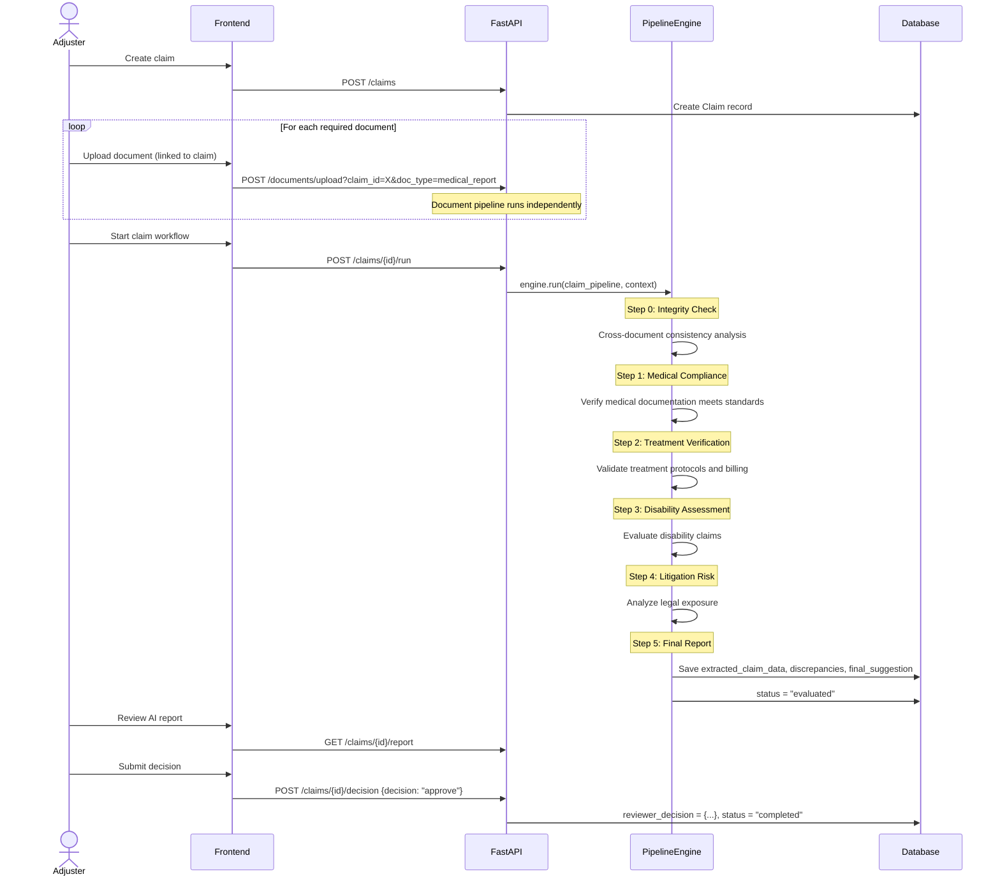
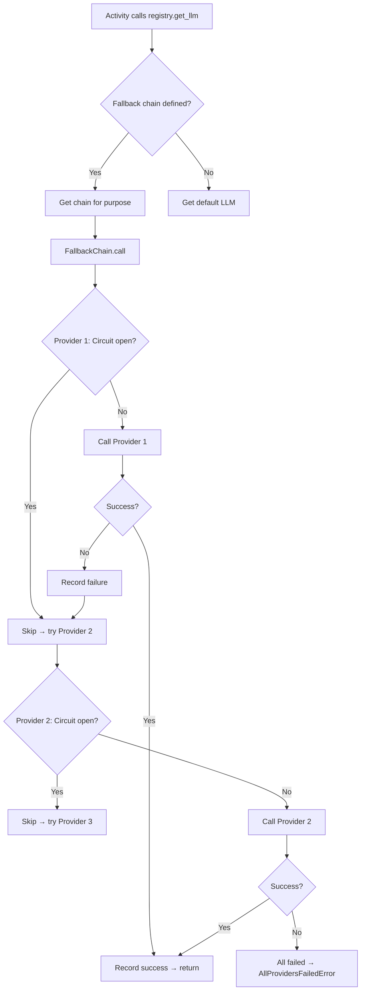

# Document AI Platform — Complete Project Documentation

> **Purpose**: This document is an exhaustive, reverse-engineered specification of the Document AI Platform. It is detailed enough for an experienced developer or AI agent to completely recreate the project without seeing the original source code.

---

## Table of Contents

1. [Project Overview](#1-project-overview)
2. [Repository Structure](#2-repository-structure)
3. [System Architecture](#3-system-architecture)
4. [Configuration System](#4-configuration-system)
5. [Provider Abstraction Layer](#5-provider-abstraction-layer)
6. [Pipeline Orchestration Engine](#6-pipeline-orchestration-engine)
7. [Activity Layer (AI Agents)](#7-activity-layer-ai-agents)
8. [Tools Layer (Function Calling)](#8-tools-layer-function-calling)
9. [API Layer](#9-api-layer)
10. [Database Layer](#10-database-layer)
11. [Resilience Framework](#11-resilience-framework)
12. [Observability Stack](#12-observability-stack)
13. [Background Worker System](#13-background-worker-system)
14. [Frontend Application](#14-frontend-application)
15. [Deployment & Infrastructure](#15-deployment--infrastructure)
16. [Security & Isolation](#16-security--isolation)
17. [Data Flow Diagrams](#17-data-flow-diagrams)
18. [Dependencies & Versions](#18-dependencies--versions)
19. [Environment Variables](#19-environment-variables)
20. [Legacy System (backend v1)](#20-legacy-system-backend-v1)
21. [Recreation Guide](#21-recreation-guide)

---

## 1. Project Overview

### 1.1 What This System Does

Document AI Platform is an enterprise-grade **Intelligent Document Processing (IDP)** system that automates:

1. **Document Processing Pipeline** — Upload a document (PDF, image, DOCX) → OCR extraction → AI classification → structured field extraction → business-rule validation → fraud detection → signature/face verification → human review → database persistence.
2. **Insurance Claim Processing Pipeline** — Create a claim → link multiple documents → run all document pipelines → cross-document integrity checks → medical compliance analysis → treatment verification → disability assessment → litigation risk analysis → AI-generated recommendation → human adjudicator decision.

### 1.2 Design Philosophy

The system is built around these architectural principles:

- **Provider Agnosticism**: Every external dependency (LLM, OCR, storage, embedding, vision) is accessed through abstract interfaces. Concrete implementations (Mistral, OpenAI, Tesseract, S3, etc.) are pluggable via a singleton `ProviderRegistry`.
- **Resilience-First**: Every provider call is protected by circuit breakers, fallback chains, and retry policies with exponential backoff.
- **Pipeline-as-Code**: Processing workflows are defined as declarative step sequences with checkpointing, HITL (Human-in-the-Loop) pauses, and crash recovery.
- **Agent Loop Pattern**: Every AI task follows the same multi-turn conversation loop: send prompt → LLM requests tool calls → execute tools locally → return results → LLM produces final JSON.

### 1.3 Technology Stack

| Layer | Technology | Version |
|-------|-----------|---------|
| API Server | FastAPI + Uvicorn | 0.119.1 / 0.30.6 |
| Background Worker | arq (Redis-backed) | latest |
| Database | SQLAlchemy (async) + SQLite/PostgreSQL | 2.0.41 |
| Primary LLM | Mistral AI SDK | 2.5.0 |
| Workflow Engine | Mistral Workflows SDK (Temporal) | 3.4.0 |
| OCR | Mistral OCR + Google Document AI | mistral-ocr-latest |
| ML Models | PyTorch + DINOv2 + OpenCV | CPU mode |
| Frontend | React 19 + Vite 8 + React Router 7 | see package.json |
| Observability | OpenTelemetry + Prometheus | 1.39.1 |
| Containerization | Docker + Docker Compose | Python 3.12-slim |

---

## 2. Repository Structure

The repository contains two major versions. **`backend-v2`** is the active system; **`backend`** is the legacy predecessor.

```
Document-AI/
├── backend/                        # LEGACY (v1) — Mistral-coupled monolith
│   ├── main.py                     # Single-file FastAPI app
│   ├── workflow.py                 # Mistral Workflows SDK (Temporal)
│   ├── activities/                 # Hard-coded Mistral Agent ID calls
│   └── ...
│
├── backend-v2/                     # ACTIVE — Provider-agnostic platform
│   ├── main.py                     # FastAPI entry point + lifespan
│   ├── worker.py                   # arq background worker
│   ├── config.py                   # Pydantic Settings (env-based)
│   ├── config/
│   │   └── platform.yaml           # Master YAML configuration
│   ├── .env.example                # Environment variable template
│   ├── logging_config.py           # Structured JSON logging
│   ├── observability.py            # OpenTelemetry + Prometheus setup
│   │
│   ├── platform_core/              # Core platform layer
│   │   ├── config.py               # YAML loader with ${ENV} resolution
│   │   ├── registry.py             # Singleton ProviderRegistry
│   │   ├── agent_loop.py           # Shared LLM conversation loop
│   │   ├── providers/
│   │   │   ├── interfaces.py       # Abstract base classes (5 types)
│   │   │   ├── llm/
│   │   │   │   └── mistral.py      # MistralLLM implementation
│   │   │   ├── ocr/
│   │   │   │   └── mistral_ocr.py  # MistralOCR implementation
│   │   │   ├── vision/
│   │   │   │   └── mistral_vision.py
│   │   │   ├── embedding/
│   │   │   │   └── dinov2.py       # DINOv2 (PyTorch) embeddings
│   │   │   └── storage/
│   │   │       └── local.py        # Local filesystem storage
│   │   ├── pipeline/
│   │   │   ├── definitions.py      # Step sequence factories
│   │   │   ├── engine.py           # PipelineEngine orchestrator
│   │   │   └── checkpoint.py       # State persistence for crash recovery
│   │   ├── resilience/
│   │   │   ├── circuit_breaker.py  # Three-state circuit breaker
│   │   │   ├── fallback.py         # Multi-provider fallback chain
│   │   │   ├── retry.py            # Exponential backoff + jitter
│   │   │   └── health.py           # Background health monitor
│   │   ├── isolation/
│   │   │   └── sandbox.py          # Step-level provider scoping + timeouts
│   │   └── prompts/
│   │       ├── manager.py          # Prompt file loader + cache
│   │       ├── classifier.md       # System prompt: document classifier
│   │       ├── extractor.md        # System prompt: field extractor
│   │       ├── validator.md        # System prompt: data validator
│   │       ├── reviewer.md         # System prompt: review decision
│   │       ├── fraud_checker.md    # System prompt: fraud examiner
│   │       ├── intake.md           # System prompt: duplicate checker
│   │       ├── preprocessor.md     # System prompt: image enhancer
│   │       └── output.md           # System prompt: persistence agent
│   │
│   ├── activities/                 # AI Agent activities
│   │   ├── classifier.py           # Document classification
│   │   ├── extractor.py            # Structured field extraction
│   │   ├── validator.py            # Business-rule validation
│   │   ├── reviewer.py             # Human review decision
│   │   ├── fraud_checker.py        # Identity document proofing
│   │   ├── intake.py               # Duplicate detection
│   │   ├── preprocessor.py         # Image quality enhancement
│   │   ├── output.py               # Database persistence
│   │   ├── auto_verifier.py        # Signature/face verification
│   │   ├── pre_validator.py        # Quick visual validation
│   │   └── claim_agents/           # Claim-specific AI agents
│   │       ├── integrity.py        # Cross-document consistency
│   │       ├── medical.py          # Medical compliance
│   │       ├── treatment.py        # Treatment verification
│   │       ├── disability.py       # Disability assessment
│   │       ├── litigation.py       # Litigation risk
│   │       └── report.py           # Final claim report
│   │
│   ├── tools/                      # Tool definitions for LLM function calling
│   │   ├── classifier.py           # get_supported_document_types, get_document_text
│   │   ├── extractor.py            # extract_text_from_document, crop_kyc_images
│   │   ├── validator.py            # get_template_fields
│   │   ├── reviewer.py             # get_review_context
│   │   ├── fraud_checker.py        # run_identity_proofing
│   │   ├── intake.py               # check_document_duplicates
│   │   ├── preprocessor.py         # enhance_document_image
│   │   ├── output.py               # persist_final_extraction
│   │   ├── auto_verifier.py        # verify_signature, verify_face
│   │   ├── pre_validator.py        # pre_validate_document
│   │   └── claim_tools.py          # Claim-specific tool implementations
│   │
│   ├── api/
│   │   ├── queue.py                # Redis connection pool (arq)
│   │   └── routers/
│   │       └── v1/
│   │           ├── __init__.py     # Router aggregator
│   │           ├── documents.py    # Document CRUD + upload + retry
│   │           ├── claims.py       # Claim CRUD + workflow trigger
│   │           ├── workflow.py     # HITL resume endpoints
│   │           └── settings.py     # Configuration + templates + agents
│   │
│   ├── schemas/                    # Pydantic request/response models
│   │   ├── documents.py            # DocumentUploadResponse, etc.
│   │   └── claims.py               # ClaimResponse, ClaimReportResponse, etc.
│   │
│   ├── db/
│   │   ├── database.py             # Async SQLAlchemy engine + session factory
│   │   ├── models.py               # ORM models (Document, Claim, ExtractedData, etc.)
│   │   ├── operations.py           # Document CRUD + checkpoint CRUD
│   │   └── claim_operations.py     # Claim-specific DB operations
│   │
│   ├── utils/                      # Shared utilities
│   │   ├── file_handler.py         # File save + hash + base64
│   │   ├── ocr.py                  # OCR wrapper (Mistral + Google DocAI)
│   │   ├── norm_config.py          # Normalization rules loader
│   │   ├── classification_config.py# Document type config loader
│   │   ├── templates.py            # Extraction template loader
│   │   └── signature_verifier.py   # DINOv2 + Vision verification
│   │
│   ├── Dockerfile                  # Python 3.12-slim container
│   ├── docker-compose.yml          # App + Worker + PostgreSQL + Redis
│   └── requirements.txt            # Pinned Python dependencies
│
└── frontend-v2/                    # React SPA
    ├── package.json                # React 19, Vite 8, Axios, Lucide
    ├── src/
    │   ├── main.jsx                # Entry point
    │   ├── App.jsx                 # React Router configuration
    │   ├── api/
    │   │   └── client.js           # Axios API client (all endpoints)
    │   ├── store/
    │   │   └── AppStore.jsx        # Context + useReducer state
    │   ├── hooks/
    │   │   ├── useDocumentList.js   # Document list fetcher
    │   │   └── useDocumentPoller.js # Status polling hook
    │   ├── pages/
    │   │   ├── Dashboard.jsx       # Overview metrics
    │   │   ├── Upload.jsx          # Document upload (single + batch)
    │   │   ├── Processing.jsx      # In-flight document tracking
    │   │   ├── Extraction.jsx      # Field review + editing (88KB)
    │   │   ├── Validation.jsx      # Validation results + corrections
    │   │   ├── Documents.jsx       # Document list + management
    │   │   ├── Agents.jsx          # Agent monitoring
    │   │   ├── Analytics.jsx       # Processing analytics
    │   │   ├── Settings.jsx        # Platform settings (52KB)
    │   │   ├── Templates.jsx       # Extraction template editor
    │   │   ├── ClaimProcess.jsx    # Claim creation + document linking
    │   │   └── ClaimWorkflow.jsx   # Claim workflow monitoring (39KB)
    │   ├── components/
    │   │   ├── layout/             # AppShell, Sidebar, Header
    │   │   └── ui/                 # Reusable UI components
    │   └── styles/
    │       ├── tokens.css          # Design tokens (colors, spacing, fonts)
    │       ├── animations.css      # Keyframe animations
    │       ├── layout.css          # Layout utilities
    │       └── components.css      # Component styles
    └── vite.config.js              # Vite build configuration
```

---

## 3. System Architecture

### 3.1 High-Level Architecture Diagram



### 3.2 Layered Architecture

The system has 6 distinct layers, each with strict dependency rules:

| Layer | Components | Depends On |
|-------|-----------|------------|
| **L0 — Config** | `platform.yaml`, `config.py`, `.env` | OS environment |
| **L1 — Providers** | `interfaces.py`, `mistral.py`, `dinov2.py`, etc. | External SDKs |
| **L2 — Resilience** | `CircuitBreaker`, `FallbackChain`, `RetryPolicy`, `HealthMonitor` | L1 (interfaces only) |
| **L3 — Registry** | `ProviderRegistry` (singleton) | L1 + L2 |
| **L4 — Pipeline** | `PipelineEngine`, `CheckpointManager`, `StepSandbox` | L3 |
| **L5 — Activities** | `classifier.py`, `extractor.py`, etc. | L3 + L4 |
| **L6 — API** | FastAPI routers, schemas | L4 + L5 |

**Critical rule**: Activities (L5) NEVER import concrete providers. They use `ProviderRegistry.get()` to obtain abstract interfaces.

### 3.3 Startup Sequence

The application startup is managed by FastAPI's `lifespan` context manager in `main.py`:

```python
@asynccontextmanager
async def lifespan(app: FastAPI):
    # 1. Setup structured JSON logging
    setup_logging(level="INFO")
    
    # 2. Load platform config (YAML + .env resolution)
    config = load_config()
    
    # 3. Initialize ProviderRegistry from config (creates all provider instances)
    registry = ProviderRegistry.from_config(config)
    
    # 4. Initialize database (create tables if needed)
    await init_db()
    
    # 5. Start HealthMonitor background task
    health_monitor = HealthMonitor(registry, interval_seconds=30)
    await health_monitor.start()
    
    # 6. Connect Redis pool for arq job queue (optional — graceful degradation)
    try:
        redis_pool = await get_redis_pool()
        app.state.redis_pool = redis_pool
    except Exception:
        app.state.redis_pool = None  # Falls back to asyncio.create_task()
    
    # 7. Setup observability (OpenTelemetry + Prometheus)
    setup_observability(app)
    
    yield  # Application runs here
    
    # Shutdown
    await health_monitor.stop()
```

---

## 4. Configuration System

### 4.1 Two-Tier Configuration

The system uses a **two-tier configuration** pattern:

1. **`config.py`** (Pydantic `BaseSettings`) — Loads environment variables for backward compatibility (Agent IDs, storage dir, etc.). Used by legacy code paths.
2. **`config/platform.yaml`** — The authoritative master configuration for the v2 platform. Controls providers, fallback chains, resilience parameters, pipeline behavior, CORS, database, and observability.

### 4.2 Config Loading Flow

```
.env file → os.environ → platform.yaml (${ENV} resolution) → Python dict
```

The `load_config()` function in `platform_core/config.py`:
1. Parses `.env` into `os.environ` (custom parser, no `python-dotenv` dependency at runtime)
2. Reads `config/platform.yaml` via `yaml.safe_load()`
3. Recursively resolves `${ENV_VAR}` placeholders against `os.environ`
4. Returns the fully resolved config dict

### 4.3 platform.yaml Structure

```yaml
app:
  name: "Document AI Platform"
  version: "2.0.0"
  debug: false
  host: "0.0.0.0"
  port: 8000

providers:
  llm:
    mistral:
      type: mistral              # Maps to PROVIDER_CLASSES["llm"]["mistral"]
      params:
        api_key: "${MISTRAL_API_KEY}"
        model: "mistral-large-latest"
  ocr:
    mistral:
      type: mistral_ocr
      params:
        api_key: "${MISTRAL_API_KEY}"
  storage:
    local:
      type: local
      params:
        base_dir: "${STORAGE_DIR}"
  embedding:
    dinov2:
      type: dinov2
      params:
        model: "facebook/dinov2-small"
        device: "cpu"
  vision:
    mistral:
      type: mistral_vision
      params:
        api_key: "${MISTRAL_API_KEY}"
        model: "pixtral-12b-2409"

# Purpose-specific provider ordering. When provider A fails, try B, then C.
fallback_chains:
  llm.default:        [mistral]
  llm.classifier:     [mistral]
  llm.extractor:      [mistral]
  llm.validator:      [mistral]
  llm.reviewer:       [mistral]
  llm.fraud_checker:  [mistral]
  llm.claim_agents:   [mistral]
  # ... 8 more purpose-specific chains
  ocr.default:        [mistral]
  storage.default:    [local]
  vision.default:     [mistral]
  embedding.default:  [dinov2]

resilience:
  circuit_breaker:
    failure_threshold: 5           # 5 consecutive failures → circuit opens
    recovery_timeout_seconds: 60   # Wait 60s before probe attempt
  retry:
    max_retries: 3
    base_delay_seconds: 1.0
    max_delay_seconds: 30.0
  health_check:
    interval_seconds: 30
    timeout_seconds: 15

pipelines:
  document_processing:
    workflow_engine: auto          # "auto" | "mistral" | "local"
    enable_pre_validation: true
    enable_preprocessing: false
    enable_fraud_check: true
    review_confidence_threshold: 0.80
    step_timeout_seconds: 300
    max_file_size_mb: 50
  claim_processing:
    step_timeout_seconds: 120

cors:
  allowed_origins:
    - "http://localhost:5173"
    - "http://localhost:3000"

database:
  url: "${DATABASE_URL}"
  pool_size: 20
  max_overflow: 10

observability:
  tracing:
    enabled: false
    exporter: "otlp"
    endpoint: "${OTEL_ENDPOINT}"
  metrics:
    enabled: false
    port: 9090
  logging:
    level: "INFO"
    format: "json"

document_types:
  - invoice
  - pan_card
  - claim_form
  - policy_document
  - id_proof
  - medical_report
  - lab_reports
  - prescription_records
  - bills_invoices
  - disability_certificate
  - legal_letter
```

---

## 5. Provider Abstraction Layer

### 5.1 Why It Exists

The v1 codebase had **16 activity files** that all contained identical boilerplate:
```python
from mistralai.client import Mistral
client = Mistral(api_key=settings.MISTRAL_API_KEY)
response = await client.agents.complete_async(agent_id=settings.CLASSIFIER_AGENT_ID, ...)
```

This coupled every business logic file to the Mistral SDK. Switching to OpenAI or running locally with Ollama would require editing all 16 files.

The v2 platform decouples this via **5 abstract interfaces** in `platform_core/providers/interfaces.py`:

### 5.2 Provider Interfaces

```python
class LLMProvider(ABC):
    async def chat(messages, system_prompt, tools, temperature, max_tokens, response_format) -> LLMResponse
    async def health_check() -> ProviderStatus
    name: str  # property

class OCRProvider(ABC):
    async def extract(file_path, pages, include_blocks) -> OCRResponse
    async def health_check() -> ProviderStatus
    name: str

class StorageProvider(ABC):
    async def save(data, key, metadata) -> str
    async def get(key) -> bytes
    async def delete(key) -> None
    async def get_signed_url(key, expires_seconds) -> str
    async def exists(key) -> bool
    name: str

class EmbeddingProvider(ABC):
    async def embed(inputs: list[str] | list[bytes]) -> EmbeddingResponse
    async def embed_images(image_paths: list[str]) -> EmbeddingResponse
    async def health_check() -> ProviderStatus
    name: str

class VisionProvider(ABC):
    async def analyze(images: list[str], prompt, response_format) -> LLMResponse
    async def health_check() -> ProviderStatus
    name: str
```

### 5.3 Standardized Response Types

Every provider returns **standardized dataclasses**, not vendor-specific objects:

```python
@dataclass
class LLMResponse:
    content: str                    # The text response
    tool_calls: list[dict] | None   # Normalized tool calls
    finish_reason: str              # "stop", "tool_calls", etc.
    usage: dict                     # {prompt_tokens, completion_tokens, total_tokens}
    provider: str                   # "mistral", "openai", etc.
    latency_ms: float              # Round-trip latency
    raw_response: Any              # Original vendor response (debugging only)

@dataclass
class OCRResponse:
    raw_text: str
    confidence: float
    pages: list[dict]
    blocks: list[dict]              # Bounding boxes for citation highlighting
    word_confidences: list[dict]
    provider: str

@dataclass
class EmbeddingResponse:
    embeddings: list[list[float]]
    model: str
    provider: str
```

### 5.4 Concrete Provider: MistralLLM

Located at `platform_core/providers/llm/mistral.py`:

```python
class MistralLLM(LLMProvider):
    def __init__(self, api_key: str, model: str = "mistral-large-latest"):
        self._client = Mistral(api_key=api_key)
        self._model = model

    async def chat(self, messages, system_prompt="", tools=None, ...) -> LLMResponse:
        # 1. Prepend system prompt as first message (replaces Mistral Agent IDs)
        if system_prompt:
            messages = [{"role": "system", "content": system_prompt}] + messages
        
        # 2. Call Mistral API
        resp = await self._client.chat.complete_async(model=self._model, messages=messages, ...)
        
        # 3. Normalize tool_calls to provider-agnostic format
        tool_calls = [{"id": tc.id, "function": {"name": tc.function.name, "arguments": tc.function.arguments}} ...]
        
        # 4. Return standardized LLMResponse
        return LLMResponse(content=..., tool_calls=..., provider="mistral", latency_ms=...)

    async def health_check(self) -> ProviderStatus:
        # Send minimal "ping" request to verify API connectivity
        await self._client.chat.complete_async(model=self._model, messages=[...], max_tokens=1)
        return ProviderStatus.HEALTHY
```

### 5.5 ProviderRegistry (Singleton)

The `ProviderRegistry` at `platform_core/registry.py` is the single point of access for all providers:

**Initialization** (from YAML config):
```python
@classmethod
def from_config(cls, config: dict) -> "ProviderRegistry":
    _register_builtin_providers()  # Imports all provider classes
    registry = cls()
    
    # For each provider type (llm, ocr, storage, embedding, vision):
    for name, conf in config["providers"]["llm"].items():
        provider_type = conf["type"]       # e.g., "mistral"
        params = conf["params"]            # e.g., {api_key: "...", model: "..."}
        ProviderClass = PROVIDER_CLASSES["llm"][provider_type]  # MistralLLM
        provider = ProviderClass(**params)
        registry.register_llm(name, provider)
    
    # Load fallback chains
    registry.set_fallback_chains(config["fallback_chains"])
    
    cls._instance = registry
    return registry
```

**Access patterns**:
```python
registry = ProviderRegistry.get()

# Direct access (specific provider)
llm = registry.get_llm("mistral")

# Fallback chain (for a specific purpose)
llm_chain = registry.get_llm_chain("classifier")  # Returns FallbackChain[LLMProvider]
result = await llm_chain.call(method="chat", messages=..., system_prompt=...)
```

**Provider registration map** (`PROVIDER_CLASSES`):
```python
PROVIDER_CLASSES = {
    "llm":       {"mistral": MistralLLM},
    "ocr":       {"mistral_ocr": MistralOCR},
    "storage":   {"local": LocalStorage},
    "embedding": {"dinov2": DINOv2Embedding},
    "vision":    {"mistral_vision": MistralVision},
}
```

---

## 6. Pipeline Orchestration Engine

### 6.1 Pipeline Definitions

Pipelines are defined as ordered lists of `PipelineStep` objects in `platform_core/pipeline/definitions.py`.

Each step has:
- `name` — Unique identifier (e.g., `"classify"`)
- `handler` — Async function to execute
- `is_hitl` — Whether this step pauses for human input
- `is_optional` — Whether failure should be non-fatal
- `condition` — Optional function to skip the step based on context

**Document Processing Pipeline** (built by `build_document_pipeline(config)`):

```
Step 0: intake       — Duplicate detection (HITL on duplicate found)
Step 1: pre_validate — Quick visual quality check (optional, conditional)
Step 2: preprocess   — Image enhancement (optional, conditional)
Step 3: classify     — Document type classification
Step 4: fraud_check  — Identity document proofing (optional, conditional)
Step 5: extract      — Structured field extraction (OCR + LLM)
Step 6: validate     — Business-rule validation
Step 7: auto_verify  — Signature/face verification (optional, conditional)
Step 8: review       — Human review decision (HITL when confidence < threshold)
Step 9: output       — Database persistence
```

**Claim Processing Pipeline** (built by `build_claim_pipeline(config)`):

```
Step 0: integrity    — Cross-document consistency check
Step 1: medical      — Medical compliance analysis
Step 2: treatment    — Treatment verification
Step 3: disability   — Disability assessment
Step 4: litigation   — Litigation risk analysis
Step 5: report       — Final recommendation generation
```

### 6.2 PipelineEngine

The `PipelineEngine` at `platform_core/pipeline/engine.py` is the orchestrator:

```python
class PipelineEngine:
    def __init__(self, checkpoint_mgr: CheckpointManager):
        self._checkpoint_mgr = checkpoint_mgr

    async def run(self, pipeline: list[PipelineStep], context: dict) -> dict:
        pipeline_id = context.get("document_id") or context.get("claim_id")
        
        # Check for existing checkpoint (crash recovery)
        checkpoint = await self._checkpoint_mgr.load(pipeline_id)
        start_index = 0
        if checkpoint:
            start_index = checkpoint["completed_step_index"] + 1
            context = checkpoint["context"]
        
        for i, step in enumerate(pipeline[start_index:], start=start_index):
            # Skip if condition is not met
            if step.condition and not step.condition(context):
                continue
            
            # Update DB status
            await db.update_status(pipeline_id, step.status_label)
            
            try:
                # Execute step with timeout
                result = await asyncio.wait_for(
                    step.handler(context),
                    timeout=step.timeout_seconds
                )
                context.update(result)
                
                # Save checkpoint after each successful step
                await self._checkpoint_mgr.save(pipeline_id, i, step.name, context)
                
            except asyncio.TimeoutError:
                await db.update_error(pipeline_id, {"error": f"Step '{step.name}' timed out"})
                raise
            
            # Handle HITL pause
            if step.is_hitl and context.get("_needs_human_input"):
                context["_paused_at"] = step.name
                await self._checkpoint_mgr.save(pipeline_id, i, step.name, context)
                return context  # Pipeline pauses; resumed via API
        
        # Pipeline complete
        await self._checkpoint_mgr.clear(pipeline_id)
        return context
```

### 6.3 CheckpointManager

The `CheckpointManager` at `platform_core/pipeline/checkpoint.py` provides crash recovery:

- **`save(pipeline_id, step_index, step_name, context)`** — Persists state to DB (or in-memory for dev)
- **`load(pipeline_id)`** — Retrieves the last checkpoint
- **`clear(pipeline_id)`** — Removes checkpoint after successful completion
- **`list_incomplete()`** — Lists all pipelines with checkpoints (for startup recovery)
- **`_sanitize_context(context)`** — Strips non-JSON-serializable objects before persistence

**Storage backends**:
1. **Database** — Uses `db.operations.save_checkpoint()` / `load_checkpoint()` / `clear_checkpoint()` which persist to the `pipeline_checkpoints` table
2. **In-memory** — Fallback dict for development/testing when no DB operations module is provided

### 6.4 HITL (Human-in-the-Loop) Flow

When a pipeline encounters a step that requires human input (e.g., duplicate detection, human review):

1. Step handler returns `{"_needs_human_input": True, ...}`
2. Engine detects `_needs_human_input` in context
3. Engine sets `context["_paused_at"] = step.name` and saves checkpoint
4. Engine returns — pipeline is now "paused"
5. Human submits decision via REST API (`POST /workflow/{id}/resume/duplicate` or `POST /workflow/{id}/resume/review`)
6. API endpoint loads checkpoint, injects human decision into context, creates a new `PipelineEngine`, and resumes from the paused step

---

## 7. Activity Layer (AI Agents)

### 7.1 The Agent Loop Pattern

Every activity follows the **exact same pattern**, extracted into `platform_core/agent_loop.py`:

```python
async def run_agent_loop(
    llm: LLMProvider,
    system_prompt: str,
    user_message: str,
    tools_schema: list[dict],
    tool_executor: Callable[[str, dict], Awaitable[Any]],
    temperature: float = 0.2,
    max_iterations: int = 10,
) -> dict:
    messages = [{"role": "user", "content": user_message}]
    
    for iteration in range(max_iterations):
        response = await llm.chat(
            messages=messages,
            system_prompt=system_prompt,
            tools=tools_schema,
            temperature=temperature,
        )
        
        if not response.tool_calls:
            # Final response — parse JSON and return
            return _parse_json_response(response.content)
        
        # Execute tool calls
        messages.append({"role": "assistant", "content": response.content, "tool_calls": [...]})
        
        for tc in response.tool_calls:
            tool_result = await tool_executor(tc["function"]["name"], json.loads(tc["function"]["arguments"]))
            messages.append({"role": "tool", "name": ..., "content": json.dumps(tool_result), "tool_call_id": ...})
    
    raise AgentLoopError("Max iterations exceeded")
```

**Key design decisions**:
- The `_parse_json_response()` function handles 4 fallback strategies: raw JSON parse → markdown code block extraction → first `{` to last `}` → JSON reformat request to LLM
- If `json_mode=True` and parsing fails, the loop sends a follow-up message asking the LLM to reformat as JSON with `response_format={"type": "json_object"}`
- `run_simple_completion()` is a simplified variant for agents that don't use tools

### 7.2 Classifier Activity

**File**: `activities/classifier.py`
**Purpose**: Classifies a document into one of the supported document types (invoice, PAN card, claim form, etc.)

**Flow**:
1. Gets `ProviderRegistry.get()` → `registry.get_llm()`
2. Loads system prompt via `PromptManager().get("classifier")`
3. Defines tool executor callback that handles `get_supported_document_types` and `get_document_text`
4. Calls `run_agent_loop()` with classifier tools
5. Maps returned doc_type string back to formal snake_case key via fuzzy matching

**Output**: `{"doc_type": "pan_card", "confidence": 0.95, "reasoning": "..."}`

### 7.3 Extractor Activity

**File**: `activities/extractor.py`
**Purpose**: Extracts structured fields from a document using OCR and LLM.

**Why it doesn't use `run_agent_loop()`**: The extractor needs to capture **side-effect state** from tool execution (OCR confidence, word-level confidence scores, KYC image crops) that are needed for post-processing after the LLM returns. This requires a custom conversation loop.

**Flow**:
1. Gets LLM provider and loads `extractor` system prompt
2. Builds user message requesting extraction with normalization rules
3. Sends to LLM with `extract_text_from_document` and `crop_kyc_images` tools
4. During tool execution, captures `ocr_confidence`, `word_confidence_scores`, `kyc_image_result`
5. Parses LLM's final JSON response into `raw_extracted` and `normalized_extracted`
6. Computes per-field confidence scores using `_compute_confidences_recursive()` which matches each extracted field's words against OCR word-level confidence scores
7. Merges KYC image data (signature/photo base64, signer name) into extracted fields

**Output**: `{"fields": {...}, "raw_extracted": {...}, "raw_ocr": "...", "confidence": 0.92, "field_confidences": {...}}`

### 7.4 Validator Activity

**File**: `activities/validator.py`
**Purpose**: Validates extracted data against business rules and corrects OCR errors.

Uses `run_agent_loop()` with a single tool: `get_template_fields` which returns the expected field schema for the document type. The LLM cross-references extracted data against the schema and applies corrections.

### 7.5 Reviewer Activity

**File**: `activities/reviewer.py`
**Purpose**: Decides if a document can be auto-approved or needs human review.

Uses `get_review_context` tool which provides the confidence score and validated data to the LLM. The LLM returns `{"approved": bool, "needs_review": bool, "reason": "..."}`.

### 7.6 Fraud Checker Activity

**File**: `activities/fraud_checker.py`
**Purpose**: Runs identity document proofing checks via forensic analysis.

Uses `run_identity_proofing` tool which performs image-level forensic checks (metadata analysis, compression artifacts, font consistency, etc.).

### 7.7 Intake Activity

**File**: `activities/intake.py`
**Purpose**: Checks if a newly uploaded document is a duplicate by hash and filename.

Has a **fallback path**: if the LLM agent loop fails, it falls back to direct database duplicate checking without LLM involvement.

### 7.8 Preprocessor Activity

**File**: `activities/preprocessor.py`
**Purpose**: Enhances document image quality to optimize downstream OCR.

Steps: Resolution normalization → Brightness/CLAHE → Noise removal → Skew correction.

Has an **anti-hallucination check**: if the LLM returns a file path that doesn't exist on disk, it falls back to the original file path. Also has a full fallback: if the agent loop fails entirely, it runs the image enhancement tool directly without LLM.

### 7.9 Output Activity

**File**: `activities/output.py`
**Purpose**: Persists the final validated and verified data to the database.

Uses `persist_final_extraction` tool which writes `ExtractedData` records to the database.

---

## 8. Tools Layer (Function Calling)

### 8.1 Tool Architecture

Each activity has a corresponding tools file in `tools/`. A tools file exports:
1. `*_TOOLS` — A list of OpenAI-compatible tool definitions (JSON schema)
2. Tool implementation functions — The actual Python functions executed when the LLM requests them

Tools are **never called by the LLM directly**. The LLM returns a structured `tool_calls` response, and the `agent_loop` (or activity's custom loop) dispatches to the local Python function.

### 8.2 Key Tools

| Tool | File | Called By | Purpose |
|------|------|-----------|---------|
| `get_supported_document_types` | `tools/classifier.py` | Classifier | Returns the list of supported document types from config |
| `get_document_text` | `tools/classifier.py` | Classifier | Performs OCR on the document and returns raw text |
| `extract_text_from_document` | `tools/extractor.py` | Extractor | Full OCR extraction with structured templates + word confidences |
| `crop_kyc_images` | `tools/extractor.py` | Extractor | Crops signature/photo regions from KYC documents |
| `get_template_fields` | `tools/validator.py` | Validator | Returns expected field schema for a document type |
| `get_review_context` | `tools/reviewer.py` | Reviewer | Returns confidence scores and validation data |
| `check_document_duplicates` | `tools/intake.py` | Intake | Checks DB for hash/filename duplicates |
| `enhance_document_image` | `tools/preprocessor.py` | Preprocessor | Applies image enhancement pipeline |
| `run_identity_proofing` | `tools/fraud_checker.py` | Fraud Checker | Forensic document analysis |
| `persist_final_extraction` | `tools/output.py` | Output | Writes results to database |
| `verify_signature` / `verify_face` | `tools/auto_verifier.py` | Auto Verifier | DINOv2 embedding comparison + Vision analysis |
| `pre_validate_document` | `tools/pre_validator.py` | Pre-Validator | Quick visual quality check |

---

## 9. API Layer

### 9.1 Router Structure

All API routes are versioned under `/api/v1/` via `api/routers/v1/__init__.py`:

```python
api_v1_router = APIRouter(prefix="/api/v1")
api_v1_router.include_router(documents_router)   # /api/v1/documents/*
api_v1_router.include_router(claims_router)       # /api/v1/claims/*
api_v1_router.include_router(workflow_router)      # /api/v1/workflow/*
api_v1_router.include_router(settings_router)      # /api/v1/settings/*, /api/v1/templates/*, /api/v1/agents
```

### 9.2 Document Endpoints

| Method | Path | Purpose |
|--------|------|---------|
| `POST` | `/documents/upload` | Upload single document → start pipeline |
| `POST` | `/documents/upload/batch` | Upload up to 20 documents concurrently |
| `GET` | `/documents` | List documents (paginated: `?page=1&limit=20`) |
| `GET` | `/documents/{id}/status` | Get processing status + extracted data |
| `GET` | `/documents/{id}/extracted` | Get full extracted/validated data |
| `PUT` | `/documents/{id}/extracted` | Update validated data with corrections |
| `GET` | `/documents/{id}/file` | Serve original document file |
| `GET` | `/documents/{id}/ocr-blocks` | Get OCR bounding boxes for citation |
| `POST` | `/documents/{id}/retry` | Retry a failed pipeline |
| `DELETE` | `/documents/{id}` | Soft-delete a document |

**Upload flow**:
1. Validate file type (PDF, JPEG, PNG, WEBP, DOCX)
2. Save file to disk via `save_file()` → returns `(file_path, file_hash)`
3. Create `Document` record in DB with `status="pending"`
4. If Redis is available: enqueue `run_document_pipeline` job to arq
5. If Redis is unavailable: create `asyncio.Task` to run pipeline inline
6. If `claim_id` query param is present: link document to claim via `claim_db.link_document_to_claim()`

### 9.3 Claim Endpoints

| Method | Path | Purpose |
|--------|------|---------|
| `POST` | `/claims` | Create new claim |
| `GET` | `/claims` | List all claims |
| `GET` | `/claims/{id}/status` | Get claim status + linked documents |
| `POST` | `/claims/{id}/run` | Trigger claim processing workflow |
| `GET` | `/claims/{id}/report` | Get final structured report |
| `POST` | `/claims/{id}/decision` | Submit human approve/reject decision |
| `DELETE` | `/claims/{id}` | Soft-delete a claim |

### 9.4 Workflow (HITL) Endpoints

| Method | Path | Purpose |
|--------|------|---------|
| `POST` | `/workflow/{pipeline_id}/resume/duplicate` | Resume pipeline paused at duplicate check |
| `POST` | `/workflow/{pipeline_id}/resume/review` | Resume pipeline paused at human review |

**Resume flow**:
1. Load checkpoint from `CheckpointManager`
2. Verify pipeline is paused at the expected step
3. Inject human decision into context
4. Build a new pipeline and engine
5. Resume via `asyncio.create_task(engine.run(...))`

### 9.5 Settings & Template Endpoints

| Method | Path | Purpose |
|--------|------|---------|
| `GET/PUT` | `/settings/normalization` | Get/update field normalization rules |
| `GET/PUT` | `/settings/classification` | Get/update supported document types |
| `GET/PUT` | `/templates` | Get/save extraction templates |
| `DELETE` | `/templates/{name}` | Delete a template |
| `POST` | `/templates/generate` | Generate template from sample document (using Vision AI) |
| `GET` | `/agents` | List all registered providers |

### 9.6 Pydantic Schemas

**Document schemas** (`schemas/documents.py`):
```python
class DocumentUploadResponse(BaseModel):
    document_id: str
    filename: str
    status: str
    message: str
    workflow_run_id: str

class WorkflowStatusResponse(BaseModel):
    document_id: str
    workflow_run_id: Optional[str]
    status: str
    doc_type: Optional[str]
    confidence_score: Optional[float]
    extracted_data: Optional[Dict[str, Any]]
    message: str

class DuplicateDecisionRequest(BaseModel):
    override: bool

class ReviewerDecisionRequest(BaseModel):
    approved: bool
    corrections: Optional[Dict[str, Any]]
    rejection_reason: Optional[str]

class UpdateExtractedDataRequest(BaseModel):
    validated_data: Dict[str, Any]
```

**Claim schemas** (`schemas/claims.py`):
```python
class CreateClaimRequest(BaseModel):
    claimant_name: str
    claim_type: Optional[str] = "unknown"
    policy_number: Optional[str] = "unknown"
    description: Optional[str]
    priority: Optional[str] = "medium"
    amount: Optional[float] = 0.0

class ClaimResponse(BaseModel):
    claim_id: str
    claimant_name: Optional[str]
    claim_type: Optional[str]
    policy_number: Optional[str]
    status: str
    documents: List[ClaimDocumentStatus] = []

class ClaimDecisionRequest(BaseModel):
    decision: str     # "approve" or "reject"
    notes: Optional[str]

class ClaimReportResponse(BaseModel):
    claim_id: str
    overall_status: str   # "APPROVE" | "REVIEW BEFORE APPROVAL" | "REJECT"
    suggestion: Optional[str]
    agent_results: Dict[str, Any]
```

---

## 10. Database Layer

### 10.1 Database Engine

**File**: `db/database.py`

- Uses **SQLAlchemy 2.0 async** with `create_async_engine`
- Default: **SQLite** with `aiosqlite` driver and WAL mode for concurrent reads
- Production: **PostgreSQL** with `asyncpg` driver
- Connection URL from `DATABASE_URL` env var (default: `sqlite+aiosqlite:///./doc_workflow.db`)
- `AsyncSessionLocal` factory for request-scoped sessions

### 10.2 ORM Models

**File**: `db/models.py`

```python
class Document(Base):
    __tablename__ = "documents"
    id = Column(String, primary_key=True, default=generate_uuid)
    filename = Column(String, nullable=False)
    file_path = Column(String)
    file_hash = Column(String)                          # SHA-256 for duplicate detection
    status = Column(String, default="pending")          # pending|processing|classifying|extracting|...
    doc_type = Column(String)                           # "invoice", "pan_card", etc.
    workflow_run_id = Column(String)                     # Mistral Workflow or pipeline ID
    customer_id = Column(String)
    error_details = Column(JSON)                         # {"error": "...", "stage": "classifier"}
    created_at = Column(DateTime, default=now)
    updated_at = Column(DateTime, default=now, onupdate=now)
    
    # Relationships
    extracted_data = relationship("ExtractedData", back_populates="document", uselist=False)

class ExtractedData(Base):
    __tablename__ = "extracted_data"
    id = Column(String, primary_key=True, default=generate_uuid)
    document_id = Column(String, ForeignKey("documents.id"))
    raw_extracted = Column(JSON)                         # Raw OCR extraction
    validated_data = Column(JSON)                        # After validation/correction
    confidence_score = Column(Float)                     # Overall OCR confidence
    field_confidences = Column(JSON)                     # Per-field confidence scores
    reviewer_corrections = Column(JSON)                  # Human corrections
    signature_verification = Column(JSON)                # {verdict, similarity_score, analysis}
    photo_verification = Column(JSON)                    # {verdict, similarity_score, analysis}
    fraud_check = Column(JSON)                           # Fraud analysis results
    
    document = relationship("Document", back_populates="extracted_data")

class Claim(Base):
    __tablename__ = "claims"
    id = Column(String, primary_key=True, default=generate_uuid)
    customer_id = Column(String)
    claimant_id = Column(String)
    policy_id = Column(String)
    claim_type = Column(String)
    status = Column(String, default="pending")
    workflow_run_id = Column(String)
    extracted_claim_data = Column(JSON)                   # Consolidated extraction
    discrepancies = Column(JSON)                          # Cross-document issues
    final_suggestion = Column(JSON)                       # AI recommendation
    reviewer_decision = Column(JSON)                      # Human decision
    error_details = Column(JSON)
    created_at = Column(DateTime, default=now)
    
    documents = relationship("Document", secondary="claim_documents")

class ClaimDocument(Base):
    __tablename__ = "claim_documents"
    id = Column(String, primary_key=True, default=generate_uuid)
    claim_id = Column(String, ForeignKey("claims.id"))
    document_id = Column(String, ForeignKey("documents.id"))
    doc_type = Column(String)                             # Role within the claim

class PipelineCheckpoint(Base):
    __tablename__ = "pipeline_checkpoints"
    id = Column(String, primary_key=True, default=generate_uuid)
    pipeline_id = Column(String, unique=True)
    data = Column(Text)                                   # JSON-serialized checkpoint
    created_at = Column(DateTime, default=now)
    updated_at = Column(DateTime, default=now, onupdate=now)
```

### 10.3 Database Operations

**File**: `db/operations.py` — Document-centric operations:
- `update_status(document_id, status)` — Update document status
- `update_status_and_message(document_id, status, message)` — Update status with error message
- `update_doc_type(document_id, doc_type)` — Set classification result
- `update_error(document_id, error_details)` — Set status="failed" with error JSON
- `check_duplicate_hash(file_hash, exclude_id)` — Find existing doc with same hash
- `check_duplicate_filename(filename, exclude_id)` — Find existing doc with same filename
- `get_document(document_id)` — Fetch document by ID
- `save_checkpoint(pipeline_id, data)` — Upsert pipeline checkpoint
- `load_checkpoint(pipeline_id)` — Load checkpoint data string
- `clear_checkpoint(pipeline_id)` — Delete checkpoint after completion

**File**: `db/claim_operations.py` — Claim-centric operations:
- `create_claim(customer_id, claim_type, metadata)` — Create claim record
- `link_document_to_claim(claim_id, document_id, doc_type)` — Create link in `claim_documents` table

---

## 11. Resilience Framework

### 11.1 Circuit Breaker

**File**: `platform_core/resilience/circuit_breaker.py`

Implements the standard three-state circuit breaker pattern:

```
CLOSED (normal) ──[5 failures]──→ OPEN (blocking)
                                    │
                              [60s timeout]
                                    │
                                    ↓
                              HALF_OPEN (probing)
                                 ↙        ↘
                          [success]      [failure]
                              ↓               ↓
                           CLOSED           OPEN
```

```python
class CircuitBreaker:
    def __init__(self, provider_name, failure_threshold=5, recovery_timeout=60):
        self.state = CircuitState.CLOSED
        self.failure_count = 0
    
    @property
    def is_open(self) -> bool:
        if self.state == CircuitState.OPEN:
            if time.time() - self.last_failure_time > self.recovery_timeout:
                self.state = CircuitState.HALF_OPEN
                return False  # Allow one probe call
            return True
        return False
    
    def record_success(self):   # Resets to CLOSED
    def record_failure(self):   # Increments count, may trip to OPEN
    def force_open(self):       # Manual override (from health monitor)
```

### 11.2 Fallback Chain

**File**: `platform_core/resilience/fallback.py`

Wraps multiple providers of the same type and tries them in order:

```python
class FallbackChain(Generic[T]):
    def __init__(self, providers: list[T], purpose: str = "default"):
        self._providers = providers
        self._circuit_breakers = {p.name: CircuitBreaker(p.name, ...) for p in providers}
    
    async def call(self, method: str = "chat", **kwargs) -> Any:
        for provider in self._providers:
            cb = self._circuit_breakers[provider.name]
            if cb.is_open:
                continue  # Skip — circuit breaker is open
            try:
                result = await getattr(provider, method)(**kwargs)
                cb.record_success()
                return result
            except Exception:
                cb.record_failure()
                continue
        raise AllProvidersFailedError(...)
```

### 11.3 Retry Policy

**File**: `platform_core/resilience/retry.py`

```python
class RetryPolicy:
    def __init__(self, max_retries=3, base_delay=1.0, max_delay=30.0):
        self.retryable_errors = (ConnectionError, TimeoutError, asyncio.TimeoutError, OSError)
    
    async def execute(self, func, *args, **kwargs):
        for attempt in range(self.max_retries + 1):
            try:
                return await func(*args, **kwargs)
            except self.retryable_errors:
                delay = min(base_delay * 2**attempt + random.uniform(0, 1), max_delay)
                await asyncio.sleep(delay)
        raise last_error
```

### 11.4 Health Monitor

**File**: `platform_core/resilience/health.py`

Background task that periodically checks all provider health:

```python
class HealthMonitor:
    def __init__(self, registry, interval_seconds=30, timeout_seconds=5):
    
    async def start(self):   # Creates asyncio.Task for _loop()
    async def stop(self):    # Cancels the task
    
    async def _loop(self):
        while self._running:
            await self._check_all()
            await asyncio.sleep(self._interval)
    
    async def _check_all(self):
        results = await asyncio.wait_for(
            self._registry.health_check_all(), timeout=self._timeout
        )
        for provider_name, status in results.items():
            if status == "down":
                logger.warning(f"Provider '{provider_name}' is DOWN")
```

---

## 12. Observability Stack

### 12.1 Structured Logging

**File**: `logging_config.py`

Custom `JSONFormatter` that outputs single-line JSON to stdout:

```json
{
  "timestamp": "2026-07-23T11:00:00+00:00",
  "level": "INFO",
  "logger": "activities.classifier",
  "message": "[Document abc123] Starting classifier activity",
  "module": "classifier",
  "function": "classifier_activity",
  "line": 31,
  "document_id": "abc123"
}
```

Supports custom context fields: `document_id`, `claim_id`, `pipeline`, `step`, `provider`.
Suppresses noisy loggers: `uvicorn.access`, `httpx`, `httpcore`, `arq`.

### 12.2 OpenTelemetry Tracing

**File**: `observability.py`

- Creates a `TracerProvider` with service name `document-ai-platform`
- Exports spans via OTLP gRPC if `OTEL_EXPORTER_OTLP_ENDPOINT` is set
- Instruments FastAPI via `FastAPIInstrumentor.instrument_app(app)`

### 12.3 Prometheus Metrics

**File**: `observability.py`

Mounts `/metrics` endpoint via `prometheus_client.make_asgi_app()`.

Custom metrics:
```python
# Pipeline metrics
PIPELINE_STEP_DURATION    = Histogram("pipeline_step_duration_seconds", [...], ["pipeline", "step"])
PIPELINE_STEP_TOTAL       = Counter("pipeline_step_total", [...], ["pipeline", "step", "status"])
PIPELINE_RUN_DURATION     = Histogram("pipeline_run_duration_seconds", [...], ["pipeline"])

# Provider metrics
PROVIDER_CALL_DURATION    = Histogram("provider_call_duration_seconds", [...], ["provider_type", "provider_name"])
PROVIDER_CALL_TOTAL       = Counter("provider_call_total", [...], ["provider_type", "provider_name", "status"])

# Circuit breaker
CIRCUIT_BREAKER_STATE     = Gauge("circuit_breaker_state", [...], ["provider_name"])  # 0=closed, 1=open, 2=half_open

# Queue
QUEUE_DEPTH               = Gauge("queue_depth", [...])

# Agent loop
AGENT_LOOP_ITERATIONS     = Histogram("agent_loop_iterations", [...], ["prompt_name"], buckets=[1,2,3,4,5,7,10])
AGENT_LOOP_TOOL_CALLS     = Counter("agent_loop_tool_calls_total", [...], ["tool_name"])
```

---

## 13. Background Worker System

### 13.1 arq Worker

**File**: `worker.py`

The worker uses `arq` (a Redis-backed async task queue) to process pipeline jobs:

```python
class WorkerSettings:
    functions = [run_document_pipeline, run_claim_pipeline]
    redis_settings = RedisSettings(host='localhost', port=6379)
    max_jobs = 5
    job_timeout = 600  # 10 minutes

async def run_document_pipeline(ctx, document_id, filename, file_path):
    config = load_config()
    pipeline = build_document_pipeline(config)
    engine = PipelineEngine(checkpoint_mgr=CheckpointManager())
    await engine.run(pipeline=pipeline, context={...})

async def run_claim_pipeline(ctx, claim_id, claimant_id, policy_id):
    config = load_config()
    pipeline = build_claim_pipeline(config)
    engine = PipelineEngine(checkpoint_mgr=CheckpointManager())
    await engine.run(pipeline=pipeline, context={...})
```

### 13.2 Redis Connection

**File**: `api/queue.py`

```python
async def get_redis_pool():
    redis_url = settings.REDIS_URL or "redis://localhost:6379/0"
    parsed = urllib.parse.urlparse(redis_url)
    redis_settings = RedisSettings(
        host=parsed.hostname, port=parsed.port,
        database=int(parsed.path.lstrip('/')),
        password=parsed.password
    )
    return await create_pool(redis_settings)
```

### 13.3 Graceful Degradation

If Redis is unavailable at startup, `app.state.redis_pool` is set to `None`. When a pipeline needs to run:
- **With Redis**: `redis_pool.enqueue_job("run_document_pipeline", ...)`
- **Without Redis**: `asyncio.create_task(engine.run(...))`

This allows the system to run in development without Redis.

---

## 14. Frontend Application

### 14.1 Technology Stack

| Technology | Version | Purpose |
|-----------|---------|---------|
| React | 19.2.6 | UI framework |
| React Router | 7.15.1 | Client-side routing |
| Vite | 8.0.12 | Build tool + dev server |
| Axios | 1.16.1 | HTTP client |
| Lucide React | 1.16.0 | Icon library |

### 14.2 Application Structure

**Entry point** (`main.jsx`): Renders `<App />` inside `<StrictMode>`, imports CSS in order: tokens → animations → layout → components.

**Routing** (`App.jsx`): Uses `createBrowserRouter` with all routes nested under `<AppShell />`:

| Route | Component | Purpose |
|-------|-----------|---------|
| `/` | `Dashboard` | Overview metrics and stats |
| `/upload` | `Upload` | Single + batch document upload |
| `/processing` | `Processing` | In-flight pipeline monitoring |
| `/extraction` | `Extraction` | Field review + inline editing (largest page: 88KB) |
| `/validation` | `Validation` | Validation results + corrections |
| `/documents` | `Documents` | Document list + management |
| `/agents` | `Agents` | Agent/provider monitoring |
| `/analytics` | `Analytics` | Processing analytics |
| `/settings` | `Settings` | Platform configuration (52KB) |
| `/templates` | `Templates` | Extraction template editor |
| `/claim-process` | `ClaimProcess` | Claim creation + document linking |
| `/claim-workflow` | `ClaimWorkflow` | Claim workflow monitoring (39KB) |

### 14.3 State Management

**File**: `store/AppStore.jsx`

Uses React Context + `useReducer` pattern (no external state library):

```javascript
const initialState = {
    documents: [],          // [{id, filename, status, doc_type, workflow_run_id}]
    activeDocId: null,
    pollingIds: new Set(),  // Documents being polled for status
    toasts: [],
    loading: false,
    confidenceMode: 'word', // 'word' | 'field'
    // Configurable thresholds (persisted to localStorage)
    fieldHighlightThreshold: 95,  // % below which a field value is amber
    autoApproveThreshold: 80,     // % below which doc enters review
    confHighThreshold: 90,        // Green badge threshold
    confMedThreshold: 70,         // Amber badge threshold (below = red)
};
```

Actions: `SET_DOCUMENTS`, `ADD_DOCUMENT`, `UPDATE_DOCUMENT`, `REMOVE_DOCUMENT`, `SET_ACTIVE_DOC`, `ADD_POLLING`, `REMOVE_POLLING`, `ADD_TOAST`, `REMOVE_TOAST`, `SET_LOADING`, `SET_CONFIDENCE_MODE`, and threshold setters.

Derived state (computed in provider):
- `pendingDocs` — Documents in active processing states
- `reviewDocs` — Documents awaiting human review or flagged as duplicates
- `completedDocs` — Documents with status "completed"

### 14.4 API Client

**File**: `api/client.js`

Axios instance with:
- Base URL from `VITE_API_BASE_URL` or `http://localhost:8000/api/v1`
- 30-second default timeout (5 minutes for batch uploads, 2 minutes for AI operations)
- Response error interceptor that normalizes error messages

Exported functions cover all backend endpoints:
- `uploadDocument(file, onProgress)` — Single file upload with progress
- `uploadDocumentsBatch(files, onProgress)` — Multi-file batch upload
- `getStatus(documentId)` — Poll document processing status
- `listDocuments(page, limit)` — Paginated document list
- `getExtractedData(documentId)` — Full extraction results
- `updateExtractedData(documentId, validatedData)` — Save corrections
- `resumeDuplicate(workflowRunId, override)` — HITL: duplicate decision
- `resumeReview(workflowRunId, approved, corrections, rejectionReason)` — HITL: review decision
- `getAgents()` — Provider/agent listing
- `getTemplates()` / `saveTemplates()` / `deleteTemplate()` — Template CRUD
- `generateTemplateFromSample(templateName, file, isKyc, kycBoxes)` — AI template generation
- `verifySignature(documentId, referenceFile, verificationType)` — Signature/face verification
- `getNormConfig()` / `saveNormConfig()` — Normalization settings
- `getClassificationConfig()` / `saveClassificationConfig()` — Document type config
- `createClaim(payload)` / `listClaims()` / `getClaimStatus()` / `runClaimWorkflow()` / `getClaimReport()` / `submitClaimDecision()` / `deleteClaim()` — Claim lifecycle
- `uploadClaimDocument(claimId, file, docType, onProgress)` — Upload document linked to claim

---

## 15. Deployment & Infrastructure

### 15.1 Dockerfile

```dockerfile
FROM python:3.12-slim
WORKDIR /app
COPY requirements.txt .
RUN pip install --no-cache-dir -r requirements.txt
COPY . .
EXPOSE 8000
CMD ["python", "-m", "uvicorn", "main:app", "--host", "0.0.0.0", "--port", "8000"]
```

### 15.2 Docker Compose

4 services:

```yaml
services:
  postgres:
    image: postgres:15-alpine
    environment:
      POSTGRES_USER: postgres
      POSTGRES_PASSWORD: password
      POSTGRES_DB: document_ai
    ports: ["5432:5432"]
    volumes: [postgres_data:/var/lib/postgresql/data]
    healthcheck: pg_isready -U postgres

  redis:
    image: redis:7-alpine
    ports: ["6379:6379"]
    volumes: [redis_data:/data]
    healthcheck: redis-cli ping

  app:
    build: .
    ports: ["8000:8000"]
    env_file: .env
    depends_on:
      postgres: {condition: service_healthy}
      redis: {condition: service_healthy}
    volumes:
      - ./storage:/app/storage
      - ./config:/app/config
      - ./migrations:/app/migrations

  worker:
    build: .
    command: arq worker.WorkerSettings
    env_file: .env
    depends_on:
      postgres: {condition: service_healthy}
      redis: {condition: service_healthy}
    volumes:
      - ./storage:/app/storage
      - ./config:/app/config
```

### 15.3 Database Migration

Uses **Alembic** for schema migrations. Migration files stored in `migrations/` directory (mounted as volume).

---

## 16. Security & Isolation

### 16.1 Step Sandbox

**File**: `platform_core/isolation/sandbox.py`

Provides per-step isolation guarantees:

```python
class StepSandbox:
    # Default provider access matrix
    DEFAULT_PROVIDER_ACCESS = {
        "intake":         ["llm"],
        "pre_validate":   ["llm", "vision"],
        "preprocess":     ["llm"],
        "classify":       ["llm", "ocr"],
        "fraud_check":    ["llm", "ocr", "vision"],
        "extract":        ["llm", "ocr"],
        "validate":       ["llm"],
        "auto_verify":    ["llm", "embedding", "vision"],
        "review":         ["llm"],
        "output":         ["llm", "storage"],
    }
    
    async def execute(self, handler, context, registry):
        # 1. Create ScopedProviderRegistry (restricts provider access)
        scoped_registry = ScopedProviderRegistry(
            self.step_name, self.allowed_providers, registry
        )
        
        # 2. Execute with timeout boundary
        async with asyncio.timeout(self.timeout):
            result = await handler(context, scoped_registry)
        
        # 3. Validate output type (must be dict or None)
        return result
```

**`ScopedProviderRegistry`**: A restricted view that raises `PermissionError` if a step tries to access a provider type it's not allowed to use (e.g., the classifier step can't access storage).

### 16.2 File Upload Validation

- Whitelist of allowed MIME types: `application/pdf`, `image/jpeg`, `image/png`, `image/webp`, `application/vnd.openxmlformats-officedocument.wordprocessingml.document`
- Batch upload limited to 20 files per request
- Max file size configurable via `max_file_size_mb` in platform.yaml (default: 50MB)

---

## 17. Data Flow Diagrams

### 17.1 Document Processing Sequence



### 17.2 Claim Processing Sequence



### 17.3 Provider Resolution Flow



---

## 18. Dependencies & Versions

### 18.1 Core Python Dependencies

| Package | Version | Purpose |
|---------|---------|---------|
| `fastapi` | 0.119.1 | REST API framework |
| `uvicorn[standard]` | 0.30.6 | ASGI server |
| `sqlalchemy` | 2.0.41 | ORM + async database |
| `aiosqlite` | 0.22.1 | SQLite async driver |
| `asyncpg` | latest | PostgreSQL async driver |
| `pydantic` | 2.12.5 | Data validation |
| `pydantic-settings` | 2.14.0 | Environment-based settings |

### 18.2 AI/ML Dependencies

| Package | Version | Purpose |
|---------|---------|---------|
| `mistralai` | 2.5.0 | Mistral AI SDK |
| `mistralai-workflows` | 3.4.0 | Mistral Workflows (Temporal) |
| `temporalio` | 1.24.2 | Temporal SDK (used by Mistral Workflows) |
| `torch` | latest (CPU) | PyTorch (DINOv2 inference) |
| `torchvision` | latest (CPU) | Vision transforms |
| `transformers` | latest | HuggingFace model loading |
| `opencv-python-headless` | latest | Image processing |
| `scikit-image` | latest | Image processing |
| `pillow` | 12.2.0 | Image manipulation |
| `pymupdf` | 1.28.0 | PDF rendering |
| `pypdf` | 6.14.2 | PDF parsing |

### 18.3 Infrastructure Dependencies

| Package | Version | Purpose |
|---------|---------|---------|
| `arq` | latest | Redis-backed async task queue |
| `redis` | latest | Redis client |
| `alembic` | latest | Database migrations |
| `prometheus-client` | latest | Prometheus metrics |
| `opentelemetry-*` | 1.39.1 | Distributed tracing |
| `google-cloud-documentai` | 3.15.0 | Google Document AI OCR |

### 18.4 Document Processing Dependencies

| Package | Version | Purpose |
|---------|---------|---------|
| `python-docx` | 1.2.0 | DOCX text extraction |
| `lxml` | 6.1.1 | XML parsing |
| `numpy` | 2.5.0 | Numerical operations |
| `structlog` | 25.5.0 | Structured logging |
| `httpx` | 0.28.1 | HTTP client |

### 18.5 Frontend Dependencies

| Package | Version | Purpose |
|---------|---------|---------|
| `react` | 19.2.6 | UI framework |
| `react-dom` | 19.2.6 | DOM rendering |
| `react-router-dom` | 7.15.1 | Client-side routing |
| `axios` | 1.16.1 | HTTP client |
| `lucide-react` | 1.16.0 | Icon library |
| `vite` | 8.0.12 | Build tool |
| `@vitejs/plugin-react` | 6.0.1 | React plugin for Vite |

---

## 19. Environment Variables

All environment variables with their purposes (from `.env.example`):

| Variable | Default | Purpose |
|----------|---------|---------|
| `MISTRAL_API_KEY` | (required) | Mistral AI API key |
| `STORAGE_DIR` | `./storage` | Local file storage directory |
| `DATABASE_URL` | `sqlite+aiosqlite:///./doc_workflow.db` | Database connection string |
| `APP_HOST` | `0.0.0.0` | Server bind host |
| `APP_PORT` | `8000` | Server bind port |
| `DEBUG` | `true` | Debug mode flag |
| `REDIS_URL` | `redis://localhost:6379/0` | Redis connection (for arq) |
| `CLASSIFIER_AGENT_ID` | (legacy) | Mistral Agent ID for classifier |
| `GENERAL_EXTRACTOR_AGENT_ID` | (legacy) | Mistral Agent ID for extractor |
| `VALIDATOR_AGENT_ID` | (legacy) | Mistral Agent ID for validator |
| `REVIEWER_AGENT_ID` | (legacy) | Mistral Agent ID for reviewer |
| `AUTO_VERIFIER_AGENT_ID` | (legacy) | Mistral Agent ID for auto-verifier |
| `OUTPUT_AGENT_ID` | (legacy) | Mistral Agent ID for output agent |
| `SIGNATURE_VISION_AGENT_ID` | (legacy) | Mistral Agent ID for signature vision |
| `SIGNATURE_JUDGE_AGENT_ID` | (legacy) | Mistral Agent ID for signature judge |
| `FACE_MORPHOLOGY1_AGENT_ID` | (legacy) | Face verification agent |
| `FACE_MORPHOLOGY2_AGENT_ID` | (legacy) | Face verification agent |
| `FACE_AGE_AGENT_ID` | (legacy) | Face age estimation agent |
| `FACE_JUDGE_AGENT_ID` | (legacy) | Face verification judge |
| `PRE_VALIDATOR_AGENT_ID` | (legacy) | Pre-validation vision agent |
| `INTAKE_AGENT_ID` | (legacy) | Intake duplicate checker |
| `PREPROCESSING_AGENT_ID` | (legacy) | Preprocessing agent |
| `FRAUD_AGENT_ID` | (legacy) | Fraud examiner agent |
| `CLAIM_INTEGRITY_AGENT_ID` | (legacy) | Claim integrity agent |
| `CLAIM_MEDICAL_AGENT_ID` | (legacy) | Claim medical agent |
| `CLAIM_TREATMENT_AGENT_ID` | (legacy) | Claim treatment agent |
| `CLAIM_DISABILITY_AGENT_ID` | (legacy) | Claim disability agent |
| `CLAIM_LITIGATION_AGENT_ID` | (legacy) | Claim litigation agent |
| `CLAIM_REPORT_AGENT_ID` | (legacy) | Claim report agent |
| `ENABLE_PREPROCESSING` | `false` | Enable image preprocessing step |
| `ENABLE_PREPROCESSING_PDF` | `false` | Enable PDF preprocessing |
| `GOOGLE_APPLICATION_CREDENTIALS` | (optional) | Google Cloud credentials |
| `DOCUMENTAI_PROJECT_ID` | `458272416814` | Google Document AI project |
| `DOCUMENTAI_LOCATION` | `us` | Google Document AI region |
| `DOCUMENTAI_PROCESSOR_ID` | `ae6356d350bf69a6` | Google Document AI processor |
| `OTEL_EXPORTER_OTLP_ENDPOINT` | (optional) | OpenTelemetry endpoint |
| `VITE_API_BASE_URL` | `http://localhost:8000/api/v1` | Frontend API base URL |

---

## 20. Legacy System (backend v1)

The `backend/` directory contains the original v1 implementation. Key differences from v2:

| Aspect | v1 (backend/) | v2 (backend-v2/) |
|--------|--------------|------------------|
| LLM Access | Hardcoded Mistral Agent IDs in every activity | ProviderRegistry + abstract interfaces |
| Prompts | Pre-configured on Mistral Studio | Local `.md` files via PromptManager |
| Workflow Engine | Mistral Workflows SDK (Temporal Cloud) | Dual-mode: Mistral Workflows or local PipelineEngine |
| Resilience | None | Circuit breaker + fallback chains + retry |
| Config | Pydantic Settings only | YAML + env resolution |
| Observability | Basic logging | OpenTelemetry + Prometheus + structured JSON |
| Code Reuse | 16 files with identical conversation loops | Shared `run_agent_loop()` |
| Vendor Lock-in | 100% Mistral | Provider-agnostic |

The v1 code is retained for reference and backward compatibility but should not be used for new development.

---

## 21. Recreation Guide

### 21.1 Prerequisites

1. Python 3.12+
2. Node.js 18+ (for frontend)
3. Redis (optional — system degrades gracefully without it)
4. PostgreSQL (optional — defaults to SQLite)
5. Mistral AI API key

### 21.2 Step-by-Step Setup

```bash
# 1. Clone and navigate
cd Document-AI

# 2. Backend setup
cd backend-v2
cp .env.example .env
# Edit .env — set MISTRAL_API_KEY at minimum

# 3. Install Python dependencies
pip install -r requirements.txt

# 4. Create storage directory
mkdir -p storage

# 5. Run the API server
uvicorn main:app --host 0.0.0.0 --port 8000 --reload

# 6. (Optional) Run the background worker
arq worker.WorkerSettings

# 7. Frontend setup (in a new terminal)
cd ../frontend-v2
npm install
npm run dev
```

### 21.3 Docker Setup

```bash
cd backend-v2
cp .env.example .env
# Edit .env

docker-compose up --build
```

This starts 4 containers: PostgreSQL, Redis, API server, and background worker.

### 21.4 Adding a New LLM Provider

To add OpenAI support:

1. Create `platform_core/providers/llm/openai.py`:
   ```python
   class OpenAILLM(LLMProvider):
       def __init__(self, api_key, model="gpt-4o"):
           ...
       async def chat(...) -> LLMResponse:
           # Call OpenAI API, normalize response to LLMResponse
       async def health_check() -> ProviderStatus:
           ...
       @property
       def name(self) -> str:
           return "openai"
   ```

2. Register in `platform_core/registry.py`:
   ```python
   def _register_builtin_providers():
       from platform_core.providers.llm.openai import OpenAILLM
       PROVIDER_CLASSES["llm"]["openai"] = OpenAILLM
   ```

3. Add to `config/platform.yaml`:
   ```yaml
   providers:
     llm:
       openai:
         type: openai
         params:
           api_key: "${OPENAI_API_KEY}"
           model: "gpt-4o"
   
   fallback_chains:
     llm.default: [mistral, openai]
   ```

### 21.5 Adding a New Pipeline Step

1. Create the activity function in `activities/`:
   ```python
   async def my_step_activity(document_id, ...) -> dict:
       registry = ProviderRegistry.get()
       llm = registry.get_llm()
       system_prompt = PromptManager().get("my_step")
       result = await run_agent_loop(llm=llm, system_prompt=system_prompt, ...)
       return result
   ```

2. Create the tools file in `tools/`:
   ```python
   MY_STEP_TOOLS = [{"type": "function", "function": {"name": "...", "parameters": {...}}}]
   async def my_tool_implementation(...): ...
   ```

3. Create the system prompt in `platform_core/prompts/my_step.md`

4. Add the step to `platform_core/pipeline/definitions.py`:
   ```python
   def build_document_pipeline(config):
       steps = [
           ...,
           PipelineStep(name="my_step", handler=my_step_handler),
           ...,
       ]
   ```

5. Add provider access rules to `platform_core/isolation/sandbox.py`:
   ```python
   DEFAULT_PROVIDER_ACCESS = {
       ...,
       "my_step": ["llm", "ocr"],
   }
   ```

---

## Appendix A: Prompt Files

The system prompts are stored as Markdown files in `platform_core/prompts/`. Each file contains the system prompt for one AI agent. The `PromptManager` loads them by name and caches in memory.

Available prompts:
- `classifier.md` — Instructions for document type classification
- `extractor.md` — Instructions for structured field extraction
- `validator.md` — Instructions for data validation and OCR error correction
- `reviewer.md` — Instructions for review decision making
- `fraud_checker.md` — Instructions for identity document forensic analysis
- `intake.md` — Instructions for duplicate document detection
- `preprocessor.md` — Instructions for image quality enhancement
- `output.md` — Instructions for final data persistence

## Appendix B: Document Status State Machine

```
pending → intake_checking → [duplicate] → (HITL) → classifying
                         → pre_validating → preprocessing → classifying
                                                          → classifying
classifying → fraud_checking → extracting → validating → awaiting_review → (HITL) → completed
                                                       → completed (auto-approved)
Any state → failed (on error)
Any state → deleted (soft delete)
```

## Appendix C: Claim Status State Machine

```
pending → processing → evaluating → evaluated → completed (approved)
                                              → rejected
Any state → failed
Any state → deleted
```
