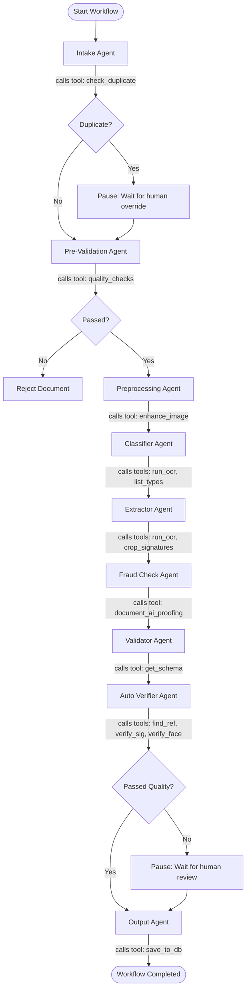

# Workflow Functions Analysis

This document provides a detailed breakdown of the functions and activities executed inside the `DocumentProcessingWorkflow` (defined in [workflow.py](file:///c:/Users/Dhruvkumar/Desktop/Document-Ai/backend/workflow.py)). 

It details:
1. Which functions are called directly without an agent.
2. Which agent can host them as tools.
3. Which utility/helper functions are called directly inside agent-driven steps and how to refactor them into agent tools.

---

## 1. Overview of Workflow Activities

Below is a summary of all activities currently defined and executed in [workflow.py](file:///c:/Users/Dhruvkumar/Desktop/Document-Ai/backend/workflow.py):

| Step | Activity / Function | Runs via Agent? | Current Agent Invoked (if any) |
|---|---|---|---|
| **State** | `update_status_activity` / `update_status_and_message_activity` / `update_doc_type_activity` | ❌ No | None (Direct DB operations) |
| **1. Intake** | [intake_activity](file:///c:/Users/Dhruvkumar/Desktop/Document-Ai/backend/activities/intake.py) | ❌ No | None (Direct DB operations) |
| **2. Pre-Validation** | [pre_validator_activity](file:///c:/Users/Dhruvkumar/Desktop/Document-Ai/backend/activities/pre_validator.py) |  Yes | `Pre-Validation Agent` (`PRE_VALIDATOR_AGENT_ID`) |
| **2.5. Preprocessing** | [preprocessor_activity](file:///c:/Users/Dhruvkumar/Desktop/Document-Ai/backend/activities/preprocessor.py) | ❌ No | None (Direct local OpenCV image processing) |
| **3. Classify** | [classifier_activity](file:///c:/Users/Dhruvkumar/Desktop/Document-Ai/backend/activities/classifier.py) |  Yes | `Classifier Agent` (`CLASSIFIER_AGENT_ID`) |
| **3.5. Fraud Check** | [fraud_check_activity](file:///c:/Users/Dhruvkumar/Desktop/Document-Ai/backend/activities/fraud_checker.py) | ❌ No | None (Direct Google Document AI API or local mock) |
| **4. Extract** | [extractor_activity](file:///c:/Users/Dhruvkumar/Desktop/Document-Ai/backend/activities/extractor.py) |  Yes | `Extractor Agent` (`GENERAL_EXTRACTOR_AGENT_ID` / `OTHERS_EXTRACTOR_AGENT_ID`) |
| **5. Validate** | [validator_activity](file:///c:/Users/Dhruvkumar/Desktop/Document-Ai/backend/activities/validator.py) |  Yes | `Validator Agent` (`VALIDATOR_AGENT_ID`) |
| **5.5. Auto-Verify** | [auto_verify_activity](file:///c:/Users/Dhruvkumar/Desktop/Document-Ai/backend/activities/auto_verifier.py) | ❌ No | None (Activity is a standard Python workflow task executing DB operations and calling verifier ML pipelines under the hood) |
| **6. Review** | [reviewer_activity](file:///c:/Users/Dhruvkumar/Desktop/Document-Ai/backend/activities/reviewer.py) |  Yes | `Reviewer Agent` (`REVIEWER_AGENT_ID`) |
| **7. Output** | [output_activity](file:///c:/Users/Dhruvkumar/Desktop/Document-Ai/backend/activities/output.py) | ❌ No | None (Direct DB write/merge operations) |

---

## 2. Functions Called Directly WITHOUT Agents

These are the functions/activities running **purely as Python code or API integrations**, completely bypassing the agent structure.

### A. State Update Helpers
*   **Functions**: `update_status_activity`, `update_status_and_message_activity`, `update_doc_type_activity`
*   **What they do**: Interact directly with the SQLite database to update the document's stage, message, or classified type.
*   **Proposed Agent Fitting**: 
    *   **Fit into: Orchestrator / System Agent** (or a **Database Operations Agent**).
    *   If the workflow is agent-driven, each agent could call a tool: `update_document_state(document_id, status, message)` to report its own progress.

### B. Intake Operations
*   **Function**: `intake_activity` (defined in [intake.py](file:///c:/Users/Dhruvkumar/Desktop/Document-Ai/backend/activities/intake.py))
*   **Direct Sub-calls**:
    *   `db.get_document()`
    *   `db.check_duplicate_hash()`
    *   `db.check_duplicate_filename()`
    *   `list_stored_filenames()`
*   **What it does**: Validates document presence, checks database for identical SHA-256 hashes or file names to flag duplicates.
*   **Proposed Agent Fitting**: 
    *   **Fit into: [NEW] Intake Agent / Gatekeeper Agent**.
    *   This agent would have tools:
        *   `check_duplicate_hash(document_id)`
        *   `check_duplicate_filename(filename)`
    *   The Intake Agent would use these tools to inspect the document and return an intake verdict (`is_duplicate: True/False`).

### C. Image Preprocessing
*   **Function**: `preprocessor_activity` (defined in [preprocessor.py](file:///c:/Users/Dhruvkumar/Desktop/Document-Ai/backend/activities/preprocessor.py))
*   **Direct Sub-calls**:
    *   `preprocess_image()` (from [preprocessor.py](file:///c:/Users/Dhruvkumar/Desktop/Document-Ai/backend/utils/preprocessor.py))
*   **What it does**: Applies computer vision enhancements (resolution normalization, CLAHE brightness adjustment, noise removal, skew correction) using OpenCV.
*   **Proposed Agent Fitting**:
    *   **Fit into: [NEW] Preprocessing Agent / Image Optimization Agent**.
    *   This agent would be called with the document's file path and execute a tool:
        *   `enhance_document_image(file_path: str, output_path: str) -> dict`
    *   The agent would return the preprocessed output path.

### D. Fraud Checking
*   **Function**: `fraud_check_activity` (defined in [fraud_checker.py](file:///c:/Users/Dhruvkumar/Desktop/Document-Ai/backend/activities/fraud_checker.py))
*   **Direct Sub-calls**:
    *   `documentai.DocumentProcessorServiceClient()` (Google Document AI SDK)
    *   Mock files read from [output.json](file:///c:/Users/Dhruvkumar/Desktop/Document-Ai/output.json) as a fallback
*   **What it does**: Sends KYC files to Google Document AI's 'Identity Document Proofing' processor to perform forensic checks (image manipulation, suspicious words, duplicate detection).
*   **Proposed Agent Fitting**:
    *   **Fit into: [NEW] Fraud Examiner Agent / Forensic Agent**.
    *   This agent would have tools:
        *   `run_google_identity_proofing(file_path: str) -> dict`
        *   `get_mock_fraud_data() -> dict` (fallback tool)
    *   The Fraud Examiner Agent would run the proofing tool, interpret the statuses of the checks (`passed`, `failed`), and output the structured results.

### E. Automated Verification (KYC)
*   **Function**: `auto_verify_activity` (defined in [auto_verifier.py](file:///c:/Users/Dhruvkumar/Desktop/Document-Ai/backend/activities/auto_verifier.py))
*   **Direct Sub-calls**:
    *   Querying `CustomerReference` by `customer_id`, `national_id` (or matching passport/document numbers), or `full_name`.
    *   `save_base64_to_temp_file()` helper to decode and save signature/photo crops.
    *   `run_verification_pipeline()` (from [signature_verifier.py](file:///c:/Users/Dhruvkumar/Desktop/Document-Ai/backend/utils/signature_verifier.py))
    *   `run_face_verification_pipeline()` (from [face_verifier.py](file:///c:/Users/Dhruvkumar/Desktop/Document-Ai/backend/utils/face_verifier.py))
*   **What it does**: Checks for customer references in the SQLite database and executes ML pipelines (DINOv2 + Mistral Vision/Judge Agents) to verify signature and photo authenticity.
*   **Proposed Agent Fitting**:
    *   **Fit into: [NEW] Auto Verifier Agent / Identity Matcher Agent**.
    *   This agent would have tools:
        *   `find_customer_reference(document_id, validated_data) -> dict`
        *   `verify_signature_authenticity(doc_sig_b64, ref_sig_b64) -> dict`
        *   `verify_face_authenticity(doc_photo_b64, ref_photo_b64) -> dict`
    *   The Auto Verifier Agent would call these tools to fetch the baseline images and execute the verifications, passing final structured verdicts back.

### F. Output Persistence
*   **Function**: `output_activity` (defined in [output.py](file:///c:/Users/Dhruvkumar/Desktop/Document-Ai/backend/activities/output.py))
*   **Direct Sub-calls**:
    *   SQLAlchemy session commits updating `ExtractedData` and `Document` models with raw/validated data, fraud checks, and signature/photo verification verdicts.
*   **What it does**: Saves the final approved fields, reviewer corrections, fraud checks, and signature/photo verification results into the SQL database and sets the document state to `completed`.
*   **Proposed Agent Fitting**:
    *   **Fit into: [NEW] Output Agent / Database Writer Agent**.
    *   This agent would have a tool:
        *   `save_final_extraction(document_id, doc_type, data, confidence, fraud_results, signature_verification, photo_verification) -> dict`
    *   The Output Agent would consolidate all metadata and invoke this tool at the very end of the workflow.

---

## 3. Direct Functions Called Inside Agent-Driven Activities

Even when an activity calls an agent, there are direct helper functions executing locally in Python either before calling the agent or inside the agent's tool execution block.

### A. Classifier Activity
*   **Caller**: [classifier_activity](file:///c:/Users/Dhruvkumar/Desktop/Document-Ai/backend/activities/classifier.py)
*   **Direct Sub-calls**:
    *   `extract_with_ocr()` (from [ocr.py](file:///c:/Users/Dhruvkumar/Desktop/Document-Ai/backend/utils/ocr.py)): Performed **before** invoking the agent.
    *   `get_supported_doc_types()`: Reads templates from `templates.json`.
*   **Proposed Agent Refactoring**:
    *   Give these functions directly to the **Classifier Agent** as tools:
        *   `run_document_ocr(file_path: str) -> str`
        *   `list_supported_document_types() -> list`
    *   The Classifier Agent would first run `run_document_ocr` and `list_supported_document_types`, then use their output to select the correct `doc_type`.

### B. Extractor Activity
*   **Caller**: [extractor_activity](file:///c:/Users/Dhruvkumar/Desktop/Document-Ai/backend/activities/extractor.py)
*   **Direct Sub-calls**:
    *   `extract_with_ocr()`: Triggered when the agent invokes its tool `extract_text_from_document` (or executed as a python fallback if the agent does not call it).
    *   `get_template_fields()` / `get_template_metadata()`: Evaluated in python.
    *   `extract_signature_and_photo()` (from [signature_extractor.py](file:///c:/Users/Dhruvkumar/Desktop/Document-Ai/backend/utils/signature_extractor.py)): Triggered directly in Python if `is_kyc` is True to generate signature and face crops.
*   **Proposed Agent Refactoring**:
    *   The **Extractor Agent** already calls `extract_text_from_document` as a tool.
    *   We can register `extract_signature_and_photo` as a tool:
        *   `crop_signature_and_photo(file_path: str, coordinates: dict) -> dict`
    *   The Extractor Agent can invoke this tool during extraction.

### C. Validator Activity
*   **Caller**: [validator_activity](file:///c:/Users/Dhruvkumar/Desktop/Document-Ai/backend/activities/validator.py)
*   **Direct Sub-calls**:
    *   `get_template_fields()`: Reads `templates.json` to construct the validation prompt.
*   **Proposed Agent Refactoring**:
    *   Give `get_template_fields` to the **Validator Agent** as a tool:
        *   `get_validation_schema(doc_type: str) -> list`
    *   The Validator Agent would fetch the validation schema, compare the fields, and return the validation report.

---

## 4. Proposed Architecture: Unified Single-File Workflow

If we refactor the workflow to run strictly via agents, the workflow file would become a simple orchestrator calling each agent sequentially. The agents themselves would interact with the system using registered tools.

Here is a conceptual flow of how the single-file workflow would look:

