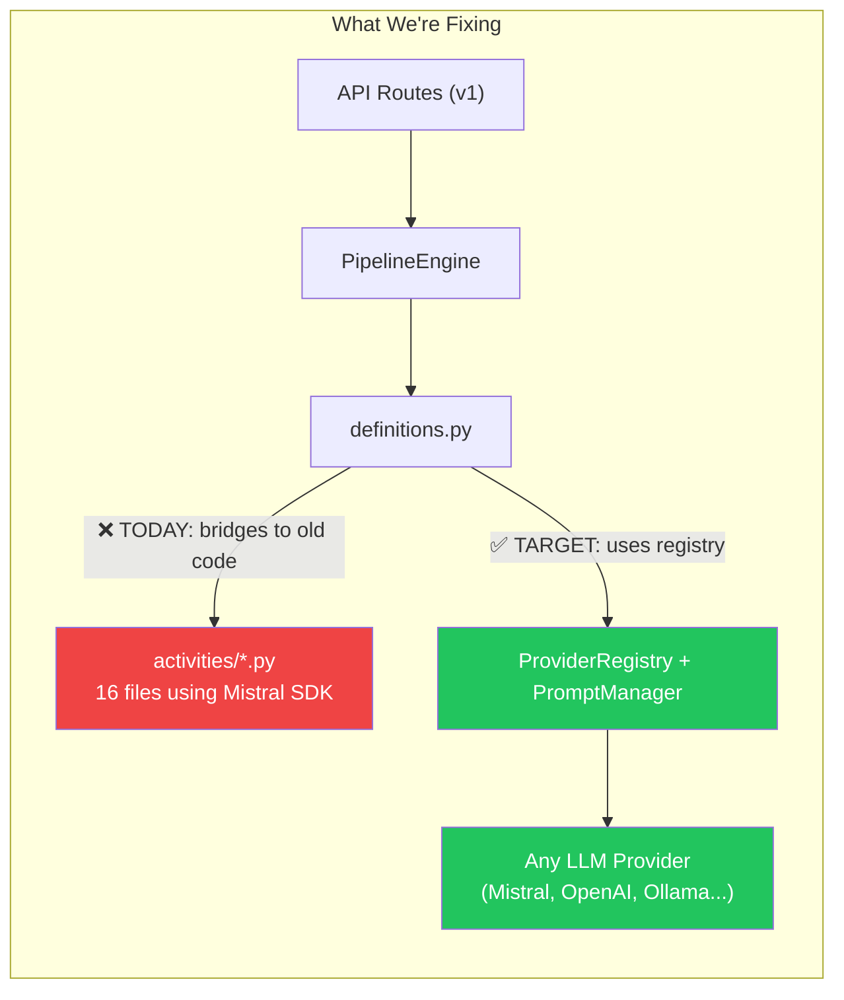
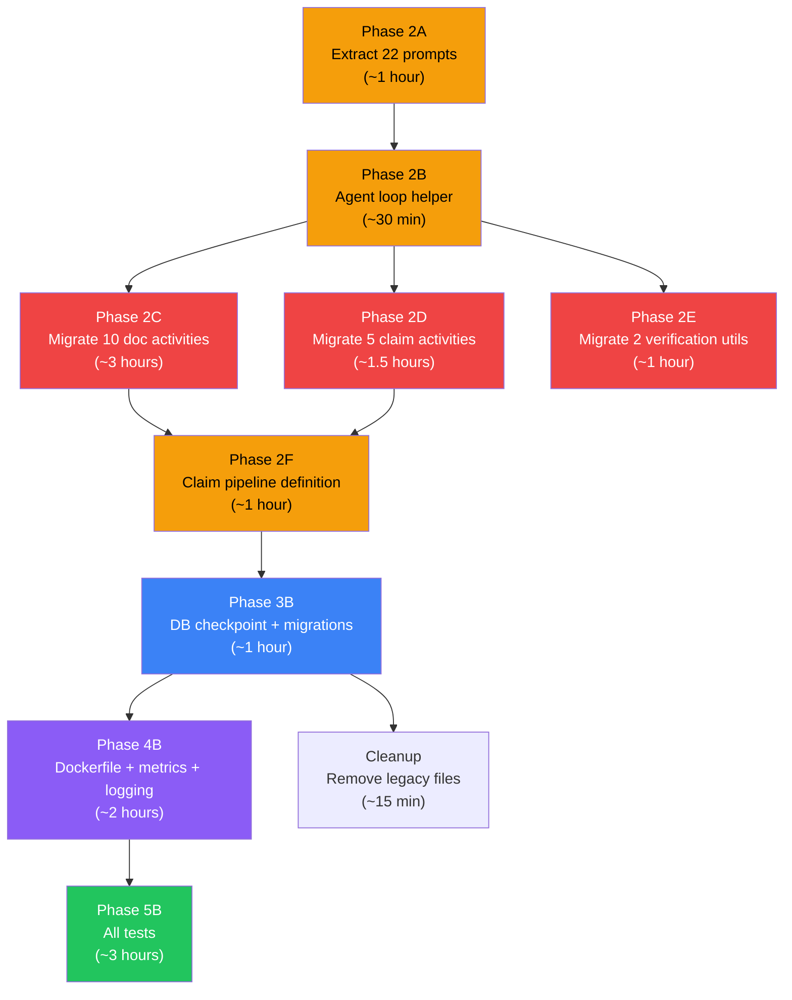

# Document AI Platform — Complete Implementation Plan

> **Goal**: Transform the Mistral-coupled backend into a plug-and-play, model-agnostic platform.
> **Design Document**: [production_recommendations.md](file:///C:/Users/MrHarshGurjar/.gemini/antigravity-ide/brain/d414d136-abc1-4f88-8d19-d88d8d264b38/production_recommendations.md)
> **Previous Session**: [session_reference.md](file:///c:/Users/MrHarshGurjar/Desktop/code/Document-Ai/session_reference.md)

---

## How To Read This Plan

- **✅ DONE** = File exists on disk with functional code. No work needed.
- **⚠️ NEEDS WORK** = File exists but has gaps or uses legacy bridge.
- **🔨 NEW** = File does not exist. Must be created.
- Every file has an **exact path**, **what to do**, and **code pattern** where relevant.
- Phases are ordered by dependency — do them in order.

---

## Architecture Overview



---

# Phase 1 — Foundation (Provider Abstraction) ✅ COMPLETE

> **All items done.** No work remaining in Phase 1.

| # | Item | Status | File |
|---|------|--------|------|
| 1.1 | Provider interfaces (5 ABCs) | ✅ | [interfaces.py](file:///c:/Users/MrHarshGurjar/Desktop/code/Document-Ai/backend-v2/platform_core/providers/interfaces.py) |
| 1.2 | MistralLLM provider | ✅ | [mistral.py](file:///c:/Users/MrHarshGurjar/Desktop/code/Document-Ai/backend-v2/platform_core/providers/llm/mistral.py) |
| 1.3 | MistralOCR provider | ✅ | [mistral_ocr.py](file:///c:/Users/MrHarshGurjar/Desktop/code/Document-Ai/backend-v2/platform_core/providers/ocr/mistral_ocr.py) |
| 1.4 | MistralVision provider | ✅ | [mistral_vision.py](file:///c:/Users/MrHarshGurjar/Desktop/code/Document-Ai/backend-v2/platform_core/providers/vision/mistral_vision.py) |
| 1.5 | LocalStorage provider | ✅ | [local.py](file:///c:/Users/MrHarshGurjar/Desktop/code/Document-Ai/backend-v2/platform_core/providers/storage/local.py) |
| 1.6 | DINOv2 Embedding provider | ✅ | [dinov2.py](file:///c:/Users/MrHarshGurjar/Desktop/code/Document-Ai/backend-v2/platform_core/providers/embedding/dinov2.py) |
| 1.7 | Provider Registry | ✅ | [registry.py](file:///c:/Users/MrHarshGurjar/Desktop/code/Document-Ai/backend-v2/platform_core/registry.py) |
| 1.8 | FallbackChain | ✅ | [fallback.py](file:///c:/Users/MrHarshGurjar/Desktop/code/Document-Ai/backend-v2/platform_core/resilience/fallback.py) |
| 1.9 | CircuitBreaker | ✅ | [circuit_breaker.py](file:///c:/Users/MrHarshGurjar/Desktop/code/Document-Ai/backend-v2/platform_core/resilience/circuit_breaker.py) |
| 1.10 | RetryPolicy | ✅ | [retry.py](file:///c:/Users/MrHarshGurjar/Desktop/code/Document-Ai/backend-v2/platform_core/resilience/retry.py) |
| 1.11 | HealthMonitor | ✅ | [health.py](file:///c:/Users/MrHarshGurjar/Desktop/code/Document-Ai/backend-v2/platform_core/resilience/health.py) |
| 1.12 | Config Loader | ✅ | [config.py](file:///c:/Users/MrHarshGurjar/Desktop/code/Document-Ai/backend-v2/platform_core/config.py) |
| 1.13 | platform.yaml | ✅ | [platform.yaml](file:///c:/Users/MrHarshGurjar/Desktop/code/Document-Ai/backend-v2/config/platform.yaml) |
| 1.14 | Prompt Manager | ✅ | [manager.py](file:///c:/Users/MrHarshGurjar/Desktop/code/Document-Ai/backend-v2/platform_core/prompts/manager.py) |

---

# Phase 2 — Pipeline Engine & Activity Migration

> **This is the critical phase.** The pipeline engine infrastructure is built, but the activities still call Mistral SDK directly. This phase wires everything together.

## Phase 2A — Extract System Prompts (🔨 NEW — 20 files)

**What**: Copy each agent's `instructions` text from [agents_config.py](file:///c:/Users/MrHarshGurjar/Desktop/code/Document-Ai/backend-v2/agents_config.py) into a `.md` file that the `PromptManager` can load.

**Where**: `backend-v2/platform_core/prompts/`

| # | File to Create | Source in agents_config.py | Lines |
|---|----------------|---------------------------|-------|
| 2A.1 | 🔨 `prompts/classifier.md` | `CLASSIFIER_AGENT_ID` instructions | L13-26 |
| 2A.2 | 🔨 `prompts/extractor.md` | `GENERAL_EXTRACTOR_AGENT_ID` instructions | L34-50 |
| 2A.3 | 🔨 `prompts/validator.md` | `VALIDATOR_AGENT_ID` instructions | L58-77 |
| 2A.4 | 🔨 `prompts/reviewer.md` | `REVIEWER_AGENT_ID` instructions | L85-106 |
| 2A.5 | 🔨 `prompts/auto_verifier.md` | `AUTO_VERIFIER_AGENT_ID` instructions | L114-127 |
| 2A.6 | 🔨 `prompts/output.md` | `OUTPUT_AGENT_ID` instructions | L135-145 |
| 2A.7 | 🔨 `prompts/signature_vision.md` | `SIGNATURE_VISION_AGENT_ID` instructions | L153-244 |
| 2A.8 | 🔨 `prompts/signature_judge.md` | `SIGNATURE_JUDGE_AGENT_ID` instructions | L252-353 |
| 2A.9 | 🔨 `prompts/face_morphology1.md` | `FACE_MORPHOLOGY1_AGENT_ID` instructions | L361-408 |
| 2A.10 | 🔨 `prompts/face_morphology2.md` | `FACE_MORPHOLOGY2_AGENT_ID` instructions | L417-470 |
| 2A.11 | 🔨 `prompts/face_age.md` | `FACE_AGE_AGENT_ID` instructions | L479-528 |
| 2A.12 | 🔨 `prompts/face_judge.md` | `FACE_JUDGE_AGENT_ID` instructions | L537-573 |
| 2A.13 | 🔨 `prompts/pre_validator.md` | `PRE_VALIDATOR_AGENT_ID` instructions | L581-623 |
| 2A.14 | 🔨 `prompts/intake.md` | `INTAKE_AGENT_ID` instructions | L631 (empty — write generic one) |
| 2A.15 | 🔨 `prompts/preprocessor.md` | `PREPROCESSING_AGENT_ID` instructions | L639-651 |
| 2A.16 | 🔨 `prompts/fraud_checker.md` | `FRAUD_AGENT_ID` instructions | L660-670 |
| 2A.17 | 🔨 `prompts/claim_integrity.md` | `CLAIM_INTEGRITY_AGENT_ID` instructions | L678-734 |
| 2A.18 | 🔨 `prompts/claim_medical.md` | `CLAIM_MEDICAL_AGENT_ID` instructions | L743-797 |
| 2A.19 | 🔨 `prompts/claim_treatment.md` | `CLAIM_TREATMENT_AGENT_ID` instructions | L806-860 |
| 2A.20 | 🔨 `prompts/claim_disability.md` | `CLAIM_DISABILITY_AGENT_ID` instructions | L869-916 |
| 2A.21 | 🔨 `prompts/claim_litigation.md` | `CLAIM_LITIGATION_AGENT_ID` instructions | L925-975 |
| 2A.22 | 🔨 `prompts/claim_report.md` | `CLAIM_REPORT_AGENT_ID` instructions | L984-1011 |

> [!NOTE]
> Each `.md` file is pure text — the system prompt content. The `PromptManager.get("classifier")` call looks for `prompts/classifier.md` and returns its text content.

---

## Phase 2B — Create Agent Conversation Helper (🔨 NEW — 1 file)

**What**: Extract the repeated agent conversation loop (present in all 16 activities) into a shared utility. This eliminates ~1500 lines of duplicated code.

**Where**: 🔨 `backend-v2/platform_core/agent_loop.py`

**Why**: Every activity has this identical pattern:
```python
# 1. Call LLM with tools
response = await client.agents.complete_async(agent_id=..., messages=..., tools=...)
# 2. Loop: if tool_calls, execute tools, append results, call again
while message.tool_calls:
    for tc in message.tool_calls:
        # execute tool, append result
    response = await client.agents.complete_async(...)
# 3. Parse final JSON response
```

**New shared helper**:
```python
# platform_core/agent_loop.py

async def run_agent_loop(
    llm: LLMProvider,
    system_prompt: str,
    user_message: str,
    tools_schema: list[dict],
    tool_executor: Callable[[str, dict], Awaitable[Any]],  
    temperature: float = 0.2,
    max_iterations: int = 10,
    json_mode: bool = True,
) -> dict:
    """
    Generic agent conversation loop that works with ANY LLM provider.
    
    1. Sends user_message to the LLM with system_prompt and tools
    2. If LLM returns tool_calls, executes them via tool_executor callback
    3. Appends tool results and calls LLM again
    4. Repeats until LLM returns a final text response
    5. Parses and returns the JSON response
    """
    messages = [{"role": "user", "content": user_message}]
    
    for _ in range(max_iterations):
        response = await llm.chat(
            messages=messages,
            system_prompt=system_prompt,
            tools=tools_schema,
            temperature=temperature,
        )
        
        if not response.tool_calls:
            # Final response — parse JSON
            return _parse_json_response(response.content)
        
        # Execute tool calls
        messages.append({"role": "assistant", "content": response.content or "", "tool_calls": response.tool_calls})
        for tc in response.tool_calls:
            result = await tool_executor(tc["function"]["name"], json.loads(tc["function"]["arguments"]))
            messages.append({"role": "tool", "name": tc["function"]["name"], "content": json.dumps(result), "tool_call_id": tc["id"]})
    
    raise RuntimeError("Agent loop exceeded max iterations")
```

---

## Phase 2C — Migrate Document Activities (⚠️ MODIFY — 10 files)

**What**: Rewrite each document processing activity to use `ProviderRegistry` + `PromptManager` + `run_agent_loop()` instead of direct Mistral SDK calls.

**Pattern — BEFORE** (every activity today):
```python
import mistralai.workflows as workflows           # ❌ Remove
from mistralai.client import Mistral              # ❌ Remove
client = Mistral(api_key=settings.MISTRAL_API_KEY) # ❌ Remove

@workflows.activity()                              # ❌ Remove decorator
async def classifier_activity(document_id, file_path):
    response = await client.agents.complete_async(
        agent_id=settings.CLASSIFIER_AGENT_ID,    # ❌ Replace with prompt
        messages=messages, tools=tools
    )
```

**Pattern — AFTER**:
```python
from platform_core.registry import ProviderRegistry
from platform_core.prompts.manager import PromptManager
from platform_core.agent_loop import run_agent_loop

prompts = PromptManager()

async def classifier_activity(document_id, file_path):
    registry = ProviderRegistry.get()
    llm = registry.get_llm()                       # ✅ Any LLM
    system_prompt = prompts.get("classifier")       # ✅ Local .md file
    
    async def execute_tool(name, args):             # ✅ Same tool functions
        if name == "get_supported_document_types":
            return {"supported_types": list(get_supported_doc_types().values()) + ["Others"]}
        elif name == "get_document_text":
            return {"raw_text": get_document_text(args.get("file_path", file_path), document_id)}
    
    result = await run_agent_loop(
        llm=llm,
        system_prompt=system_prompt,
        user_message=f"Classify document at '{file_path}'...",
        tools_schema=CLASSIFIER_TOOLS,
        tool_executor=execute_tool,
        temperature=0.2,
    )
    return result
```

**Files to modify** (all in `backend-v2/activities/`):

| # | File | Size | Agent Prompt Name | Tools Used |
|---|------|------|-------------------|------------|
| 2C.1 | [intake.py](file:///c:/Users/MrHarshGurjar/Desktop/code/Document-Ai/backend-v2/activities/intake.py) | 6KB | `intake` | `check_document_duplicates` |
| 2C.2 | [pre_validator.py](file:///c:/Users/MrHarshGurjar/Desktop/code/Document-Ai/backend-v2/activities/pre_validator.py) | 8KB | `pre_validator` | `get_file_metadata` |
| 2C.3 | [preprocessor.py](file:///c:/Users/MrHarshGurjar/Desktop/code/Document-Ai/backend-v2/activities/preprocessor.py) | 8KB | `preprocessor` | `enhance_document_image` |
| 2C.4 | [classifier.py](file:///c:/Users/MrHarshGurjar/Desktop/code/Document-Ai/backend-v2/activities/classifier.py) | 7KB | `classifier` | `get_supported_document_types`, `get_document_text` |
| 2C.5 | [fraud_checker.py](file:///c:/Users/MrHarshGurjar/Desktop/code/Document-Ai/backend-v2/activities/fraud_checker.py) | 6KB | `fraud_checker` | `run_identity_proofing` |
| 2C.6 | [extractor.py](file:///c:/Users/MrHarshGurjar/Desktop/code/Document-Ai/backend-v2/activities/extractor.py) | 11KB | `extractor` | `extract_text_from_document`, `get_template_fields`, `crop_kyc_images` |
| 2C.7 | [validator.py](file:///c:/Users/MrHarshGurjar/Desktop/code/Document-Ai/backend-v2/activities/validator.py) | 7KB | `validator` | `get_template_fields` |
| 2C.8 | [auto_verifier.py](file:///c:/Users/MrHarshGurjar/Desktop/code/Document-Ai/backend-v2/activities/auto_verifier.py) | 11KB | `auto_verifier` | `find_customer_reference`, `verify_signature`, `verify_face` |
| 2C.9 | [reviewer.py](file:///c:/Users/MrHarshGurjar/Desktop/code/Document-Ai/backend-v2/activities/reviewer.py) | 6KB | `reviewer` | `get_review_context` |
| 2C.10 | [output.py](file:///c:/Users/MrHarshGurjar/Desktop/code/Document-Ai/backend-v2/activities/output.py) | 10KB | `output` | `persist_final_extraction` |

**What to change in EACH file (3-step recipe)**:
1. **Delete** imports: `import mistralai.workflows as workflows`, `from mistralai.client import Mistral`, `client = Mistral(...)`.
2. **Delete** the `@workflows.activity()` decorator.
3. **Replace** the manual conversation loop with `run_agent_loop()` call.

> [!IMPORTANT]
> The `tools/*.py` files (tool schemas + tool execution functions) remain **UNCHANGED**. They are pure Python functions that don't touch any LLM vendor. Only the `activities/*.py` files change.

---

## Phase 2D — Migrate Claim Activities (⚠️ MODIFY — 5 files)

Same pattern as 2C, applied to claim agents:

| # | File | Agent Prompt Name | Tools Used |
|---|------|-------------------|------------|
| 2D.1 | [claim_integrity.py](file:///c:/Users/MrHarshGurjar/Desktop/code/Document-Ai/backend-v2/activities/claim_integrity.py) | `claim_integrity` | `get_claim_documents_data`, `get_claimant_history`, `get_policy_details` |
| 2D.2 | [claim_medical.py](file:///c:/Users/MrHarshGurjar/Desktop/code/Document-Ai/backend-v2/activities/claim_medical.py) | `claim_medical` | `get_claim_documents_data` |
| 2D.3 | [claim_treatment.py](file:///c:/Users/MrHarshGurjar/Desktop/code/Document-Ai/backend-v2/activities/claim_treatment.py) | `claim_treatment` | `get_claim_documents_data` |
| 2D.4 | [claim_disability.py](file:///c:/Users/MrHarshGurjar/Desktop/code/Document-Ai/backend-v2/activities/claim_disability.py) | `claim_disability` | `get_claim_documents_data` |
| 2D.5 | [claim_litigation.py](file:///c:/Users/MrHarshGurjar/Desktop/code/Document-Ai/backend-v2/activities/claim_litigation.py) | `claim_litigation` | `get_claim_documents_data`, `get_claimant_history` |

---

## Phase 2E — Migrate Verification Utils (⚠️ MODIFY — 2 files)

These utils in `backend-v2/utils/` also have direct Mistral SDK calls:

| # | File | What Changes | Prompts Used |
|---|------|-------------|--------------|
| 2E.1 | [signature_verifier.py](file:///c:/Users/MrHarshGurjar/Desktop/code/Document-Ai/backend-v2/utils/signature_verifier.py) | Replace `client.chat.complete_async()` with `registry.get_vision().analyze()` and `registry.get_llm().chat()` | `signature_vision`, `signature_judge` |
| 2E.2 | [face_verifier.py](file:///c:/Users/MrHarshGurjar/Desktop/code/Document-Ai/backend-v2/utils/face_verifier.py) | Replace 4 separate Mistral agent calls with `registry.get_vision()` calls | `face_morphology1`, `face_morphology2`, `face_age`, `face_judge` |

---

## Phase 2F — Build Claim Pipeline Definition (🔨 NEW — additions to 1 file)

**What**: Add `build_claim_pipeline()` to [definitions.py](file:///c:/Users/MrHarshGurjar/Desktop/code/Document-Ai/backend-v2/platform_core/pipeline/definitions.py) — mirrors the flow in [claim_workflow.py](file:///c:/Users/MrHarshGurjar/Desktop/code/Document-Ai/backend-v2/claim_workflow.py).

**Steps to define**:
```
claim_integrity → claim_medical → claim_treatment → claim_disability → claim_litigation → claim_report → save_claim_report
```

**Code to add at end of definitions.py**:
```python
def build_claim_pipeline(config: dict) -> PipelineDefinition:
    step_timeout = config.get("pipelines", {}).get("claim_processing", {}).get("step_timeout_seconds", 120)
    steps = [
        StepDefinition(name="claim_integrity", handler=_step_claim_integrity, ...),
        StepDefinition(name="claim_medical", handler=_step_claim_medical, ...),
        StepDefinition(name="claim_treatment", handler=_step_claim_treatment, ...),
        StepDefinition(name="claim_disability", handler=_step_claim_disability, ...),
        StepDefinition(name="claim_litigation", handler=_step_claim_litigation, ...),
        StepDefinition(name="claim_report", handler=_step_claim_report, ...),
        StepDefinition(name="save_claim_report", handler=_step_save_claim_report, ...),
    ]
    return PipelineDefinition(name="claim_processing", steps=steps)
```

Also update [worker.py](file:///c:/Users/MrHarshGurjar/Desktop/code/Document-Ai/backend-v2/worker.py) to add a `run_claim_pipeline` task and update [claims.py](file:///c:/Users/MrHarshGurjar/Desktop/code/Document-Ai/backend-v2/api/routers/v1/claims.py) router to use the new engine instead of legacy `claim_workflow.py`.

---

## Phase 2 Summary

| Sub-phase | Files | Type | Effort |
|-----------|-------|------|--------|
| 2A: Extract prompts | 22 new `.md` files | Mechanical copy | ~1 hour |
| 2B: Agent loop helper | 1 new file | New code | ~30 min |
| 2C: Migrate doc activities | 10 modified files | Repetitive rewrite | ~3 hours |
| 2D: Migrate claim activities | 5 modified files | Repetitive rewrite | ~1.5 hours |
| 2E: Migrate verification utils | 2 modified files | Targeted rewrite | ~1 hour |
| 2F: Claim pipeline definition | 3 modified files | New definitions | ~1 hour |
| **Total Phase 2** | **43 files** | | **~8 hours** |

---

# Phase 3 — Infrastructure

## Phase 3A — Already Done ✅

| # | Item | Status | File |
|---|------|--------|------|
| 3A.1 | API versioning (v1 router) | ✅ | [api/routers/v1/](file:///c:/Users/MrHarshGurjar/Desktop/code/Document-Ai/backend-v2/api/routers/v1) — 4 route modules |
| 3A.2 | Split main.py | ✅ | [main.py](file:///c:/Users/MrHarshGurjar/Desktop/code/Document-Ai/backend-v2/main.py) — 133 lines |
| 3A.3 | Redis queue module | ✅ | [queue.py](file:///c:/Users/MrHarshGurjar/Desktop/code/Document-Ai/backend-v2/api/queue.py) |
| 3A.4 | Background worker | ✅ | [worker.py](file:///c:/Users/MrHarshGurjar/Desktop/code/Document-Ai/backend-v2/worker.py) |
| 3A.5 | Alembic config | ✅ | [alembic.ini](file:///c:/Users/MrHarshGurjar/Desktop/code/Document-Ai/backend-v2/alembic.ini) + [env.py](file:///c:/Users/MrHarshGurjar/Desktop/code/Document-Ai/backend-v2/migrations/env.py) |
| 3A.6 | Docker Compose (Postgres + Redis) | ✅ | [docker-compose.yml](file:///c:/Users/MrHarshGurjar/Desktop/code/Document-Ai/backend-v2/docker-compose.yml) |

## Phase 3B — Remaining Work

| # | Item | Status | What To Do |
|---|------|--------|------------|
| 3B.1 | Generate Alembic migration | 🔨 | Run `alembic revision --autogenerate -m "initial_schema"`. Currently `migrations/versions/` is empty — no migration scripts exist. The app falls back to `init_db()` (create_all). |
| 3B.2 | Add Checkpoint table to DB | 🔨 | Add a `PipelineCheckpoint` model to [db/models.py](file:///c:/Users/MrHarshGurjar/Desktop/code/Document-Ai/backend-v2/db/models.py) and matching CRUD in [db/operations.py](file:///c:/Users/MrHarshGurjar/Desktop/code/Document-Ai/backend-v2/db/operations.py). Currently `CheckpointManager` falls back to in-memory dict because DB methods (`save_checkpoint`, `load_checkpoint`, `clear_checkpoint`, `list_checkpoints`) don't exist in db/operations.py. |
| 3B.3 | Add claim pipeline to worker | ⚠️ | Add `run_claim_pipeline` function to [worker.py](file:///c:/Users/MrHarshGurjar/Desktop/code/Document-Ai/backend-v2/worker.py) and register it in `WorkerSettings.functions`. |
| 3B.4 | Remove legacy files | ⚠️ | After Phase 2 is complete, remove/archive these legacy files that are no longer needed: `workflow.py` (replaced by pipeline engine), `claim_workflow.py` (replaced by claim pipeline definition), `create_or_update_agents.py` (no longer using Mistral Studio agents), `agents_config.py` (prompts now in `.md` files). Keep `main_legacy.py` as backup reference. |

---

# Phase 4 — Observability & Deploy

## Phase 4A — Already Done ✅

| # | Item | Status | File |
|---|------|--------|------|
| 4A.1 | OpenTelemetry basic setup | ✅ | [observability.py](file:///c:/Users/MrHarshGurjar/Desktop/code/Document-Ai/backend-v2/observability.py) — TracerProvider + FastAPIInstrumentor |
| 4A.2 | Prometheus /metrics endpoint | ✅ | (in observability.py) — mounts prometheus ASGI app |
| 4A.3 | /health endpoint | ✅ | (in main.py L114-124) — returns provider registry summary |

## Phase 4B — Remaining Work

### 4B.1 — 🔨 Create Dockerfile

**Path**: `backend-v2/Dockerfile`

```dockerfile
FROM python:3.12-slim

WORKDIR /app
COPY requirements.txt .
RUN pip install --no-cache-dir -r requirements.txt

COPY . .

EXPOSE 8000
CMD ["uvicorn", "main:app", "--host", "0.0.0.0", "--port", "8000"]
```

### 4B.2 — 🔨 Create .dockerignore

**Path**: `backend-v2/.dockerignore`

```
__pycache__/
*.pyc
.env
storage/
doc_workflow.db*
*.log
.git/
```

### 4B.3 — ⚠️ Update docker-compose.yml

Add the `app` and `worker` services to [docker-compose.yml](file:///c:/Users/MrHarshGurjar/Desktop/code/Document-Ai/backend-v2/docker-compose.yml):

```yaml
  app:
    build: .
    ports:
      - "8000:8000"
    env_file: .env
    depends_on:
      postgres: { condition: service_healthy }
      redis: { condition: service_healthy }
    volumes:
      - ./storage:/app/storage
      - ./config:/app/config

  worker:
    build: .
    command: arq worker.WorkerSettings
    env_file: .env
    depends_on:
      postgres: { condition: service_healthy }
      redis: { condition: service_healthy }
```

### 4B.4 — ⚠️ Add Custom Metrics to observability.py

**Modify**: [observability.py](file:///c:/Users/MrHarshGurjar/Desktop/code/Document-Ai/backend-v2/observability.py)

Add these `prometheus_client` metrics:

```python
from prometheus_client import Counter, Histogram, Gauge

# Pipeline metrics
PIPELINE_STEP_DURATION = Histogram("pipeline_step_duration_seconds", "Duration of each pipeline step", ["pipeline", "step"])
PIPELINE_STEP_TOTAL = Counter("pipeline_step_total", "Total pipeline steps executed", ["pipeline", "step", "status"])

# Provider metrics
PROVIDER_CALL_DURATION = Histogram("provider_call_duration_seconds", "Provider call latency", ["provider_type", "provider_name"])
PROVIDER_CALL_TOTAL = Counter("provider_call_total", "Total provider calls", ["provider_type", "provider_name", "status"])

# Circuit breaker
CIRCUIT_BREAKER_STATE = Gauge("circuit_breaker_state", "Current circuit breaker state (0=closed, 1=open, 2=half_open)", ["provider_name"])

# Queue
QUEUE_DEPTH = Gauge("queue_depth", "Current background task queue depth")
```

Then instrument `PipelineEngine._execute_step()` and `LLMProvider.chat()` etc. to record these metrics.

### 4B.5 — ⚠️ Add Custom Trace Spans

**Modify**: [engine.py](file:///c:/Users/MrHarshGurjar/Desktop/code/Document-Ai/backend-v2/platform_core/pipeline/engine.py)

Wrap each step execution in an OpenTelemetry span:

```python
from opentelemetry import trace
tracer = trace.get_tracer(__name__)

async def _execute_step(self, step, context):
    with tracer.start_as_current_span(f"pipeline.step.{step.name}") as span:
        span.set_attribute("pipeline.step.name", step.name)
        span.set_attribute("document.id", context.get("document_id", ""))
        # ... existing execution logic
```

### 4B.6 — 🔨 Structured JSON Logging

**Path**: 🔨 `backend-v2/logging_config.py`

Replace `basicConfig()` in [main.py](file:///c:/Users/MrHarshGurjar/Desktop/code/Document-Ai/backend-v2/main.py) L27 with a structured JSON formatter:

```python
import logging, json, sys
from datetime import datetime, timezone

class JSONFormatter(logging.Formatter):
    def format(self, record):
        return json.dumps({
            "timestamp": datetime.now(timezone.utc).isoformat(),
            "level": record.levelname,
            "logger": record.name,
            "message": record.getMessage(),
            "module": record.module,
            "line": record.lineno,
        })

def setup_logging(level="INFO"):
    handler = logging.StreamHandler(sys.stdout)
    handler.setFormatter(JSONFormatter())
    logging.root.handlers = [handler]
    logging.root.setLevel(getattr(logging, level))
```

---

# Phase 5 — Testing & Polish

## Phase 5A — Already Done ✅

| # | Item | Status | File |
|---|------|--------|------|
| 5A.1 | Pipeline engine tests (2 tests) | ✅ | [test_pipeline.py](file:///c:/Users/MrHarshGurjar/Desktop/code/Document-Ai/backend-v2/tests/test_pipeline.py) |

## Phase 5B — Remaining Tests

### 5B.1 — 🔨 Provider Unit Tests

**Path**: `backend-v2/tests/test_providers.py`

| Test | What it validates |
|------|------------------|
| `test_mistral_llm_chat` | MistralLLM.chat() normalizes tool_calls to `LLMResponse` format |
| `test_mistral_llm_health_check` | Health check returns `ProviderStatus.HEALTHY` or `.DOWN` |
| `test_local_storage_save_get_delete` | Save → get → exists → delete lifecycle |
| `test_local_storage_signed_url` | Returns file path for local storage |
| `test_dinov2_embed_images` | Embedding output shape matches expected dimensions |

### 5B.2 — 🔨 Registry Unit Tests

**Path**: `backend-v2/tests/test_registry.py`

| Test | What it validates |
|------|------------------|
| `test_from_config` | Registry builds from platform.yaml and registers all providers |
| `test_singleton` | `ProviderRegistry.get()` returns the same instance |
| `test_get_llm_chain` | Returns `FallbackChain` with correct provider order |
| `test_provider_not_found` | Raises `ProviderNotFoundError` for unknown provider |
| `test_health_check_all` | Runs health checks on all registered providers |

### 5B.3 — 🔨 Resilience Unit Tests

**Path**: `backend-v2/tests/test_resilience.py`

| Test | What it validates |
|------|------------------|
| `test_circuit_breaker_open_on_failures` | Opens after N consecutive failures |
| `test_circuit_breaker_half_open_recovery` | Transitions to HALF_OPEN after timeout |
| `test_fallback_chain_tries_next` | Falls back to second provider when first fails |
| `test_fallback_chain_all_fail` | Raises `AllProvidersFailedError` when all providers fail |
| `test_retry_exponential_backoff` | Retries with increasing delays |

### 5B.4 — 🔨 Agent Loop Unit Tests

**Path**: `backend-v2/tests/test_agent_loop.py`

| Test | What it validates |
|------|------------------|
| `test_agent_loop_no_tools` | Returns parsed JSON when LLM responds without tool calls |
| `test_agent_loop_with_tools` | Executes tool, feeds result back, gets final response |
| `test_agent_loop_max_iterations` | Raises after exceeding max_iterations |
| `test_agent_loop_json_parse_error` | Handles malformed JSON gracefully |

### 5B.5 — 🔨 API Integration Tests

**Path**: `backend-v2/tests/test_api.py`

| Test | What it validates |
|------|------------------|
| `test_upload_document` | POST /api/v1/documents/upload returns document_id |
| `test_get_status` | GET /api/v1/documents/status/{id} returns status |
| `test_list_documents` | GET /api/v1/documents returns paginated list |
| `test_create_claim` | POST /api/v1/claims creates claim |
| `test_health_endpoint` | GET /health returns provider summary |

Use `httpx.AsyncClient` + `TestClient` with mock providers registered in the registry.

### 5B.6 — 🔨 Load Testing Setup

**Path**: `backend-v2/tests/load/locustfile.py`

```python
from locust import HttpUser, task, between

class DocumentAIUser(HttpUser):
    wait_time = between(1, 3)
    
    @task(3)
    def upload_document(self):
        with open("tests/fixtures/sample.pdf", "rb") as f:
            self.client.post("/api/v1/documents/upload", files={"file": f})
    
    @task(1)
    def list_documents(self):
        self.client.get("/api/v1/documents")
    
    @task(1)
    def health_check(self):
        self.client.get("/health")
```

---

# Execution Order & Dependencies



---

# Complete File Inventory

## Files to CREATE (26 files)

| # | Path | Phase |
|---|------|-------|
| 1-22 | `platform_core/prompts/*.md` (22 prompt files) | 2A |
| 23 | `platform_core/agent_loop.py` | 2B |
| 24 | `Dockerfile` | 4B.1 |
| 25 | `.dockerignore` | 4B.2 |
| 26 | `logging_config.py` | 4B.6 |

## Files to MODIFY (25 files)

| # | Path | Phase |
|---|------|-------|
| 1-10 | `activities/{intake,pre_validator,preprocessor,classifier,fraud_checker,extractor,validator,auto_verifier,reviewer,output}.py` | 2C |
| 11-15 | `activities/{claim_integrity,claim_medical,claim_treatment,claim_disability,claim_litigation}.py` | 2D |
| 16-17 | `utils/{signature_verifier,face_verifier}.py` | 2E |
| 18 | `platform_core/pipeline/definitions.py` | 2F |
| 19 | `worker.py` | 2F, 3B.3 |
| 20 | `api/routers/v1/claims.py` | 2F |
| 21 | `db/models.py` (add PipelineCheckpoint) | 3B.2 |
| 22 | `db/operations.py` (add checkpoint CRUD) | 3B.2 |
| 23 | `docker-compose.yml` | 4B.3 |
| 24 | `observability.py` | 4B.4 |
| 25 | `main.py` (use JSON logging) | 4B.6 |

## Files to DELETE/ARCHIVE (after Phase 2 complete)

| # | Path | Reason |
|---|------|--------|
| 1 | `workflow.py` | Replaced by `PipelineEngine` |
| 2 | `claim_workflow.py` | Replaced by `build_claim_pipeline()` |
| 3 | `create_or_update_agents.py` | No longer using Mistral Studio agents |
| 4 | `agents_config.py` | Prompts moved to `.md` files |

## Test Files to CREATE (6 files)

| # | Path | Phase |
|---|------|-------|
| 1 | `tests/test_providers.py` | 5B.1 |
| 2 | `tests/test_registry.py` | 5B.2 |
| 3 | `tests/test_resilience.py` | 5B.3 |
| 4 | `tests/test_agent_loop.py` | 5B.4 |
| 5 | `tests/test_api.py` | 5B.5 |
| 6 | `tests/load/locustfile.py` | 5B.6 |

---

# Total Effort Estimate

| Phase | Work Items | Effort |
|-------|-----------|--------|
| Phase 1 | — | ✅ Done |
| Phase 2A | 22 prompt files | ~1 hour |
| Phase 2B | 1 agent loop helper | ~30 min |
| Phase 2C | 10 document activities | ~3 hours |
| Phase 2D | 5 claim activities | ~1.5 hours |
| Phase 2E | 2 verification utils | ~1 hour |
| Phase 2F | Claim pipeline + worker + router | ~1 hour |
| Phase 3B | DB checkpoint + Alembic migration | ~1 hour |
| Phase 4B | Dockerfile + metrics + logging | ~2 hours |
| Phase 5B | 6 test files | ~3 hours |
| Cleanup | Remove 4 legacy files | ~15 min |
| **TOTAL** | **57 files touched** | **~14 hours** |
