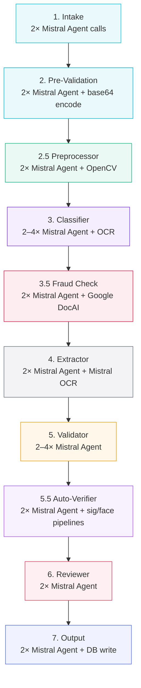

# Latency Analysis: `document_processing_workflow`

## Executive Summary

Your workflow suffers from **massive serial latency** caused by chaining **up to 22 sequential Mistral API calls** and multiple external service calls, all executed one after another with no parallelism between independent stages. For a **KYC document** (worst case), the total wall-clock time can exceed **90–120 seconds**. For a non-KYC document, it's still **40–60 seconds**.

The core problem is **architectural**: every activity wraps a simple tool call inside an LLM agent conversation, adding ~2–5s of unnecessary overhead per step. Several independent steps that *could* run in parallel are instead fully sequential.

---

## Workflow Pipeline Visualization



> [!CAUTION]
> **All 10 stages above are fully sequential** — each one `await`s the previous one's completion before starting. There is zero parallelism between independent steps.

---

## Root Cause Breakdown

### 🔴 Root Cause 1: The "Double-Call" Anti-Pattern (Every Activity)

**Impact: +2–5 seconds per activity × 8 activities = +16–40s total**

Every single activity follows this pattern:

```
Call 1: Agent.complete(prompt + tools)     → agent returns tool_call
        Execute tool locally
Call 2: Agent.complete(tool_result)        → agent returns JSON answer
```

This means **every step** makes **two** round-trips to Mistral's API — one to decide to call a tool, and another to format the tool output as JSON. The second call is pure overhead: the LLM is just reformatting data it already has.

**Files affected:**
- [intake.py](file:///c:/Users/MrYashGupta/Desktop/Document-AI/backend-v2/activities/intake.py#L54-L110) — lines 54→58 (call 1), 106→110 (call 2)
- [preprocessor.py](file:///c:/Users/MrYashGupta/Desktop/Document-AI/backend-v2/activities/preprocessor.py#L78-L136) — lines 78→82 (call 1), 131→136 (call 2)
- [classifier.py](file:///c:/Users/MrYashGupta/Desktop/Document-AI/backend-v2/activities/classifier.py#L53-L114) — lines 53→57 (call 1), loop at 110→114
- [extractor.py](file:///c:/Users/MrYashGupta/Desktop/Document-AI/backend-v2/activities/extractor.py#L123-L199) — lines 123→127 (call 1), loop at 194→199
- [validator.py](file:///c:/Users/MrYashGupta/Desktop/Document-AI/backend-v2/activities/validator.py#L76-L125) — lines 76→80 (call 1), loop at 120→125
- [fraud_checker.py](file:///c:/Users/MrYashGupta/Desktop/Document-AI/backend-v2/activities/fraud_checker.py#L64-L113) — lines 64→68 (call 1), loop at 108→113
- [reviewer.py](file:///c:/Users/MrYashGupta/Desktop/Document-AI/backend-v2/activities/reviewer.py#L64-L110) — lines 64→68 (call 1), loop at 105→110
- [output.py](file:///c:/Users/MrYashGupta/Desktop/Document-AI/backend-v2/activities/output.py#L95-L183) — lines 95→99 (call 1), loop at 178→183

> [!TIP]
> **Fix**: For deterministic steps (intake, preprocessor, output, reviewer), skip the LLM entirely and call the tool function directly. For steps where the LLM adds value (classifier, extractor, validator), parse the tool output locally instead of sending it back for a second LLM call.

---

### 🔴 Root Cause 2: The "Retry on Non-JSON" Pattern (Adds a 3rd Call)

**Impact: +3–5 seconds per retry occurrence**

Several activities have a fallback that makes a **third** API call when the agent's response isn't valid JSON:

```python
# classifier.py L119-142, validator.py L129-152, fraud_checker.py L117-141, reviewer.py L114-138, output.py L186-210
except Exception:
    messages.append({"role": "user", "content": "Please output JSON..."})
    response = client.agents.complete(...)  # ← 3rd API call!
```

This happens frequently because agents often wrap JSON in markdown code fences.

**Files affected:**
- [classifier.py](file:///c:/Users/MrYashGupta/Desktop/Document-AI/backend-v2/activities/classifier.py#L119-L142)
- [validator.py](file:///c:/Users/MrYashGupta/Desktop/Document-AI/backend-v2/activities/validator.py#L129-L152)
- [fraud_checker.py](file:///c:/Users/MrYashGupta/Desktop/Document-AI/backend-v2/activities/fraud_checker.py#L117-L141)
- [reviewer.py](file:///c:/Users/MrYashGupta/Desktop/Document-AI/backend-v2/activities/reviewer.py#L114-L138)
- [output.py](file:///c:/Users/MrYashGupta/Desktop/Document-AI/backend-v2/activities/output.py#L186-L210)

> [!TIP]
> **Fix**: Always use `response_format={"type": "json_object"}` in the second call to guarantee JSON. This eliminates the need for the retry path entirely.

---

### 🔴 Root Cause 3: Fully Sequential Pipeline (No Parallelism)

**Impact: Eliminates any opportunity for concurrent execution**

In [workflow.py](file:///c:/Users/MrYashGupta/Desktop/Document-AI/backend-v2/workflow.py#L49-L193), every step is a bare `await`:

```python
intake_result = await intake_activity(...)          # Step 1
pre_val = await pre_validator_activity(...)          # Step 2
preprocess_result = await preprocessor_activity(...) # Step 2.5
classifier_result = await classifier_activity(...)   # Step 3
fraud_check_result = await fraud_check_activity(...) # Step 3.5
extractor_result = await extractor_activity(...)     # Step 4
validator_result = await validator_activity(...)      # Step 5
auto_verify_result = await auto_verify_activity(...)  # Step 5.5
reviewer_result = await reviewer_activity(...)       # Step 6
output_result = await output_activity(...)           # Step 7
```

Several of these steps have **no data dependency on each other** and could run in parallel:

| Steps that can run in parallel | Why |
|---|---|
| Pre-Validation (2) + Preprocessing (2.5) | Both only need `file_path` — neither depends on the other's output |
| Classification (3) + Fraud Check (3.5) | Classification uses `clean_file_path`, fraud check also uses `clean_file_path`. Fraud check doesn't need doc_type for its own logic. Currently fraud check is gated by `is_kyc` which depends on classification — but this could be restructured |
| Validation (5) + Auto-Verify (5.5) | Auto-verify uses `validated_data`, so these are dependent — **but** once validation completes, auto-verify and reviewer could overlap if restructured |

> [!IMPORTANT]
> **Biggest win**: Run pre-validation and preprocessing in parallel via `asyncio.gather()`. This alone could save **5–10 seconds**.

---

### 🟡 Root Cause 4: Redundant OCR Calls in the Extractor Path (KYC Documents)

**Impact: +5–15 seconds for KYC documents**

For KYC documents, the extractor activity calls **two** tools:
1. `extract_text_from_document` → calls `client.ocr.process()` in [ocr.py](file:///c:/Users/MrYashGupta/Desktop/Document-AI/backend-v2/utils/ocr.py#L90)
2. `crop_kyc_images` → calls `extract_signature_and_photo()` in [signature_extractor.py](file:///c:/Users/MrYashGupta/Desktop/Document-AI/backend-v2/utils/signature_extractor.py#L347) which calls `client.ocr.process()` **again** (Path 1), and if that fails, calls it a **third** time (Fallback Path, line 507), plus an additional `pixtral-large-latest` vision call (line 237).

So for a KYC document, the OCR is called **2–3 times** on the same document with slightly different parameters.

**Files affected:**
- [tools/extractor.py](file:///c:/Users/MrYashGupta/Desktop/Document-AI/backend-v2/tools/extractor.py#L191-L255) — two independent tool calls
- [utils/signature_extractor.py](file:///c:/Users/MrYashGupta/Desktop/Document-AI/backend-v2/utils/signature_extractor.py#L346-L564) — up to 3 API calls internally

---

### 🟡 Root Cause 5: Signature Verification Pipeline (3 Sequential API Calls)

**Impact: +8–15 seconds per KYC document**

The signature verification in [signature_verifier.py](file:///c:/Users/MrYashGupta/Desktop/Document-AI/backend-v2/utils/signature_verifier.py#L309-L388) runs:
1. **DINO** (CPU-bound, runs in thread) ‖ **Mistral Vision Agent** (async API call) — these run in parallel ✅
2. **Mistral Judge Agent** — sequential after both complete ❌

The face verification in [face_verifier.py](file:///c:/Users/MrYashGupta/Desktop/Document-AI/backend-v2/utils/face_verifier.py#L267-L384) runs:
1. **3 Morphology/Age agents** in parallel ✅ 
2. **Judge agent** — sequential after all three ❌

However, the **entire signature pipeline and face pipeline are themselves sequential** within `auto_verify_activity`:

```python
# tools/auto_verifier.py
sig_res = await verify_signature(...)   # Wait for complete signature pipeline
face_res = await verify_face(...)       # THEN start face pipeline
```

> [!TIP]
> **Fix**: Run `verify_signature()` and `verify_face()` concurrently with `asyncio.gather()`.

---

### 🟡 Root Cause 6: Synchronous Mistral Client Calls

**Impact: Blocks the event loop for ~2–5s per call**

All activity files use the **synchronous** `client.agents.complete()` instead of the async variant:

```python
# Every activity file:
client = Mistral(api_key=settings.MISTRAL_API_KEY)
response = client.agents.complete(...)  # SYNCHRONOUS — blocks the event loop
```

This is in [intake.py L54](file:///c:/Users/MrYashGupta/Desktop/Document-AI/backend-v2/activities/intake.py#L54), [classifier.py L53](file:///c:/Users/MrYashGupta/Desktop/Document-AI/backend-v2/activities/classifier.py#L53), [extractor.py L123](file:///c:/Users/MrYashGupta/Desktop/Document-AI/backend-v2/activities/extractor.py#L123), [validator.py L76](file:///c:/Users/MrYashGupta/Desktop/Document-AI/backend-v2/activities/validator.py#L76), [fraud_checker.py L64](file:///c:/Users/MrYashGupta/Desktop/Document-AI/backend-v2/activities/fraud_checker.py#L64), [reviewer.py L64](file:///c:/Users/MrYashGupta/Desktop/Document-AI/backend-v2/activities/reviewer.py#L64), [output.py L95](file:///c:/Users/MrYashGupta/Desktop/Document-AI/backend-v2/activities/output.py#L95).

While each individual pipeline is sequential so this doesn't block *other* requests, it does prevent the event loop from servicing other coroutines during API calls.

> [!TIP]
> **Fix**: Use `await client.agents.complete_async(...)` (or the async Mistral client) if the SDK supports it.

---

### 🟢 Root Cause 7: New `Mistral()` Client Per Module

**Impact: Minor (~100–500ms total), but wasteful**

Each activity file instantiates its own `Mistral(api_key=...)` client at module level. The signature verifier ([signature_verifier.py L327](file:///c:/Users/MrYashGupta/Desktop/Document-AI/backend-v2/utils/signature_verifier.py#L327)) and face verifier ([face_verifier.py L294](file:///c:/Users/MrYashGupta/Desktop/Document-AI/backend-v2/utils/face_verifier.py#L294)) create **additional** client instances per pipeline invocation.

---

## Estimated Per-Step Latency Breakdown

| Step | Activity | Mistral API Calls | Other External Calls | Est. Latency |
|------|----------|-------------------|---------------------|-------------|
| 1 | Intake | 2 | 1 DB query | **3–6s** |
| 2 | Pre-Validator | 2 | base64 encode | **4–8s** |
| 2.5 | Preprocessor | 2 | OpenCV image ops | **4–8s** |
| 3 | Classifier | 2–4 | OCR (get_document_text) | **5–12s** |
| 3.5 | Fraud Check (KYC only) | 2 | Google Document AI | **4–10s** |
| 4 | Extractor | 2+ | Mistral OCR + signature extractor (2–3 more OCR calls for KYC) | **6–20s** |
| 5 | Validator | 2–4 | Template lookup | **3–8s** |
| 5.5 | Auto-Verifier (KYC only) | 2 + 3 (sig) + 4 (face) | DINOv2 inference, DB queries | **10–25s** |
| 6 | Reviewer | 2 | None | **3–6s** |
| 7 | Output | 2 | DB write | **3–6s** |
| | **DB status updates** | 0 | ~10 DB writes | **1–2s** |
| | **TOTAL (non-KYC)** | ~16–28 | | **~40–60s** |
| | **TOTAL (KYC)** | ~28–42+ | | **~90–120s** |

---

## Prioritized Recommendations

### Priority 1 — Eliminate Unnecessary LLM Calls (Highest Impact)

For **deterministic activities** where the LLM adds zero intelligence (it just calls a predetermined tool and reformats the output), **bypass the agent entirely**:

| Activity | Can be direct? | Reason |
|---|---|---|
| **Intake** | ✅ Yes | Always calls `check_document_duplicates` — the tool already returns JSON |
| **Preprocessor** | ✅ Yes | Always calls `enhance_document_image` — tool result IS the answer |
| **Reviewer** | ✅ Yes | Just compares confidence_score ≥ 0.80 — pure conditional logic |
| **Output** | ✅ Yes | Always calls `persist_final_extraction` — the fallback already does this directly |
| **Fraud Check** | ✅ Yes | Always calls `run_identity_proofing` — the fallback already does this |

**Estimated savings: 5 activities × 2 calls × ~3s = ~30 seconds**

### Priority 2 — Parallelize Independent Steps

```python
# workflow.py — Run pre-validation and preprocessing concurrently
pre_val_task = pre_validator_activity(document_id, file_path)
preprocess_task = preprocessor_activity(document_id, file_path)
pre_val, preprocess_result = await asyncio.gather(pre_val_task, preprocess_task)
```

```python
# tools/auto_verifier.py — Run sig + face verification concurrently
sig_task = verify_signature(c_id, doc_sig, ref_sig)
face_task = verify_face(c_id, doc_photo, ref_photo)
sig_res, face_res = await asyncio.gather(sig_task, face_task)
```

**Estimated savings: 5–15 seconds**

### Priority 3 — Always Use `response_format={"type": "json_object"}`

For the remaining LLM-powered activities (classifier, extractor, validator), always pass `response_format={"type": "json_object"}` on **every** call, not just the retry. This eliminates the markdown-fence parsing and the 3rd retry call.

**Estimated savings: 3–5 seconds per document that currently triggers retries**

### Priority 4 — Cache/Share OCR Results

For KYC documents, the OCR is called multiple times on the same file. Pass the OCR result from the classifier's `get_document_text` call downstream to the extractor, and share the initial OCR result with the signature extractor to avoid re-processing.

**Estimated savings: 5–10 seconds for KYC documents**

### Priority 5 — Eliminate Redundant DB Status Updates

The workflow makes **~10 sequential** `update_status_activity()` calls ([workflow.py](file:///c:/Users/MrYashGupta/Desktop/Document-AI/backend-v2/workflow.py#L53-L165)), each a separate `@workflows.activity()` that writes to the DB. Consider batching these or making them fire-and-forget background tasks.

**Estimated savings: 1–2 seconds**

---

## Projected Impact

| Optimization | Current | After Fix | Savings |
|---|---|---|---|
| Eliminate LLM for 5 deterministic activities | ~30s | ~0s | **~30s** |
| Parallelize pre-validation + preprocessing | ~8–16s | ~4–8s | **~4–8s** |
| Parallelize sig + face verification | ~15–25s | ~8–15s | **~7–10s** |
| Always use json_object format | ~3–5s retries | ~0s | **~3–5s** |
| Cache OCR results | ~5–10s extra OCR | ~0s | **~5–10s** |
| **TOTAL** | **90–120s (KYC)** | **~30–50s (KYC)** | **~50–70s** |
| **TOTAL** | **40–60s (non-KYC)** | **~15–25s (non-KYC)** | **~25–35s** |
