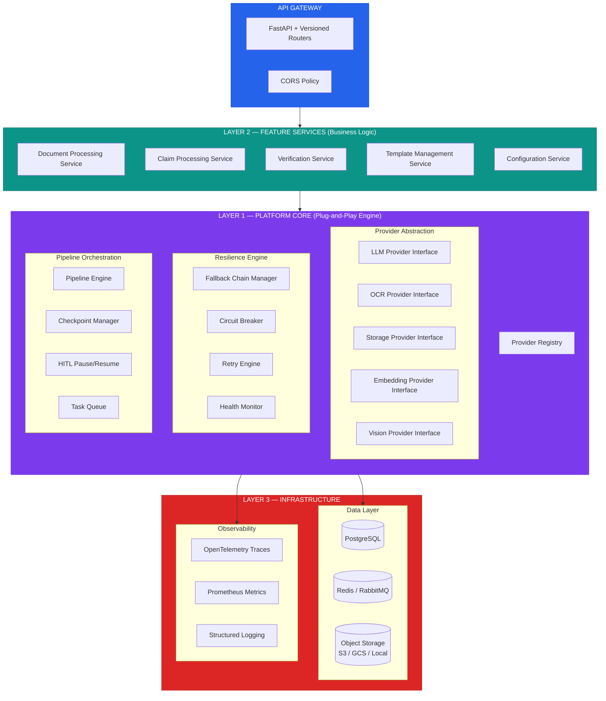
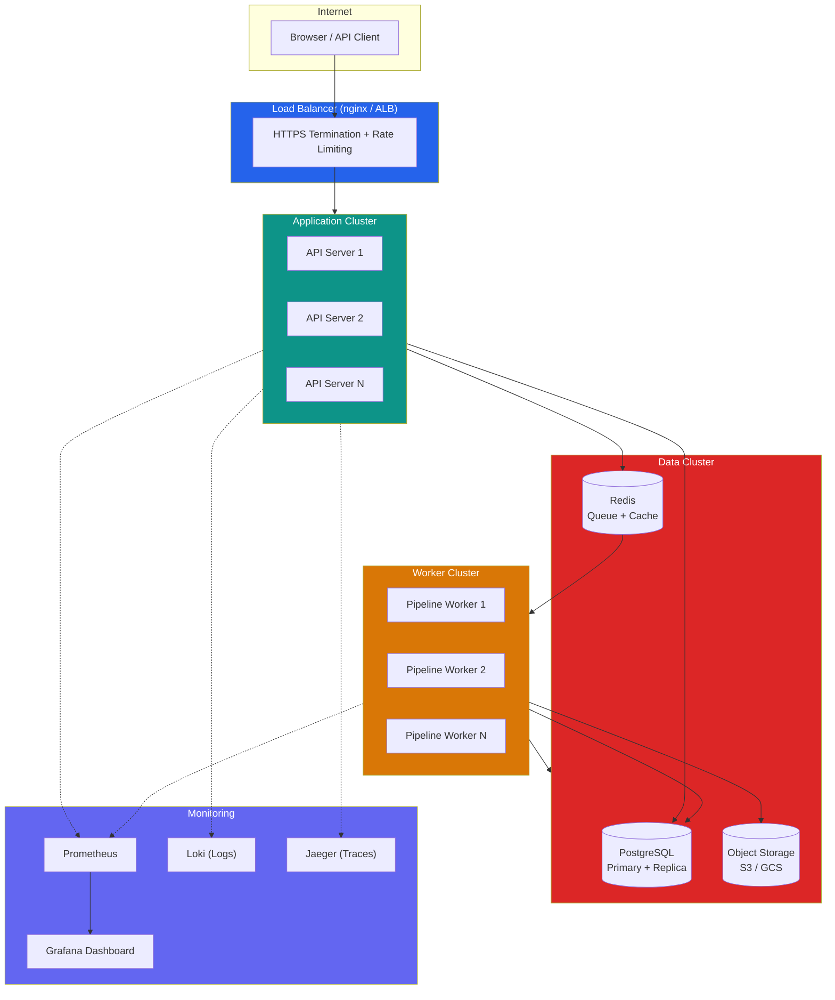
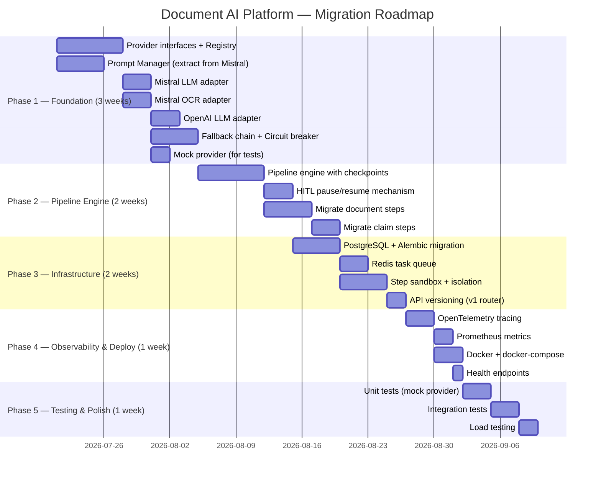

# Document AI Platform — Production-Grade Design Document

> **Goal**: Transform the current Mistral-coupled prototype into a **plug-and-play, model-agnostic platform** that any client can deploy with their own LLM, OCR, and infrastructure providers. This document serves as the **complete blueprint** — follow it to build a production backend from scratch.

---

## Table of Contents

1. [Design Principles](#1-design-principles)
2. [System Layers & Component Map](#2-system-layers--component-map)
3. [Layer 1 — Platform Core (Plug-and-Play Engine)](#3-layer-1--platform-core)
4. [Layer 2 — Feature Services (Business Logic)](#4-layer-2--feature-services)
5. [Layer 3 — Infrastructure & Data](#5-layer-3--infrastructure--data)
6. [Fallback & Resilience System](#6-fallback--resilience-system)
7. [Process & Service Isolation](#7-process--service-isolation)
8. [Directory Structure](#8-directory-structure)
9. [Configuration Schema](#9-configuration-schema)
10. [Interface Contracts](#10-interface-contracts)
11. [Deployment Topology](#11-deployment-topology)
12. [Implementation Roadmap](#12-implementation-roadmap)
13. [Current vs Target: File-by-File Migration Map](#13-migration-map)

---

## 1. Design Principles

| # | Principle | Meaning |
|---|-----------|---------|
| 1 | **Provider Agnostic** | Zero hardcoded references to any LLM, OCR, or cloud vendor. Every external service is behind an interface. |
| 2 | **Plug-and-Play** | Swap any provider by changing config — no code changes. Add new providers by implementing one interface. |
| 3 | **Fail-Safe by Default** | Every provider call has a fallback chain. If Provider A fails, Provider B takes over. If all fail, graceful degradation. |
| 4 | **Process Isolation** | Each pipeline step runs in an isolated context. A crash in one step cannot corrupt another. |
| 5 | **Observable** | Every operation emits structured traces, metrics, and logs. You can diagnose any failure from telemetry alone. |
| 6 | **Stateless & Durable** | API servers are stateless. All state lives in the database and queue. Server crashes don't lose work. |
| 7 | **Configuration-Driven** | The entire platform behavior is controlled by a single config file. No magic. No hidden defaults. |

---

## 2. System Layers & Component Map



> [!IMPORTANT]
> **Key insight**: Layer 2 (Feature Services) **never directly imports** any vendor SDK. It only calls Layer 1 interfaces. This is the fundamental decoupling that makes the system model-agnostic.

---

## 3. Layer 1 — Platform Core

This is the **engine** that any client configures. It provides services that Feature Services consume.

### 3.1 Provider Interfaces

Every external capability has exactly one abstract interface. Providers implement it.

```python
# platform/providers/interfaces.py

from abc import ABC, abstractmethod
from dataclasses import dataclass, field
from typing import Any, Optional
from enum import Enum

# ─── Unified Response Types ──────────────────────────────────

@dataclass
class LLMResponse:
    content: str
    tool_calls: list[dict] | None = None
    finish_reason: str = "stop"
    usage: dict = field(default_factory=dict)
    provider: str = ""              # Which provider served this
    latency_ms: float = 0.0        # How long it took
    raw_response: Any = None       # Original vendor response (for debugging)

@dataclass
class OCRResponse:
    raw_text: str
    confidence: float
    pages: list[dict]
    blocks: list[dict]             # Bounding boxes for citation
    word_confidences: list[dict]
    provider: str = ""

@dataclass 
class EmbeddingResponse:
    embeddings: list[list[float]]
    model: str = ""
    provider: str = ""

class ProviderStatus(Enum):
    HEALTHY = "healthy"
    DEGRADED = "degraded"
    DOWN = "down"

# ─── Abstract Interfaces ─────────────────────────────────────

class LLMProvider(ABC):
    """Interface for Language Model providers."""
    
    @abstractmethod
    async def chat(
        self,
        messages: list[dict],
        system_prompt: str = "",
        tools: list[dict] | None = None,
        temperature: float = 0.0,
        max_tokens: int = 4096,
        response_format: dict | None = None,
    ) -> LLMResponse:
        """Send a chat completion request."""
        ...

    @abstractmethod
    async def health_check(self) -> ProviderStatus:
        """Check if this provider is reachable and functional."""
        ...

    @property
    @abstractmethod
    def name(self) -> str:
        """Unique provider identifier (e.g. 'mistral', 'openai')."""
        ...

class OCRProvider(ABC):
    """Interface for OCR / document text extraction."""
    
    @abstractmethod
    async def extract(
        self,
        file_path: str,
        pages: list[int] | None = None,
        include_blocks: bool = True,
    ) -> OCRResponse:
        ...

    @abstractmethod
    async def health_check(self) -> ProviderStatus:
        ...

    @property
    @abstractmethod
    def name(self) -> str:
        ...

class StorageProvider(ABC):
    """Interface for file/object storage."""
    
    @abstractmethod
    async def save(self, data: bytes, key: str, metadata: dict = None) -> str:
        """Returns the storage key/path."""
        ...

    @abstractmethod
    async def get(self, key: str) -> bytes:
        ...

    @abstractmethod
    async def delete(self, key: str) -> None:
        ...

    @abstractmethod
    async def get_signed_url(self, key: str, expires_seconds: int = 3600) -> str:
        ...

class EmbeddingProvider(ABC):
    """Interface for vector embedding generation (e.g. signature matching)."""
    
    @abstractmethod
    async def embed(self, inputs: list[str] | list[bytes]) -> EmbeddingResponse:
        ...

class VisionProvider(ABC):
    """Interface for image analysis (e.g. face/signature comparison)."""
    
    @abstractmethod
    async def analyze(
        self,
        images: list[str],   # base64 or URLs
        prompt: str,
        response_format: dict | None = None,
    ) -> LLMResponse:
        ...
```

### 3.2 Provider Implementations

Each provider is a single file implementing the interface:

```
platform/providers/
├── interfaces.py         # Abstract base classes (above)
├── llm/
│   ├── mistral.py        # class MistralLLM(LLMProvider)
│   ├── openai.py         # class OpenAILLM(LLMProvider)
│   ├── anthropic.py      # class AnthropicLLM(LLMProvider)
│   ├── google.py         # class GoogleLLM(LLMProvider)
│   ├── ollama.py         # class OllamaLLM(LLMProvider) — local dev
│   └── mock.py           # class MockLLM(LLMProvider)   — testing
├── ocr/
│   ├── mistral_ocr.py    # class MistralOCR(OCRProvider)
│   ├── google_vision.py  # class GoogleVisionOCR(OCRProvider)
│   ├── tesseract.py      # class TesseractOCR(OCRProvider)
│   └── mock.py           # class MockOCR(OCRProvider)
├── storage/
│   ├── local.py          # class LocalStorage(StorageProvider)
│   ├── s3.py             # class S3Storage(StorageProvider)
│   ├── gcs.py            # class GCSStorage(StorageProvider)
│   └── azure_blob.py     # class AzureBlobStorage(StorageProvider)
├── embedding/
│   ├── dinov2.py         # class DINOv2Embedding(EmbeddingProvider)
│   ├── openai.py         # class OpenAIEmbedding(EmbeddingProvider)
│   └── sentence_tf.py    # class SentenceTransformerEmbedding(EmbeddingProvider)
└── vision/
    ├── mistral_vision.py # class MistralVision(VisionProvider)
    ├── openai_vision.py  # class OpenAIVision(VisionProvider)
    └── google_vision.py  # class GoogleVision(VisionProvider)
```

#### Mistral LLM Provider

> Derived from the current pattern in [classifier.py](file:///c:/Users/MrHarshGurjar/Desktop/code/Document-Ai/backend-v2/activities/classifier.py), [reviewer.py](file:///c:/Users/MrHarshGurjar/Desktop/code/Document-Ai/backend-v2/activities/reviewer.py), and all other activity files that call `client.agents.complete_async()`.

```python
# platform/providers/llm/mistral.py

import time
import logging
from mistralai.client import Mistral
from platform.providers.interfaces import LLMProvider, LLMResponse, ProviderStatus

logger = logging.getLogger(__name__)

class MistralLLM(LLMProvider):
    """
    Mistral AI LLM provider.
    
    Replaces the current pattern where every activity does:
        client = Mistral(api_key=settings.MISTRAL_API_KEY)
        response = await client.agents.complete_async(agent_id=..., messages=..., tools=...)
    
    With the new pattern, activities use the provider interface instead:
        llm = registry.get_llm_chain("classifier")
        response = await llm.call(messages=..., system_prompt=..., tools=...)
    
    Key difference: Instead of Mistral Agent IDs (pre-configured on Mistral Studio),
    we use local system prompts loaded from platform/prompts/*.md files.
    """
    
    def __init__(self, api_key: str, model: str = "mistral-large-latest"):
        self._client = Mistral(api_key=api_key)
        self._model = model

    @property
    def name(self) -> str:
        return "mistral"

    async def chat(
        self,
        messages: list[dict],
        system_prompt: str = "",
        tools: list[dict] | None = None,
        temperature: float = 0.0,
        max_tokens: int = 4096,
        response_format: dict | None = None,
    ) -> LLMResponse:
        """
        Send a chat completion request to Mistral.
        
        This maps the current codebase pattern:
            # BEFORE (activities/classifier.py line 53-57):
            response = await client.agents.complete_async(
                agent_id=settings.CLASSIFIER_AGENT_ID,
                messages=messages, tools=tools
            )
        
        To the new provider-agnostic call:
            # AFTER:
            response = await mistral_llm.chat(
                messages=messages,
                system_prompt=prompts.get("classifier"),
                tools=CLASSIFIER_TOOLS,
            )
        """
        # Prepend system prompt (replaces Mistral Agent's baked-in system prompt)
        if system_prompt:
            messages = [{"role": "system", "content": system_prompt}] + messages
        
        kwargs = {
            "model": self._model,
            "messages": messages,
            "temperature": temperature,
            "max_tokens": max_tokens,
        }
        if tools:
            kwargs["tools"] = tools
        if response_format:
            kwargs["response_format"] = response_format
        
        start = time.monotonic()
        resp = await self._client.chat.complete_async(**kwargs)
        elapsed = (time.monotonic() - start) * 1000
        
        choice = resp.choices[0]
        
        # Normalize tool_calls to a provider-agnostic format.
        # Current code (activities/classifier.py lines 65-77) does this inline:
        #   {"id": tc.id, "type": "function", "function": {"name": ..., "arguments": ...}}
        # We standardize this inside the provider.
        tool_calls = None
        if choice.message.tool_calls:
            tool_calls = [
                {
                    "id": tc.id,
                    "function": {
                        "name": tc.function.name,
                        "arguments": tc.function.arguments,
                    },
                }
                for tc in choice.message.tool_calls
            ]
        
        return LLMResponse(
            content=choice.message.content or "",
            tool_calls=tool_calls,
            finish_reason=choice.finish_reason or "stop",
            usage={
                "prompt_tokens": getattr(resp.usage, "prompt_tokens", 0),
                "completion_tokens": getattr(resp.usage, "completion_tokens", 0),
                "total_tokens": getattr(resp.usage, "total_tokens", 0),
            },
            provider="mistral",
            latency_ms=elapsed,
            raw_response=resp,
        )

    async def health_check(self) -> ProviderStatus:
        """Ping Mistral with a minimal request to verify connectivity."""
        try:
            await self._client.chat.complete_async(
                model=self._model,
                messages=[{"role": "user", "content": "ping"}],
                max_tokens=1,
            )
            return ProviderStatus.HEALTHY
        except Exception as e:
            logger.warning(f"[MistralLLM] Health check failed: {e}")
            return ProviderStatus.DOWN
```

#### Mistral OCR Provider

> Derived from the current implementation in [ocr.py](file:///c:/Users/MrHarshGurjar/Desktop/code/Document-Ai/backend-v2/utils/ocr.py) which calls `client.ocr.process()` with `model="mistral-ocr-latest"`.

```python
# platform/providers/ocr/mistral_ocr.py

import os
import time
import logging
from mistralai.client import Mistral
from platform.providers.interfaces import OCRProvider, OCRResponse, ProviderStatus
from utils.file_handler import get_file_as_base64

logger = logging.getLogger(__name__)

class MistralOCR(OCRProvider):
    """
    Mistral OCR provider.
    
    Replaces the current pattern in utils/ocr.py (lines 69-90):
        ocr_args = {
            "model": "mistral-ocr-latest",
            "document": {"type": "document_url", "document_url": document_url},
            "confidence_scores_granularity": "word",
            "include_blocks": True,
        }
        ocr_response = client.ocr.process(**ocr_args)
    
    DOCX files are handled upstream before reaching the provider (pure text
    extraction, no OCR needed). This provider handles PDF and image files only.
    """
    
    def __init__(self, api_key: str, model: str = "mistral-ocr-latest"):
        self._client = Mistral(api_key=api_key)
        self._model = model

    @property
    def name(self) -> str:
        return "mistral_ocr"

    async def extract(
        self,
        file_path: str,
        pages: list[int] | None = None,
        include_blocks: bool = True,
    ) -> OCRResponse:
        """
        Extract text from a document using Mistral OCR.
        
        Directly maps the current utils/ocr.py logic:
        - Reads file as base64
        - Builds data URL with correct MIME type
        - Calls Mistral OCR with confidence scoring + bounding blocks
        - Parses pages, word confidences, and block coordinates
        """
        _, ext = os.path.splitext(file_path.lower())
        
        # Determine MIME type (current code: utils/ocr.py lines 43-49)
        mime_map = {
            ".pdf": "application/pdf",
            ".jpeg": "image/jpeg", ".jpg": "image/jpeg",
            ".png": "image/png",
            ".webp": "image/webp",
        }
        mime_type = mime_map.get(ext, "application/pdf")
        
        base64_data = get_file_as_base64(file_path)
        document_url = f"data:{mime_type};base64,{base64_data}"
        
        # Validate page range for PDFs (current code: utils/ocr.py lines 56-67)
        actual_pages = pages
        if ext == ".pdf" and pages is not None:
            try:
                import pypdf
                reader = pypdf.PdfReader(file_path)
                total_pages = len(reader.pages)
                actual_pages = [p for p in pages if 0 <= p < total_pages]
                if not actual_pages:
                    actual_pages = [0]
            except Exception:
                actual_pages = pages
        
        # Build OCR arguments (current code: utils/ocr.py lines 70-87)
        ocr_args = {
            "model": self._model,
            "document": {"type": "document_url", "document_url": document_url},
            "confidence_scores_granularity": "word",
            "include_blocks": include_blocks,
        }
        if actual_pages is not None:
            ocr_args["pages"] = actual_pages
        
        start = time.monotonic()
        ocr_response = self._client.ocr.process(**ocr_args)
        elapsed = (time.monotonic() - start) * 1000
        logger.info(f"[MistralOCR] Extracted text in {elapsed:.0f}ms")
        
        # Parse response (current code: utils/ocr.py lines 100-145)
        raw_text = ""
        pages_list = []
        total_confidence = 0.0
        valid_pages_count = 0
        all_word_confidences = []
        all_blocks = []
        
        for page in ocr_response.pages:
            page_index = getattr(page, "index", 0)
            raw_text += page.markdown + "\n\n"
            pages_list.append({"markdown": page.markdown, "index": page_index})
            
            # Confidence scores
            if hasattr(page, "confidence_scores") and page.confidence_scores:
                if hasattr(page.confidence_scores, "average_page_confidence_score"):
                    total_confidence += page.confidence_scores.average_page_confidence_score
                    valid_pages_count += 1
                if getattr(page.confidence_scores, "word_confidence_scores", None):
                    for w in page.confidence_scores.word_confidence_scores:
                        all_word_confidences.append({
                            "text": w.text,
                            "confidence": w.confidence,
                            "start_index": w.start_index,
                        })
            
            # Bounding box blocks for citation highlighting
            dims = getattr(page, "dimensions", None)
            page_w = getattr(dims, "width", None)
            page_h = getattr(dims, "height", None)
            for block in getattr(page, "blocks", []) or []:
                b_type = getattr(block, "type", "text")
                if b_type == "image":
                    continue
                top_left_x = getattr(block, "top_left_x", None)
                bottom_right_x = getattr(block, "bottom_right_x", None)
                if top_left_x is None or bottom_right_x is None:
                    continue
                all_blocks.append({
                    "page": page_index,
                    "content": getattr(block, "content", "") or "",
                    "type": b_type,
                    "top_left_x": top_left_x,
                    "top_left_y": getattr(block, "top_left_y", None),
                    "bottom_right_x": bottom_right_x,
                    "bottom_right_y": getattr(block, "bottom_right_y", None),
                    "page_width": page_w,
                    "page_height": page_h,
                })
        
        avg_confidence = (total_confidence / valid_pages_count) if valid_pages_count > 0 else 0.0
        
        return OCRResponse(
            raw_text=raw_text.strip(),
            confidence=avg_confidence,
            pages=pages_list,
            blocks=all_blocks,
            word_confidences=all_word_confidences,
            provider="mistral_ocr",
        )

    async def health_check(self) -> ProviderStatus:
        try:
            # Minimal OCR call with a tiny test image is expensive;
            # instead verify the API key is valid via a chat ping.
            await self._client.chat.complete_async(
                model="mistral-small-latest",
                messages=[{"role": "user", "content": "ping"}],
                max_tokens=1,
            )
            return ProviderStatus.HEALTHY
        except Exception:
            return ProviderStatus.DOWN
```

#### Mistral Vision Provider

> Derived from the current implementation in [signature_verifier.py](file:///c:/Users/MrHarshGurjar/Desktop/code/Document-Ai/backend-v2/utils/signature_verifier.py) which uses `client.beta.conversations.start_async()` with multimodal image inputs for signature and face comparison.

```python
# platform/providers/vision/mistral_vision.py

import json
import time
import logging
import mimetypes
import base64
from mistralai.client import Mistral
from platform.providers.interfaces import VisionProvider, LLMResponse, ProviderStatus

logger = logging.getLogger(__name__)

class MistralVision(VisionProvider):
    """
    Mistral Vision provider for image analysis tasks.
    
    Replaces the current pattern in utils/signature_verifier.py (lines 196-254):
        response = await client.beta.conversations.start_async(
            agent_id=settings.SIGNATURE_VISION_AGENT_ID,
            inputs=[{"role": "user", "content": [
                {"type": "text", "text": "Compare these two signatures:"},
                {"type": "image_url", "image_url": {"url": f"data:{mime};base64,{b64}"}},
            ]}],
        )
    
    The new provider uses chat.complete_async with pixtral (vision model)
    and a system prompt instead of a Mistral Agent ID.
    """
    
    def __init__(self, api_key: str, model: str = "pixtral-large-latest"):
        self._client = Mistral(api_key=api_key)
        self._model = model

    @property
    def name(self) -> str:
        return "mistral_vision"

    async def analyze(
        self,
        images: list[str],
        prompt: str,
        response_format: dict | None = None,
    ) -> LLMResponse:
        """
        Analyze one or more images with a text prompt.
        
        images: list of base64 strings or file paths.
        
        Maps the current multimodal input pattern from signature_verifier.py:
            content = [
                {"type": "text", "text": "Compare these two signatures:"},
                {"type": "image_url", "image_url": {"url": f"data:{mime};base64,{b64}"}},
                {"type": "image_url", "image_url": {"url": f"data:{mime};base64,{b64}"}},
            ]
        """
        content_parts = [{"type": "text", "text": prompt}]
        
        for img in images:
            # If it's a file path, encode it
            if img.startswith("/") or img.startswith("C:") or img.startswith("c:"):
                mime, _ = mimetypes.guess_type(img)
                if mime is None:
                    mime = "image/png"
                with open(img, "rb") as f:
                    b64_data = base64.b64encode(f.read()).decode()
                url = f"data:{mime};base64,{b64_data}"
            elif img.startswith("data:"):
                url = img  # Already a data URL
            else:
                url = f"data:image/png;base64,{img}"  # Raw base64
            
            content_parts.append({
                "type": "image_url",
                "image_url": {"url": url},
            })
        
        messages = [{"role": "user", "content": content_parts}]
        
        kwargs = {
            "model": self._model,
            "messages": messages,
            "temperature": 0.0,
        }
        if response_format:
            kwargs["response_format"] = response_format
        
        start = time.monotonic()
        resp = await self._client.chat.complete_async(**kwargs)
        elapsed = (time.monotonic() - start) * 1000
        
        choice = resp.choices[0]
        raw_text = choice.message.content or ""
        
        return LLMResponse(
            content=raw_text,
            tool_calls=None,
            finish_reason=choice.finish_reason or "stop",
            usage={
                "prompt_tokens": getattr(resp.usage, "prompt_tokens", 0),
                "completion_tokens": getattr(resp.usage, "completion_tokens", 0),
                "total_tokens": getattr(resp.usage, "total_tokens", 0),
            },
            provider="mistral_vision",
            latency_ms=elapsed,
            raw_response=resp,
        )

    async def health_check(self) -> ProviderStatus:
        try:
            await self._client.chat.complete_async(
                model=self._model,
                messages=[{"role": "user", "content": "ping"}],
                max_tokens=1,
            )
            return ProviderStatus.HEALTHY
        except Exception:
            return ProviderStatus.DOWN
```

#### Current Code → Provider Mapping Reference

| Current File | Current Call | New Provider | Method |
|---|---|---|---|
| `activities/classifier.py:53` | `client.agents.complete_async(agent_id=..., messages=..., tools=...)` | `MistralLLM` | `.chat(messages, system_prompt, tools)` |
| `activities/extractor.py:18` | `client = Mistral(api_key=...)` then `client.agents.complete_async(...)` | `MistralLLM` | `.chat(...)` |
| `activities/validator.py` | `client.agents.complete_async(...)` | `MistralLLM` | `.chat(...)` |
| `activities/reviewer.py:10` | `client.agents.complete_async(...)` | `MistralLLM` | `.chat(...)` |
| `activities/fraud_checker.py:10` | `client.agents.complete_async(...)` | `MistralLLM` | `.chat(...)` |
| `activities/intake.py` | `client.agents.complete_async(...)` | `MistralLLM` | `.chat(...)` |
| `activities/pre_validator.py` | `client.agents.complete_async(...)` | `MistralLLM` | `.chat(...)` |
| `activities/preprocessor.py` | `client.agents.complete_async(...)` | `MistralLLM` | `.chat(...)` |
| `activities/auto_verifier.py:20` | `client.agents.complete_async(...)` | `MistralLLM` | `.chat(...)` |
| `activities/output.py` | `client.agents.complete_async(...)` | `MistralLLM` | `.chat(...)` |
| `activities/claim_*.py` (5 files) | `client.agents.complete_async(...)` | `MistralLLM` | `.chat(...)` |
| `utils/ocr.py:90` | `client.ocr.process(model="mistral-ocr-latest", ...)` | `MistralOCR` | `.extract(file_path, pages)` |
| `utils/signature_verifier.py:226` | `client.beta.conversations.start_async(agent_id=..., inputs=[images])` | `MistralVision` | `.analyze(images, prompt)` |
| `utils/signature_verifier.py:275` | `client.beta.conversations.start_async(agent_id=..., inputs=text)` | `MistralLLM` | `.chat(messages, system_prompt)` |

### 3.3 Provider Registry

Central registry that manages provider lifecycles and configuration:

```python
# platform/registry.py

class ProviderRegistry:
    """
    Singleton registry that holds all configured providers.
    Initialized from config at startup.
    """
    _instance = None
    
    def __init__(self):
        self._llm_providers: dict[str, LLMProvider] = {}
        self._ocr_providers: dict[str, OCRProvider] = {}
        self._storage_providers: dict[str, StorageProvider] = {}
        self._embedding_providers: dict[str, EmbeddingProvider] = {}
        self._vision_providers: dict[str, VisionProvider] = {}
        self._fallback_chains: dict[str, list[str]] = {}
    
    @classmethod
    def get(cls) -> "ProviderRegistry":
        if cls._instance is None:
            cls._instance = cls()
        return cls._instance
    
    def register_llm(self, name: str, provider: LLMProvider):
        self._llm_providers[name] = provider
    
    def get_llm(self, name: str = None) -> LLMProvider:
        """Get a specific LLM provider by name, or the default."""
        name = name or self._default_llm
        if name not in self._llm_providers:
            raise ProviderNotFoundError(f"LLM provider '{name}' not registered")
        return self._llm_providers[name]
    
    def get_llm_chain(self, purpose: str) -> "FallbackChain[LLMProvider]":
        """Get the fallback chain for a specific purpose (e.g., 'classifier')."""
        chain_names = self._fallback_chains.get(f"llm.{purpose}", 
                       self._fallback_chains.get("llm.default", []))
        providers = [self._llm_providers[n] for n in chain_names if n in self._llm_providers]
        return FallbackChain(providers, purpose=purpose)
    
    # ... same pattern for OCR, storage, embedding, vision
    
    @classmethod
    def from_config(cls, config: dict) -> "ProviderRegistry":
        """Build registry from the platform config file."""
        registry = cls()
        
        # Register LLM providers
        for name, conf in config.get("providers", {}).get("llm", {}).items():
            provider_cls = PROVIDER_CLASSES["llm"][conf["type"]]
            registry.register_llm(name, provider_cls(**conf.get("params", {})))
        
        # Register fallback chains
        for key, chain in config.get("fallback_chains", {}).items():
            registry._fallback_chains[key] = chain
        
        return registry
```

### 3.4 Prompt Manager (Replaces Agent IDs)

Instead of hardcoded Mistral Agent IDs, system prompts are stored as local files:

```
platform/prompts/
├── classifier.md          # System prompt for classification
├── extractor.md           # System prompt for extraction
├── validator.md           # System prompt for validation
├── reviewer.md            # System prompt for review
├── fraud_checker.md       # System prompt for fraud checking
├── pre_validator.md       # System prompt for pre-validation
├── preprocessor.md        # System prompt for preprocessing
├── output.md              # System prompt for output formatting
├── auto_verifier.md       # System prompt for auto-verification
├── intake.md              # System prompt for intake
├── claim_integrity.md     # System prompt for claim integrity
├── claim_medical.md       # System prompt for claim medical
├── claim_treatment.md     # System prompt for claim treatment
├── claim_disability.md    # System prompt for claim disability
├── claim_litigation.md    # System prompt for claim litigation
└── claim_report.md        # System prompt for claim report
```

```python
# platform/prompts/manager.py

class PromptManager:
    """Loads and caches system prompts from the prompts/ directory."""
    
    def __init__(self, prompts_dir: str = "platform/prompts"):
        self._dir = prompts_dir
        self._cache: dict[str, str] = {}
    
    def get(self, agent_name: str) -> str:
        """Load the system prompt for a given agent by name."""
        if agent_name not in self._cache:
            path = os.path.join(self._dir, f"{agent_name}.md")
            if not os.path.exists(path):
                raise FileNotFoundError(f"Prompt file not found: {path}")
            with open(path) as f:
                self._cache[agent_name] = f.read()
        return self._cache[agent_name]
    
    def reload(self):
        """Clear the cache — useful after editing prompts in production."""
        self._cache.clear()
```

### 3.5 Pipeline Engine (Replaces Mistral Workflows)

Self-hosted, durable, restartable pipeline that replaces the Mistral Workflow SDK:

```python
# platform/pipeline/engine.py

class PipelineEngine:
    """
    Durable pipeline engine with checkpoint/resume support.
    Replaces mistralai.workflows entirely.
    """
    
    def __init__(self, db, queue, registry: ProviderRegistry):
        self._db = db
        self._queue = queue
        self._registry = registry
        self._step_registry: dict[str, Callable] = {}
    
    def register_step(self, name: str, handler: Callable):
        """Register a pipeline step handler."""
        self._step_registry[name] = handler
    
    async def run(self, pipeline_name: str, document_id: str, 
                  context: dict, resume_from: str = None) -> dict:
        """Execute a pipeline from the beginning or resume from a checkpoint."""
        pipeline_def = self._get_pipeline(pipeline_name)
        steps = pipeline_def["steps"]
        
        start_idx = 0
        if resume_from:
            start_idx = next(i for i, s in enumerate(steps) if s["name"] == resume_from)
            context = await self._load_checkpoint(document_id)
        
        for step in steps[start_idx:]:
            step_name = step["name"]
            
            # Save checkpoint BEFORE execution (crash-safe)
            await self._save_checkpoint(document_id, step_name, context)
            
            try:
                handler = self._step_registry[step_name]
                result = await self._execute_with_isolation(
                    handler, document_id, context, step
                )
            except Exception as e:
                await self._handle_step_failure(document_id, step_name, e, step)
                if step.get("required", True):
                    raise
                continue  # Optional step — skip on failure
            
            # Check for pause (HITL)
            if result.get("_paused"):
                await self._save_pause_state(document_id, step_name, context)
                return {"status": "paused", "paused_at": step_name, 
                        "reason": result.get("_pause_reason")}
            
            # Check for rejection
            if result.get("_rejected"):
                return {"status": "rejected", "reason": result["_reject_reason"]}
            
            # Merge result into context for next step
            context[step_name] = result
        
        return {"status": "completed", "context": context}
    
    async def resume(self, document_id: str, user_input: dict) -> dict:
        """Resume a paused pipeline with user input."""
        pause_state = await self._load_pause_state(document_id)
        context = pause_state["context"]
        context["_user_input"] = user_input
        return await self.run(
            pause_state["pipeline"], document_id, context,
            resume_from=pause_state["next_step"]
        )
    
    async def _execute_with_isolation(self, handler, doc_id, context, step_def):
        """Execute a step with timeout, resource limits, and error boundaries."""
        timeout = step_def.get("timeout_seconds", 300)
        
        async with asyncio.timeout(timeout):
            # Each step gets a scoped context — it cannot see other steps' internals
            scoped_ctx = {
                "document_id": doc_id,
                "file_path": context.get("file_path"),
                "doc_type": context.get("classify", {}).get("doc_type"),
                # Only pass what the step needs (declared in step_def)
                **{k: context.get(k) for k in step_def.get("inputs", [])}
            }
            return await handler(scoped_ctx)
```

---

## 4. Layer 2 — Feature Services

Feature Services contain the **business logic**. They consume Platform Core interfaces and know nothing about specific providers.

### 4.1 Activity Pattern (Before → After)

**Before (Current — Hardcoded Mistral):**
```python
from mistralai.client import Mistral
client = Mistral(api_key=settings.MISTRAL_API_KEY)

response = await client.agents.complete_async(
    agent_id=settings.CLASSIFIER_AGENT_ID,
    messages=messages, tools=tools
)
```

**After (Provider-Agnostic):**
```python
from platform.registry import ProviderRegistry
from platform.prompts.manager import PromptManager

registry = ProviderRegistry.get()
prompts = PromptManager()

async def classify(context: dict) -> dict:
    llm = registry.get_llm_chain("classifier")  # Gets fallback chain
    system_prompt = prompts.get("classifier")
    
    response = await llm.call(
        messages=[{"role": "user", "content": f"Classify: {context['text']}"}],
        system_prompt=system_prompt,
        tools=CLASSIFIER_TOOLS,
    )
    return {"doc_type": parse_classification(response)}
```

### 4.2 Service Structure

```
services/
├── document/
│   ├── __init__.py
│   ├── service.py          # DocumentProcessingService class
│   ├── steps/              # Individual pipeline step handlers
│   │   ├── intake.py
│   │   ├── pre_validate.py
│   │   ├── preprocess.py
│   │   ├── classify.py
│   │   ├── fraud_check.py
│   │   ├── extract.py
│   │   ├── validate.py
│   │   ├── auto_verify.py
│   │   ├── review.py
│   │   └── output.py
│   └── tools/              # Pure functions (no provider imports)
│       ├── classifier_tools.py
│       ├── extractor_tools.py
│       ├── validator_tools.py
│       └── ...
├── claims/
│   ├── service.py          # ClaimProcessingService class
│   └── steps/
│       ├── integrity.py
│       ├── medical.py
│       ├── treatment.py
│       ├── disability.py
│       ├── litigation.py
│       └── report.py
├── verification/
│   ├── service.py          # SignatureVerificationService
│   ├── signature.py
│   └── face.py
└── templates/
    ├── service.py           # TemplateManagementService
    └── generator.py
```

### 4.3 Example: Document Processing Service

```python
# services/document/service.py

class DocumentProcessingService:
    """
    Registers all document processing steps with the pipeline engine.
    Each step is a standalone function that uses Platform Core interfaces.
    """
    
    def __init__(self, pipeline: PipelineEngine, registry: ProviderRegistry):
        self._pipeline = pipeline
        self._registry = registry
        self._register_steps()
    
    def _register_steps(self):
        from services.document.steps import (
            intake, pre_validate, preprocess, classify,
            fraud_check, extract, validate, auto_verify, review, output
        )
        self._pipeline.register_step("intake", intake.run)
        self._pipeline.register_step("pre_validate", pre_validate.run)
        self._pipeline.register_step("preprocess", preprocess.run)
        self._pipeline.register_step("classify", classify.run)
        self._pipeline.register_step("fraud_check", fraud_check.run)
        self._pipeline.register_step("extract", extract.run)
        self._pipeline.register_step("validate", validate.run)
        self._pipeline.register_step("auto_verify", auto_verify.run)
        self._pipeline.register_step("review", review.run)
        self._pipeline.register_step("output", output.run)
    
    PIPELINE_DEFINITION = {
        "name": "document_processing",
        "steps": [
            {"name": "intake", "required": True, "timeout_seconds": 30,
             "pause_on": "duplicate_detected"},
            {"name": "pre_validate", "required": False, "timeout_seconds": 60,
             "enabled_if": "config.enable_pre_validation"},
            {"name": "preprocess", "required": False, "timeout_seconds": 120,
             "enabled_if": "config.enable_preprocessing"},
            {"name": "classify", "required": True, "timeout_seconds": 120,
             "inputs": ["file_path"]},
            {"name": "fraud_check", "required": False, "timeout_seconds": 120,
             "enabled_if": "context.classify.is_kyc"},
            {"name": "extract", "required": True, "timeout_seconds": 300,
             "inputs": ["file_path", "classify"]},
            {"name": "validate", "required": True, "timeout_seconds": 120,
             "inputs": ["extract"]},
            {"name": "auto_verify", "required": False, "timeout_seconds": 180,
             "enabled_if": "context.classify.is_kyc"},
            {"name": "review", "required": True, "timeout_seconds": 60,
             "pause_on": "low_confidence"},
            {"name": "output", "required": True, "timeout_seconds": 30},
        ]
    }
```

### 4.4 Example: Classifier Step (Provider-Agnostic)

```python
# services/document/steps/classify.py

from platform.registry import ProviderRegistry
from platform.prompts.manager import PromptManager
from services.document.tools.classifier_tools import CLASSIFIER_TOOLS, dispatch_tool

async def run(context: dict) -> dict:
    """
    Step 3 — Document Classification.
    Uses the LLM fallback chain for 'classifier' purpose.
    """
    registry = ProviderRegistry.get()
    prompts = PromptManager()
    
    # Get the fallback chain — if Mistral fails, tries OpenAI, then Anthropic
    llm_chain = registry.get_llm_chain("classifier")
    ocr = registry.get_ocr_chain("default")
    
    # Extract text using OCR provider chain
    ocr_result = await ocr.call(file_path=context["file_path"])
    
    # Classify using LLM provider chain
    system_prompt = prompts.get("classifier")
    messages = [{"role": "user", "content": f"Classify this document:\n\n{ocr_result.raw_text[:4000]}"}]
    
    response = await llm_chain.call(
        messages=messages,
        system_prompt=system_prompt,
        tools=CLASSIFIER_TOOLS,
    )
    
    # Parse the classification result
    doc_type = parse_classification_response(response)
    
    return {
        "doc_type": doc_type,
        "is_kyc": doc_type in KYC_DOCUMENT_TYPES,
        "ocr_text": ocr_result.raw_text,
        "ocr_confidence": ocr_result.confidence,
        "provider_used": response.provider,
    }
```

---

## 5. Layer 3 — Infrastructure & Data

### 5.1 Database (PostgreSQL + Alembic)

```python
# infrastructure/database/engine.py
from sqlalchemy.ext.asyncio import create_async_engine, async_sessionmaker

engine = create_async_engine(
    settings.DATABASE_URL,            # postgresql+asyncpg://...
    pool_size=20,
    max_overflow=10,
    pool_pre_ping=True,               # Auto-reconnect stale connections
    pool_recycle=3600,                 # Recycle connections every hour
    echo=settings.DEBUG,
)
```

### 5.2 Task Queue (Redis-backed)

```python
# infrastructure/queue/task_queue.py
import redis.asyncio as redis

class TaskQueue:
    """Durable task queue for async pipeline execution."""
    
    async def enqueue(self, pipeline: str, document_id: str, context: dict):
        """Enqueue a pipeline run. Survives server restarts."""
        ...
    
    async def dequeue(self) -> dict:
        """Worker picks up next task."""
        ...
    
    async def dead_letter(self, task_id: str, error: str):
        """Move permanently failed tasks to DLQ for manual inspection."""
        ...
```

---

## 6. Fallback & Resilience System

> [!IMPORTANT]
> This is the core of "when user change the provider our system doesn't fail." Every external call goes through a `FallbackChain` that tries providers in order, with circuit breakers preventing cascade failures.

### 6.1 Fallback Chain

```python
# platform/resilience/fallback.py

class FallbackChain[T]:
    """
    Wraps multiple providers of the same type.
    Tries them in order until one succeeds.
    """
    
    def __init__(self, providers: list[T], purpose: str = "default"):
        self._providers = providers
        self._purpose = purpose
        self._circuit_breakers = {p.name: CircuitBreaker(p.name) for p in providers}
    
    async def call(self, **kwargs) -> Any:
        """
        Try each provider in the chain.
        Skip providers whose circuit breaker is open.
        """
        errors = []
        
        for provider in self._providers:
            cb = self._circuit_breakers[provider.name]
            
            if cb.is_open:
                logger.warning(f"[Fallback] Skipping {provider.name} — circuit breaker OPEN")
                continue
            
            try:
                result = await cb.execute(provider, **kwargs)
                
                # Record success metric
                metrics.provider_call_success(self._purpose, provider.name)
                return result
                
            except Exception as e:
                errors.append((provider.name, str(e)))
                logger.error(
                    f"[Fallback] {provider.name} failed for '{self._purpose}': {e}. "
                    f"Trying next provider..."
                )
                metrics.provider_call_failure(self._purpose, provider.name)
                continue
        
        # ALL providers failed
        raise AllProvidersFailedError(
            f"All providers failed for '{self._purpose}'",
            errors=errors
        )
```

### 6.2 Circuit Breaker

```python
# platform/resilience/circuit_breaker.py

class CircuitBreaker:
    """
    Prevents cascade failures by short-circuiting calls to unhealthy providers.
    
    States:
      CLOSED  → Normal operation, calls pass through
      OPEN    → Provider is down, calls immediately fail (skip to next in chain)
      HALF_OPEN → Testing if provider recovered (allows 1 probe call)
    
    Transitions:
      CLOSED → OPEN:    After `failure_threshold` consecutive failures
      OPEN → HALF_OPEN: After `recovery_timeout` seconds
      HALF_OPEN → CLOSED: If probe call succeeds
      HALF_OPEN → OPEN:   If probe call fails
    """
    
    def __init__(self, provider_name: str, failure_threshold: int = 5,
                 recovery_timeout: int = 60):
        self.provider_name = provider_name
        self.failure_threshold = failure_threshold
        self.recovery_timeout = recovery_timeout
        self.state = CircuitState.CLOSED
        self.failure_count = 0
        self.last_failure_time = None
    
    @property
    def is_open(self) -> bool:
        if self.state == CircuitState.OPEN:
            if time.time() - self.last_failure_time > self.recovery_timeout:
                self.state = CircuitState.HALF_OPEN
                return False
            return True
        return False
    
    async def execute(self, provider, **kwargs):
        try:
            # Use the correct method based on provider type
            if hasattr(provider, 'chat'):
                result = await provider.chat(**kwargs)
            elif hasattr(provider, 'extract'):
                result = await provider.extract(**kwargs)
            else:
                raise ValueError(f"Unknown provider method")
            
            self._on_success()
            return result
        except Exception as e:
            self._on_failure()
            raise
    
    def _on_success(self):
        self.failure_count = 0
        self.state = CircuitState.CLOSED
    
    def _on_failure(self):
        self.failure_count += 1
        self.last_failure_time = time.time()
        if self.failure_count >= self.failure_threshold:
            self.state = CircuitState.OPEN
            logger.critical(
                f"[CircuitBreaker] {self.provider_name} circuit OPENED "
                f"after {self.failure_count} consecutive failures"
            )
```

### 6.3 Retry Engine

```python
# platform/resilience/retry.py

class RetryPolicy:
    """Configurable retry with exponential backoff + jitter."""
    
    def __init__(self, max_retries: int = 3, base_delay: float = 1.0,
                 max_delay: float = 30.0, retryable_errors: tuple = None):
        self.max_retries = max_retries
        self.base_delay = base_delay
        self.max_delay = max_delay
        self.retryable_errors = retryable_errors or (
            ConnectionError, TimeoutError, 
            # Add provider-specific transient errors
        )
    
    async def execute(self, func, *args, **kwargs):
        last_error = None
        for attempt in range(self.max_retries + 1):
            try:
                return await func(*args, **kwargs)
            except self.retryable_errors as e:
                last_error = e
                if attempt < self.max_retries:
                    delay = min(self.base_delay * (2 ** attempt) + random.uniform(0, 1),
                               self.max_delay)
                    logger.warning(f"[Retry] Attempt {attempt+1} failed: {e}. Retrying in {delay:.1f}s")
                    await asyncio.sleep(delay)
        raise last_error
```

### 6.4 Health Monitor

```python
# platform/resilience/health.py

class HealthMonitor:
    """
    Background task that periodically checks all providers.
    Updates circuit breaker states proactively.
    """
    
    async def run_checks(self):
        """Run health checks on all registered providers."""
        registry = ProviderRegistry.get()
        
        results = {}
        for name, provider in registry.all_providers():
            status = await provider.health_check()
            results[name] = {
                "status": status.value,
                "checked_at": datetime.utcnow().isoformat(),
            }
            
            # Proactively open circuit breaker if provider is down
            if status == ProviderStatus.DOWN:
                cb = registry.get_circuit_breaker(name)
                cb.force_open()
        
        return results
```

---

## 7. Process & Service Isolation

### 7.1 Execution Sandbox

Each pipeline step runs in an **isolated execution context** with its own:
- Scoped configuration (only sees what it needs)
- Scoped secrets (classifier cannot access fraud checker's Google credentials)
- Timeout boundary (cannot run forever)
- Memory boundary (optional — via subprocess or container)
- Error boundary (crash in one step doesn't corrupt pipeline state)

```python
# platform/isolation/sandbox.py

class StepSandbox:
    """Provides isolation guarantees for each pipeline step execution."""
    
    def __init__(self, step_name: str, config: dict):
        self.step_name = step_name
        self.allowed_providers = config.get("allowed_providers", [])
        self.timeout = config.get("timeout_seconds", 300)
        self.max_memory_mb = config.get("max_memory_mb", 512)
    
    async def execute(self, handler, context: dict) -> dict:
        """Execute handler within isolation boundaries."""
        
        # 1. Scope the context — only pass declared inputs
        scoped_ctx = self._scope_context(context)
        
        # 2. Scope the providers — step can only access what's declared
        scoped_registry = self._scope_registry()
        
        # 3. Execute with timeout
        async with asyncio.timeout(self.timeout):
            try:
                result = await handler(scoped_ctx, scoped_registry)
            except asyncio.TimeoutError:
                raise StepTimeoutError(f"Step '{self.step_name}' exceeded {self.timeout}s")
            except Exception as e:
                # Error boundary — wrap in step-specific error
                raise StepExecutionError(self.step_name, original=e)
        
        # 4. Validate output (no leaking internal state)
        self._validate_output(result)
        
        return result
    
    def _scope_registry(self) -> ProviderRegistry:
        """Create a scoped view of the registry with only allowed providers."""
        full = ProviderRegistry.get()
        scoped = ScopedProviderRegistry(self.step_name)
        for provider_type in self.allowed_providers:
            scoped.copy_from(full, provider_type)
        return scoped
```

### 7.2 Secret Scoping

```python
# platform/isolation/secrets.py

class ScopedSecrets:
    """
    Each step only sees the secrets it needs.
    Prevents a compromised step from accessing unrelated API keys.
    """
    
    SCOPE_MAP = {
        "classify":     ["LLM_API_KEY", "OCR_API_KEY"],
        "fraud_check":  ["LLM_API_KEY", "GOOGLE_DOCAI_CREDENTIALS"],
        "extract":      ["LLM_API_KEY", "OCR_API_KEY"],
        "auto_verify":  ["LLM_API_KEY", "EMBEDDING_API_KEY"],
        # ... etc
    }
    
    @classmethod
    def for_step(cls, step_name: str) -> dict:
        allowed_keys = cls.SCOPE_MAP.get(step_name, [])
        return {k: os.environ[k] for k in allowed_keys if k in os.environ}
```

---

## 8. Directory Structure

```
document-ai-platform/
├── platform/                           # LAYER 1 — Plug-and-Play Engine
│   ├── __init__.py
│   ├── providers/
│   │   ├── __init__.py
│   │   ├── interfaces.py              # Abstract base classes
│   │   ├── llm/
│   │   │   ├── mistral.py
│   │   │   ├── openai.py
│   │   │   ├── anthropic.py
│   │   │   ├── google.py
│   │   │   ├── ollama.py
│   │   │   └── mock.py
│   │   ├── ocr/
│   │   │   ├── mistral_ocr.py
│   │   │   ├── google_vision.py
│   │   │   ├── tesseract.py
│   │   │   └── mock.py
│   │   ├── storage/
│   │   │   ├── local.py
│   │   │   ├── s3.py
│   │   │   ├── gcs.py
│   │   │   └── azure_blob.py
│   │   ├── embedding/
│   │   │   ├── dinov2.py
│   │   │   ├── openai.py
│   │   │   └── sentence_tf.py
│   │   └── vision/
│   │       ├── mistral_vision.py
│   │       ├── openai_vision.py
│   │       └── google_vision.py
│   ├── registry.py                    # Provider Registry + Factory
│   ├── prompts/
│   │   ├── manager.py                 # Prompt loader/cache
│   │   ├── classifier.md
│   │   ├── extractor.md
│   │   ├── validator.md
│   │   ├── reviewer.md
│   │   └── ...                        # One .md per agent role
│   ├── pipeline/
│   │   ├── engine.py                  # Pipeline orchestrator
│   │   ├── checkpoint.py              # State persistence
│   │   └── definitions.py             # Pipeline step definitions
│   ├── resilience/
│   │   ├── fallback.py                # FallbackChain
│   │   ├── circuit_breaker.py         # CircuitBreaker
│   │   ├── retry.py                   # RetryPolicy
│   │   └── health.py                  # HealthMonitor
│   └── isolation/
│       ├── sandbox.py                 # StepSandbox
│       └── secrets.py                 # ScopedSecrets
│
├── services/                          # LAYER 2 — Feature Services
│   ├── document/
│   │   ├── service.py
│   │   ├── steps/
│   │   │   ├── intake.py
│   │   │   ├── pre_validate.py
│   │   │   ├── preprocess.py
│   │   │   ├── classify.py
│   │   │   ├── fraud_check.py
│   │   │   ├── extract.py
│   │   │   ├── validate.py
│   │   │   ├── auto_verify.py
│   │   │   ├── review.py
│   │   │   └── output.py
│   │   └── tools/
│   │       ├── classifier_tools.py
│   │       ├── extractor_tools.py
│   │       └── ...
│   ├── claims/
│   │   ├── service.py
│   │   └── steps/
│   │       └── ...
│   ├── verification/
│   │   ├── service.py
│   │   ├── signature.py
│   │   └── face.py
│   └── templates/
│       └── service.py
│
├── infrastructure/                    # LAYER 3 — Infrastructure
│   ├── database/
│   │   ├── engine.py
│   │   ├── models.py
│   │   └── migrations/               # Alembic
│   ├── queue/
│   │   └── task_queue.py
│   └── observability/
│       ├── tracing.py
│       ├── metrics.py
│       └── logging.py
│
├── api/                               # API Gateway
│   ├── app.py                         # FastAPI app factory
│   ├── middleware.py                  # CORS middleware
│   └── routers/
│       ├── v1/
│       │   ├── documents.py
│       │   ├── claims.py
│       │   ├── templates.py
│       │   ├── settings.py
│       │   └── health.py
│       └── __init__.py
│
├── config/                            # Configuration
│   ├── platform.yaml                  # Master config file
│   ├── platform.dev.yaml              # Dev overrides
│   └── platform.prod.yaml             # Prod overrides
│
├── tests/
│   ├── unit/
│   ├── integration/
│   └── fixtures/
│
├── deploy/
│   ├── Dockerfile
│   ├── docker-compose.yml
│   └── k8s/
│
└── docs/
    └── api_reference.md
```

---

## 9. Configuration Schema

The entire platform is driven by a single YAML config file:

```yaml
# config/platform.yaml

app:
  name: "Document AI Platform"
  version: "2.0.0"
  debug: false
  host: "0.0.0.0"
  port: 8000

# ─── Provider Configuration ────────────────────────────────
providers:
  llm:
    mistral:
      type: mistral
      params:
        api_key: "${MISTRAL_API_KEY}"
        model: "mistral-large-latest"
    openai:
      type: openai
      params:
        api_key: "${OPENAI_API_KEY}"
        model: "gpt-4o"
    anthropic:
      type: anthropic
      params:
        api_key: "${ANTHROPIC_API_KEY}"
        model: "claude-sonnet-4-20250514"
    ollama:
      type: ollama
      params:
        base_url: "http://localhost:11434"
        model: "llama3"

  ocr:
    mistral:
      type: mistral_ocr
      params:
        api_key: "${MISTRAL_API_KEY}"
    tesseract:
      type: tesseract
      params:
        lang: "eng"

  storage:
    local:
      type: local
      params:
        base_dir: "./storage"
    s3:
      type: s3
      params:
        bucket: "${S3_BUCKET}"
        region: "${AWS_REGION}"

  embedding:
    dinov2:
      type: dinov2
      params:
        model: "facebook/dinov2-base"
        device: "cpu"

  vision:
    mistral:
      type: mistral_vision
      params:
        api_key: "${MISTRAL_API_KEY}"
    openai:
      type: openai_vision
      params:
        api_key: "${OPENAI_API_KEY}"

# ─── Fallback Chains ───────────────────────────────────────
# Format: "capability.purpose" → ordered list of provider names
fallback_chains:
  llm.default:        [mistral, openai, anthropic]
  llm.classifier:     [mistral, openai]
  llm.extractor:      [openai, mistral, anthropic]
  llm.validator:      [mistral, openai]
  llm.reviewer:       [mistral, openai]
  llm.fraud_checker:  [openai, mistral]
  llm.claim_agents:   [anthropic, openai, mistral]
  ocr.default:        [mistral, tesseract]
  storage.default:    [s3, local]
  vision.default:     [mistral, openai]
  embedding.default:  [dinov2]

# ─── Resilience Configuration ──────────────────────────────
resilience:
  circuit_breaker:
    failure_threshold: 5
    recovery_timeout_seconds: 60
  retry:
    max_retries: 3
    base_delay_seconds: 1.0
    max_delay_seconds: 30.0
  health_check:
    interval_seconds: 30
    timeout_seconds: 5

# ─── Pipeline Configuration ───────────────────────────────
pipelines:
  document_processing:
    enable_pre_validation: true
    enable_preprocessing: false
    enable_fraud_check: true
    review_confidence_threshold: 0.80
    step_timeout_seconds: 300
    max_file_size_mb: 50
    
  claim_processing:
    step_timeout_seconds: 120

# ─── CORS ─────────────────────────────────────────────────
cors:
  allowed_origins:
    - "http://localhost:5173"
    - "https://your-domain.com"

# ─── Database ─────────────────────────────────────────────
database:
  url: "postgresql+asyncpg://${DB_USER}:${DB_PASS}@${DB_HOST}:5432/${DB_NAME}"
  pool_size: 20
  max_overflow: 10
  ssl: true

# ─── Queue ────────────────────────────────────────────────
queue:
  type: redis
  url: "redis://${REDIS_HOST}:6379/0"
  
# ─── Observability ────────────────────────────────────────
observability:
  tracing:
    enabled: true
    exporter: "otlp"
    endpoint: "${OTEL_ENDPOINT}"
  metrics:
    enabled: true
    port: 9090
  logging:
    level: "INFO"
    format: "json"
```

---

## 10. Interface Contracts

### 11.1 How a Client Adds a New LLM Provider

To add support for a new LLM provider (e.g., "Cohere"), a client:

1. **Creates one file**: `platform/providers/llm/cohere.py`
2. **Implements one interface**: `LLMProvider`
3. **Adds config**: entry under `providers.llm.cohere` in `platform.yaml`
4. **Adds to chain**: add `"cohere"` to the desired `fallback_chains`

```python
# platform/providers/llm/cohere.py

class CohereLLM(LLMProvider):
    def __init__(self, api_key: str, model: str = "command-r-plus"):
        ...
    
    @property
    def name(self) -> str:
        return "cohere"
    
    async def chat(self, messages, system_prompt="", ...) -> LLMResponse:
        # Implement using Cohere SDK
        ...
    
    async def health_check(self) -> ProviderStatus:
        ...
```

**That's it. No changes to any feature service, step, or pipeline definition.**

### 11.2 How a Client Adds a New Pipeline Step

1. **Creates handler**: `services/document/steps/my_new_step.py`
2. **Registers it**: adds to `DocumentProcessingService._register_steps()`
3. **Adds to pipeline definition**: inserts step in the `steps` list in config

```python
# services/document/steps/my_new_step.py

async def run(context: dict) -> dict:
    registry = ProviderRegistry.get()
    llm = registry.get_llm_chain("my_new_step")
    # ... business logic
    return {"result": "..."}
```

---

## 11. Deployment Topology



> [!TIP]
> **Scaling**: API servers are stateless — scale horizontally behind a load balancer. Workers consume from Redis and process independently — add more workers to increase throughput. Database scales with read replicas. Object storage scales infinitely (S3/GCS).

---

## 12. Implementation Roadmap



---

## 13. Current vs Target: File-by-File Migration Map

| Current File | Issue | Target Location | Action |
|---|---|---|---|
| `main.py` (1386 lines) | Monolithic, all routes + startup | `api/app.py` + `api/routers/v1/*.py` | **Split** into versioned routers |
| `workflow.py` | Locked to `mistralai.workflows` | `platform/pipeline/engine.py` + `services/document/service.py` | **Replace** with custom pipeline |
| `claim_workflow.py` | Locked to `mistralai.workflows` | `services/claims/service.py` | **Replace** with custom pipeline |
| `config.py` | Hardcoded Mistral Agent IDs | `config/platform.yaml` | **Replace** with YAML config |
| `activities/*.py` (16 files) | `from mistralai.client import Mistral` | `services/document/steps/*.py` + `services/claims/steps/*.py` | **Rewrite** to use provider interfaces |
| `tools/*.py` (12 files) | Pure functions (mostly clean) | `services/document/tools/*.py` | **Move** (minimal changes) |
| `utils/ocr.py` | `Mistral(api_key=...)` hardcoded | `platform/providers/ocr/mistral_ocr.py` | **Extract** into OCR provider |
| `utils/signature_verifier.py` | Hardcoded Mistral + DINOv2 | `platform/providers/embedding/dinov2.py` + `platform/providers/vision/mistral_vision.py` | **Split** into providers |
| `utils/face_verifier.py` | Hardcoded Mistral agents | `services/verification/face.py` (uses provider interfaces) | **Rewrite** to use provider |
| `utils/file_handler.py` | Local disk only | `platform/providers/storage/local.py` | **Extract** into storage provider |
| `utils/preprocessor.py` | Clean (OpenCV, no vendor lock) | `services/document/tools/preprocessor.py` | **Move** (no changes) |
| `utils/perf_logger.py` | Custom file-based logging | `infrastructure/observability/` | **Replace** with OTEL |
| `db/database.py` | SQLite, manual ALTER TABLE | `infrastructure/database/engine.py` + Alembic | **Replace** with PostgreSQL |
| `db/models.py` | No indexes, no constraints | `infrastructure/database/models.py` | **Add** indexes, constraints |
| `db/operations.py` | Clean (async SQLAlchemy) | `infrastructure/database/operations.py` | **Move** (minor changes) |
| `schemas/*.py` | Clean (Pydantic) | `api/schemas/` | **Move** |
| `.env` | Agent IDs, flat config | `config/platform.yaml` + `.env` (secrets only) | **Split** config from secrets |

> [!CAUTION]
> The `tools/` directory is the **cleanest part** of the current codebase — most tools are pure functions with no vendor imports. These can be migrated with minimal changes. The `activities/` directory has the **most vendor coupling** and needs the most rewriting.
