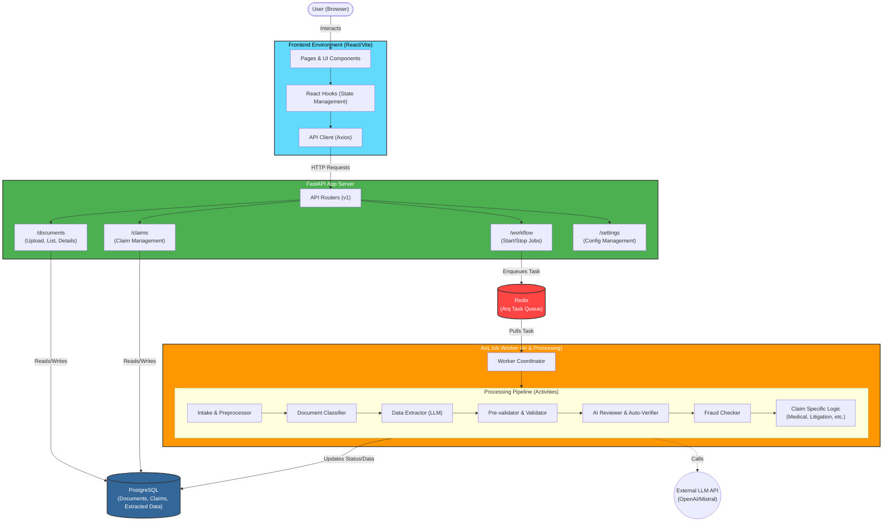

# Document-AI Detailed Component Architecture

Here is a detailed breakdown of the internal components and workflows across the Document-AI system.

### Subsystem Details

#### 1. React Frontend (`frontend-v2/src`)
- **Pages & Components:** Renders the UI for document uploads, claim monitoring, and configuration.
- **Hooks & Store:** Manages local state and continuous polling to keep the UI synchronized with background job progress.
- **API Client:** An Axios-based layer that communicates securely with the FastAPI backend.

#### 2. FastAPI Backend (`backend-v2/api`)
- **Routers (`backend-v2/api/routers/v1`):**
  - `documents.py`: Handles file uploads, retrieving document status, and fetching extracted data.
  - `claims.py`: Manages claim creation, retrieval, and updates.
  - `workflow.py`: Triggers or stops background processing pipelines.
  - `settings.py`: Manages system configurations and prompts.
- **Database Layer (`backend-v2/db`):** Uses SQLAlchemy asynchronous sessions (`create_async_engine`) to interact with PostgreSQL.

#### 3. Arq Background Worker (`backend-v2/activities`)
The core intelligence of the system. Offloads heavy tasks from the API to prevent blocking.
- **Intake & Preprocessing:** Reads uploaded files and prepares them (OCR, image normalization).
- **Classifier:** Determines the type of document uploaded.
- **Extractor:** Uses Large Language Models (LLMs) to parse raw text and pull structured entities.
- **Validators & Reviewers:** Compares extracted data against rules and cross-verifies signatures/photos for authenticity.
- **Fraud Checker:** Analyzes inconsistencies or tampered metadata.
- **Claim Specific Logic:** Specialized activities for handling different claim types (Medical, Litigation, Disability, etc.).

#### 4. Infrastructure
- **Redis:** Serves as the message broker. When the API calls `/workflow`, it places a job ID in Redis. The Arq Worker listens to Redis, picks up the job, and starts the pipeline.
- **PostgreSQL:** The single source of truth. As the worker completes each activity (e.g., Classifier -> Extractor), it updates the document's state in PostgreSQL, which the frontend eventually fetches to show progress to the user.
